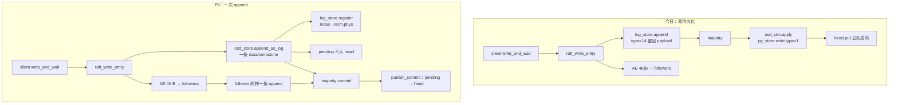
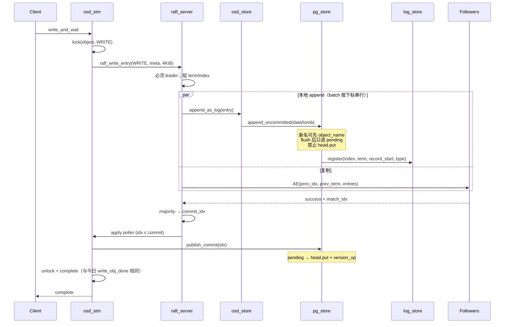
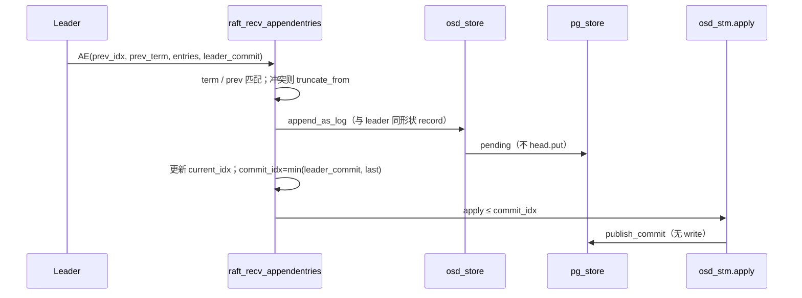
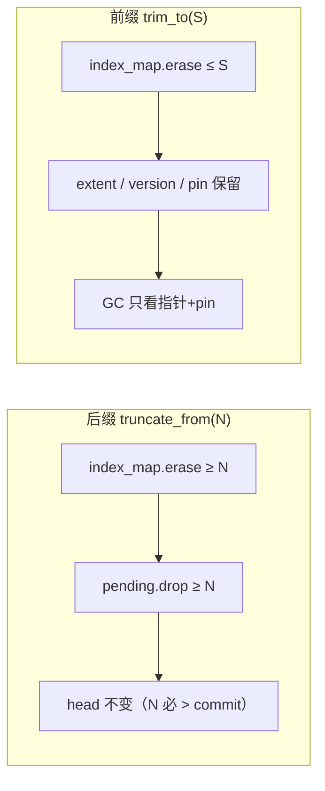
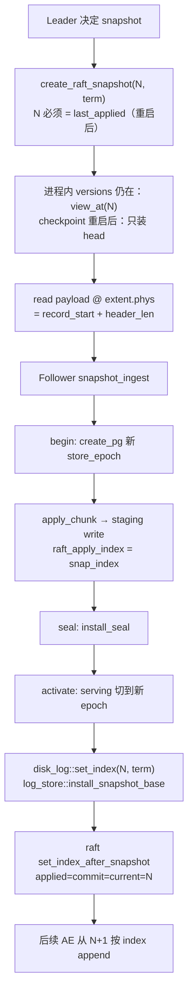

# AOS 追加流与 Raft 日志合一：IO 路径一次 append（log = STM）

作者：<待填>  
日期：2026-08-14  
状态：**Draft**  
代号：`aos_unified_log`（v2 里程碑记为 **P6 log=STM**）  
前置：`docs/append_only_store_design.md` v2（**P4 完成**）。树上已有 image/GC 数据面（`create_image_snapshot` / `gc_pass` / `rewrite_extent`），但 v2 正文把剩余工作标在 **P5 = mon/CSI 控制面、ZNS、GC 压测**。本文 **不占用 P5 编号**；合入时在 v2 §12 增补「P6 log=STM」小节，P5 仍只表示控制面。  
实现注记：本文**不改代码**；落地按文末 PR Plan 串行合入。**flag=1 非法**，直到 recover 能重建 data-as-log + pending（PR4）。

---

## Overview

```text
现状：同一条 4KiB 用户写在每颗 OSD 上落两次
  1) raft_log_entry（type=14）—— Raft 复制日志
  2) data            （type=1） —— STM apply 再写一遍
目标：每条用户写只落 **一条用户数据 record**（overwrite 即一次对齐 append）
  那条 data/tombstone 就是 log entry
  新 object 仍先写一条对齐后的 `object_name`（type=4），再写 data——与今日 apply 路径相同，P6 不额外放大
  log_store 退化为 index → {term, phys, length, rec_type}，不再拷 payload
  未提交不得发布 extent_map.head；重启后也不得把 suffix 当成已提交
  仅 live leader_commit（或本节点当选并 majority）之后才 publish；follower 不再二次 apply 写盘
```

这是 Pangu **FlatLogFile + LSBD** 在 fastblock 上的对应物：日志流即数据流，索引指向物理 record，状态机是「提交后发布映射」，不是「再写一份」。AOS 已经是唯一 localstore（v2 P4）；`aos_unified_log`（P6）把 **log 引擎与 object 引擎在写路径上并轨**，Raft 规则一字不改。

量化（单条 4KiB **overwrite**，header `kRecordHeaderLenV1 = 78`；create 另计一条 name 槽，见 Goal 1）：

| 项 | 512B 扇区 | 4KiB 扇区 |
|----|-----------|-----------|
| 单 record 对齐后 | 4174 → **4608**（9×512） | 4174 → **8192**（2×4KiB） |
| 今日双写 / OSD | 9216 ≈ **2.25×** 用户数据 | 16384 = **4×** |
| ×3 副本盘放大 | ≈ **6.75×** | **12×** |
| P6 单写 / OSD | 4608 ≈ **1.125×** | 8192 = **2×** |
| 盘 IO 节省 | **50%** | **50%** |
| 网络 AE 载荷 | 仍 4KiB / follower | 不变 |

`segment::align_up` 按 `device_backend::block_size()` 上取整。生产 SPDK bdev 多为 4KiB；mem 单测默认 4096。512B 列给出下限痛点，避免只按 4KiB 低估。

---

## Background & Motivation

### 今日双持久化（已落地、可复现）

客户端写走 `osd_stm::write_and_wait`（`src/osd/osd_stm.cc`）：

1. 持 `op_type_excl_lock`（WRITE 可并发复制）
2. 组 `osd::write_cmd` proto → `raft_entry_t`（`RAFT_LOGTYPE_WRITE` + meta + 4KiB data）
3. `raft_server_t::raft_write_entry`（必须 leader；`src/raft/raft_server.cc`）
4. `raft_log::disk_append` → `disk_log::append_aos` → `log_store::append`
   - 编码 `record_type::raft_log_entry`（`types.h` type=14）
   - payload = `log_store::encode_payload`：`term,u64 index,u64 type,u32 meta_len, meta, data`
   - header：`raft_apply_index=index`，`image_snap_seq=term`（注释写明 dup）
   - `write_at` + `flush` 后记 `index_map_[index] = {phys, aligned_len, term}`
5. 多数派提交后 `state_machine::raft_apply_entry` poller 读回 entry
6. `osd_stm::apply` → `write_obj` → `osd_store::apply` → `pg_store::write`
   - 再 append 一条 `record_type::data`（必要时先 `object_name`）
   - `write_after_flush` **立刻** `obj.head.put(e)` + `record_version_put` + `applied_writes[(off,len)] = index`（`pg_store.cc`）。幂等是「该 (offset,len) 的已应用 index 等于本次 index 则 skip」，不是四元组集合。

Follower 对称：`raft_recv_appendentries` 校验 `prev_log_idx/term`，冲突则 `raft_log_truncate`，再 `raft_disk_append_entries` 写 type=14；提交后再 apply 写 type=1。

配置变更（`RAFT_LOGTYPE_CONFIGURATION` / `ADD_NONVOTING_NODE`）走同一 `log_store::append`，payload 小；STM `apply` 对非 WRITE/DELETE 直接 `complete(0)`。

### 为何必须并轨

- **放大是结构问题，不是调参问题。** header 78B 不可避免；双写把对齐惩罚乘 2。4KiB 扇区上每 OSD 每副本 4×，三副本 12×。
- **log 与 STM 语义重复。** 用户 4KiB 已经在 type=14 的 payload 里；type=1 再写一遍只为让 `extent_map` 能随机读。Pangu FlatLogFile 的答案是：payload 只落一次，LBA/object 索引指向 log 物理位置。
- **AOS 平台已经具备并轨所需零件。** 统一 record 头、CRC、segment、`checkpoint_pass`、`log_checkpoint`、`snapshot_ingest`、`view_at`、`visit_live_extents` 都在。缺的是 **写路径合同**：一次 append、提交发布、截断丢 pending。
- **v2 明确禁止用 object API 硬套 log**（`docs/append_only_store_design.md` §6.3）。P6 不是倒退成「4MiB object 模拟 log」，而是 **同一条 data-region 流上，IO 记录同时承担 log 与 STM 角色**；配置/投票等小记录仍走 type=14。

### 与 Pangu 的「殊途同归」

| Pangu | fastblock P6 |
|-------|----------------|
| FlatLogFile：一条追加文件 | AOS data-region record 流（`layout.h` `kLayoutVersion=1`） |
| LSBD：块设备索引 → log 物理偏移 | `extent_map` + `log_store::index_map` 指向同一 phys |
| 提交后对前端可见 | `commit` 才 `head.put`；未提交只在 pending |
| 前缀 trim 不删 live 数据 | `trim_to` 只丢 index；extent + pin 保活 |
| Raft/Paxos 多数派仍在 | 不改 leader / term / majority / prev_index |

不是抄协议，是存储形态收敛： **日志即数据。**

---

## Goals & Non-Goals

### Goals

1. **每条 WRITE 一条用户数据 record。** `RAFT_LOGTYPE_WRITE` / `DELETE`（及后续 `discard`）在每颗 OSD 上只产生 **一条** data/tombstone；`log_store` 只记 `index → {term, phys, length, rec_type}`，不拷 payload。新名字仍先 append 一条扇区对齐的 `object_name`（type=4，与今日 `pg_store::write` 相同）；「一次 append」仅对 overwrite / 已存在 object 字面成立。本阶段不把 name 折进 data（非目标）。
2. **Raft 规则保持。** leader 唯一写入口；term；多数派提交；AE `prev_log_idx/term`；前缀缺失走 snapshot（`raft_get_log()->log_get_base_index()` 比较，`docs/raft_recovery_and_snapshot.md`）。
3. **未提交不可读（含重启与当选）。** 未提交写不得进入 `object_state.head`。重启后 `commit_idx = min(lapply_idx, current_idx)`；**`raft_become_leader` 不得把 commit 跳到 `current_idx`**。suffix 保持 unpublished，直到 **当前 term 的一条 log entry**（选举 no-op，§4.6.1）多数派提交。空 AE 不是 log entry。
4. **后缀截断干净。** `truncate_from(N)` = 删 `index_map ≥ N` + 丢 pending ≥ N + 丢掉「只因这些 pending create 才存在」的 `name_to_id_`；不改已提交 head。
5. **前缀 trim 不伤 live。** `trim_to(snapshot_N)` 只丢 index_map 前缀；live extent / pin / 历史 version 仍在。
6. **Follower 只 append。** 提交后 STM apply 只 `publish`，禁止第二次 `pg_store::write`。完成路径仍走今日 `write_obj_done`：先 `publish_commit` 返回，再 `unlock` + `complete`。
7. **AE catchup 按 index。** `log_store::read` 按 **record 起点** phys 读回整 record，解码成 `log_entry`。生产 `disk_read` 路径必须带 `name_lookup`；缺名字则失败，禁止空 meta 上线。
8. **配置条目仍是小 record。** `CONFIGURATION` / `ADD_NONVOTING_NODE` / `SNAPSHOT_BASE` 继续 type=14，不塞进 object 语义。
9. **Snapshot。** 进程内、versions 仍在时可用 `view_at(N)`。`checkpoint_pass` 后重启 **versions 为空**（`checkpoint_object` 只序列化 head extents + `applied_writes`）：此时只允许装 **head**，且 `snap_index = last_applied`。复用 ingest、snapshot base、`checkpoint_pass`、format 填零、segment table、GC。
10. **GC 用指针 + pin。** 禁止 `index < N ⇒ dead`。`update_phys` 使用 **record 起点**；AE 必须能解码 `gc_rewrite`。
11. **可回滚开关。** 进程默认 `aos_unified_log=0`；单测 fixture 显式打开。旧盘（type=14 + type=1）recover 可重建。关 flag 重启只在 **已具备双形状 read 的二进制**（PR2+）上合法。

### Non-Goals

- **禁止**异步复制（leader 先回客户端再补副本）。
- **禁止** leader-only 持久化（follower 内存缓存、不落盘）。
- **禁止**用 mon lease 替代多数派提交。
- 不改网络 AE 载荷形状（仍 4KiB data + proto meta）。
- 不升 `layout_version`（仍为 1）；record `format_version` 仅在需要把 `raft_term` 放进固定头时从 2→3，见 Data Model。
- 不做压缩 / EC / 跨 PG 事务。
- 不把 KV（`kv_put/delete/checkpoint`）并进这条 IO 路径。
- 不删除 `raft_log` 内存 cache（`raft_log.h` `_entries`）；只换盘合同。
- 不在本阶段改 4KiB 对象对齐合同（`kAlign=4096`，`kMaxObjectSize=4MiB`）。

---

## Proposed Design

### 4.1 一句话合同

```text
durable log entry ≡ AOS record（WRITE/DELETE/discard 为 data/tombstone；
                         配置/快照基座为小 raft_log_entry）
STM 状态            ≡ committed prefix 的 extent_map + version log
log_store           ≡ index → {term, phys, length, rec_type}   // 无 payload
可见性              ≡ 仅 index ≤ 已确认 commit 才 publish pending → head
重启                ≡ commit_idx = min(lapply, current)；become_leader 不跳 commit
                         等当前 term 的 no-op majority 后才推进
截断                ≡ 丢 index≥N 与 pending（及孤立 name）；已提交 head 不动
trim                ≡ 丢 index<N；extent/pin 仍 live
payload 指针        ≡ extent.phys_offset = record_start + header_len（禁止写死 78）
```

### 4.2 架构（现状 → 目标）



进程内模块边界不变（`docs/append_only_store_design.md` §4.1）：

```text
osd_stm / raft_server
  └── aos_runtime / osd_store
        ├── pg_store     object 映射 + pending + head + version log
        ├── log_store    纯索引（P6 后不再持 payload writer 语义）
        ├── kv_engine    不变（term/vote/lapply/cfg）
        ├── SegmentAllocator / Manifest / DeviceBackend
```

P6 改变的是 **谁在何时写哪类 record**，不是再加一套盘格式。

### 4.3 写路径（leader）



逐步对应现函数：

| 步骤 | 现状 | P6 |
|------|------|-----|
| 入口 | `osd_stm::write_and_wait` 组 entry | 不变 |
| 入队 | `raft_write_entry` → cache | 不变 |
| 落盘 | `raft_log::disk_append` → `log_store::append` 写 type=14 | `disk_append` → `osd_store::append_as_log`：按 `entry.type` 写用户数据 record（create 另加 type=4） |
| 索引 | `index_map` 含 length，read 时解码 type=14 payload | `register_index` 记 **data/tomb 的 record 起点**；read 按 `rec_type` 解码 |
| 提交 | `state_machine::raft_apply_entry` | 仍按 `commit_idx` 串行（`default_parallel_apply_num=32` 未使用） |
| apply | `osd_stm::apply` → `pg_store::write` 再写 type=1 | `osd_stm::apply` → `publish_commit`，**0 次盘 IO**；仍经 `write_obj_done` unlock |
| 发布 | `write_after_flush` 即 `head.put` | 仅 `publish_commit` 调 `head.put` / `record_version_*` |

`append_as_log` 分派：

| `raft_entry_t::type` | 写出的 `record_type` | payload | `log_store` |
|----------------------|----------------------|---------|-------------|
| `RAFT_LOGTYPE_WRITE` | `data`（新 object 可先同事务 `object_name`） | 用户 4KiB | register |
| `RAFT_LOGTYPE_DELETE` | `delete_tombstone` | 空或名字 | register |
| 未来 discard | `range_tombstone` | 空 | register |
| `CONFIGURATION` / `ADD_NONVOTING_NODE` | `raft_log_entry`（小） | 现 encode_payload，无 4KiB data | register |
| `SNAPSHOT_BASE` | `raft_log_entry` type=`kRaftLogTypeSnapshotBase` | 空 | register（`disk_log::set_index` → `install_snapshot_base`） |
| `RAFT_LOGTYPE_NOOP`（新增，值=5，接在 SNAPSHOT_BASE 后） | 小 `raft_log_entry` | 空 | register；STM apply 直接 complete（与非 IO 类型相同） |

`object_name` 仍按 `pg_store::write` 今日逻辑：新名字先 append type=4 再 data。这两条同属 **同一个 raft index 的物理前缀**，不是两条 log entry。`register_index` 的 phys 是 **data/tombstone 的 record 起点**，不是 type=4。

**`append_uncommitted` 必须先 `find_or_alloc_object`（与今日 `pg_store::write` :621–637 相同）：** 在 flush 之前就把名字写入 `name_to_id_` / `objects_`（空 head）。这样未发布 create 会出现在 object checkpoint 里（`checkpoint_object`：name + 空 extents），`recover` 加载 ckpt 即可恢复 `name_to_id_`，不必回读已被 `recover_scan_from_` 跳过的 type=4。`pending_op` 另存一份 `object_name` 字符串作皮带。

**batch 必须按下标严格串行。** `raft_log::disk_append` 今日一次可合并 WRITE 与 CONFIG。P6 后两类 record 若走两个 `segment` writer（`pg_store::seg_` 与 `log_store::writer_`）会竞态 `last_index+1` 与 `segment_allocator` 的同一 open segment。合同：

- `append_aos` / `append_as_log` **按下标递增、一次只完成一条**（含可选的 `object_name` 前缀：name flush 成功后才写 data，data 成功后才下一条）。
- 小 type=14（CONFIG / SNAPSHOT_BASE / **NOOP**）也走 `osd_store::append_as_log` 的 **同一个 writer 辅助路径**（可复用 `pg_store::seg_` 或 osd_store 独占 append helper），禁止与 data 并发打两个 open writer。
- 单测：同一 merger batch 含 WRITE + `RAFT_LOGTYPE_CONFIGURATION`，盘上 index 连续、无 allocator 双 reserve。

幂等：`applied_writes[(offset,len)] == raft_apply_index` 则 skip（`pg_store::apply_record` 今日实现）。重复 append 同一 index：`log_store` 拒绝（`last_index+1`），或 `register_index` 幂等覆盖同一 record_start。

### 4.4 Follower：只 append，不二次写



关键约束：

- `raft_recv_appendentries`（`raft_server.cc:638`）的 5 条 Raft 规则不动：term、prev 缺失、prev term 冲突、同 index 不同 term 截断、`leader_commit` 推进。
- 已提交冲突仍返回 `RAFT_ERR_NEEDS_SNAPSHOT`，不得截断 committed。
- `osd_stm::apply` 在 flag 开启时 **禁止** 再调 `_aos->apply` / `pg_store::write`。否则又双写。
- **锁与完成路径不变。** leader 在 `write_and_wait` 里 `lock(WRITE)`，今日在 `write_obj_done`（`osd_stm.cc:210`）里 `unlock` + `complete`。flag=1 只把 `_aos->apply` 换成 `publish_commit`；**必须等 `publish_commit` 回调返回后再 unlock**。不得在 publish 完成前解锁。follower apply 今日也会 `unlock`（follower 未 lock，`_runners` 减——既有问题，P6 不改）。
- 配置 entry：append 小 type=14 后，现有 `check_and_set_configuration` 仍在 **append 时** 更新成员视图（`raft_recv_appendentries` 已如此），不必等 publish。

### 4.5 AE catchup 按 index

今日三档（`docs/raft_recovery_and_snapshot.md`）保留：

1. `next_idx < log_get_base_index()` → snapshot
2. `next_idx` 在 `raft_log` cache → 内存组 AE
3. 否则 `raft_log::disk_read` → `log_store::read(start,end)`

P6 只改第 3 档的解码。`idx_pos.phys_offset` = **record 起点**（与今日 `log_store.cc:172` 一致）；`length` = 对齐后的整 record。`log_store::read` 从 record 起点 `decode_record`，禁止传入 payload 起点。

```text
log_store::read(i):
  pos = index_map[i]          // {term, phys=record_start, length, rec_type}
  backend.read(phys, length)
  decode_record               // payload = buf + header_len
  switch rec_type:
    data / gc_rewrite:        // rewrite 后 AE 仍要 4KiB + write_cmd
      name = name_lookup(object_id)   // 失败 → 整次 read 失败，禁止空 meta
      meta = write_cmd{object_name=name, offset=object_offset,
                       image_snap_seq}
      data = rec.payload               // 必须 4KiB 对齐（from_aos_entry 仍按 4KiB pad）
    delete_tombstone:
      name = name_lookup(object_id)
      meta = delete_cmd{object_name=name, image_snap_seq}
      data 空
    range_tombstone:
      本阶段不组装 AE。osd_msg.proto 只有 write_cmd / delete_cmd，
      无 discard_cmd、无 RAFT_LOGTYPE_DISCARD（4.3 标「未来」）。
      若 index_map 出现此 type：read 返回 -ENOTSUP，禁止伪造 meta。
      AE 解码在 discard 功能与 proto 一并落地时再加。
    raft_log_entry:
      走现 decode_payload（配置 / SNAPSHOT_BASE / NOOP / 旧盘）
```

`name_lookup(object_id) → string` 由 `osd_store` 注入 `log_store`（查 serving `pg_store` 的 `object_id→name`，含 pending create 已登记、尚未 publish 的名字）。**第一次把 data-as-log 接到生产 `disk_read` 的 PR 必须带上此回调**；缺名字打错误日志并返回 `-ENOENT` / `-EIO`，不得向 follower 发送空 meta。

新 object 的 type=4 在同 index 的 data 之前落盘并更新 `name_to_id_`，故 catchup 时 lookup 应成功。从未提交 create 被 `truncate_from` 后，名字映射一并删掉（§4.7），对该 index 的 disk_read 本应已从 `index_map` 消失。

`get_term(index)` 只读 `index_map`，不碰盘——选举 / prev_term 检查保持 O(1)。

### 4.6 提交发布与线性读

`state_machine::raft_apply_entry` 仍保证 `last_applied + 1 ≤ commit_idx` 串行（现 poller；`default_parallel_apply_num = 32` 在 `state_machine.cc` **未使用**，热路径一次一条 `_apply_in_progress`）。P6 把 apply 从「写盘」降成「发布」：

```text
publish_commit(index):
  op = pending.take(index)
  if !op:  // recover 后可能已在 head（见 4.9）或非 IO 类型
    return 0
  switch op.kind:
    put:     head.put(extent{phys=record_start+header_len, offset, len, raft=index, image})
             record_version_put
             applied_writes[(off,len)] = index   // 与今日 apply_record 同一幂等键
    remove:  head 清空 + deleted
             record_version_remove
    discard: head.discard
             record_version_discard
```

读：

- 用户读 / `linearization()`（lease）走 head → 只见 committed。
- `view_at(raft_read_index, image_read_seq)` 只回放 `versions`（本就只含已 publish 的 op）→ snapshot 读自然不含未提交。
- 禁止把 pending 混进 `view_at`。

`last_applied` 仍写 kv `{pool}.{pg}.lapply_idx`（`raft_server_t::save_last_apply_index`，约每 1s 或每 100 条）。**这是重启后唯一耐久的「已发布」水位。**

#### 4.6.1 重启与当选都不得把 suffix 当成已提交（Key Decision）

今日有 **两处** 把整段耐久 log 标成已提交：

1. `load`（`raft_server.cc:3159`）：`raft_set_commit_idx(raft_get_current_idx())`
2. **`raft_become_leader`（`raft_server.cc:86–95`）**：同样立刻 `raft_set_commit_idx(raft_get_current_idx())`，再发 **空** AE，`leader_commit` 已是 tail。`_last_index_before_become_leader` 只写不读。

多数派推进路径（`:439`）**已经**要求 `term == current_term` 才 `raft_node_process_commit`。但 become_leader 先跳 commit 后，这条门形同虚设。空 AE **不是** log entry，修掉 become_leader 而不补当前 term 的 entry，idle leader 的 commit 会永远停住。

双写时代 type=1 只在 apply 时写盘，伤口较小。P6 之后 data record **就是** 未提交 log。只改 `load`、不改 `raft_become_leader` 时的故障序列：

```text
1. Follower A flush index 91–100，majority 前死（B、C 仍在 90）
2. A 重启；flag=1 load：commit = min(90, 100) = 90；pending 91–100；read miss。正确。
3. A 因最长 log 当选。若仍执行 become_leader 的 commit=100，
   apply 把 91–100 publish 进 head；lease 读可见；AE 宣告 leader_commit=100。
4. A 在复制出「当前 term 的 entry」之前再死。B+C 以 log=90 选出 B。
   B 令 A truncate 91–100。A 的 head 无法 un-publish —— Goal 3 失败。
```

**选定方案（不持久化 `commit_idx`；当前 term 用选举 no-op）：**

| 规则 | 内容 |
|------|------|
| 不新增 kv 键 | 不持久化 `commit_idx`（避免与 `lapply` 双水位漂移） |
| load | flag=1：`commit_idx = min(lapply_idx, current_idx)`。**禁止**无条件 `commit_idx = current_idx` 或 `= lapply` |
| lapply > current | **保持**今日分支（`raft_server.cc:3175–3180`）：不把 commit 抬到 lapply；`applied != commit` 让 `snapshot_check` 要全量 snapshot。`commit_idx ≤ current_idx` 不变量不得破 |
| become_leader | flag=1：**禁止** `raft_set_commit_idx(current_idx)`。commit 停在当选前的值（即 `min(lapply, current)` / 已确认 commit） |
| 当前 term entry | 当选后 **立刻** append 一条 `RAFT_LOGTYPE_NOOP`（小 type=14，STM 忽略）。空 AE 不能替代。多数派路径 `:439` 在该 no-op 的 term==current_term 且多数派后才推进 commit（并可一并提交前 term suffix——Raft §5.4.2，且 suffix 已复制到多数派） |
| 不采用 | 「等到第一条客户写」——idle leader 的前 term suffix 永不提交；本设计冻结 no-op |
| recover | `index > lapply` 的 IO record 只进 pending / index_map，**不得** `head.put` |
| apply poller | 仅 `publish` `index ≤ commit_idx` |
| live 推进（follower） | 收到 AE 的 `leader_commit`（leader 侧该值只会在 no-op 多数派之后越过旧 suffix） |
| 客户端读 | head 只含已 publish。lease 读本就要求 leader |

flag=0：`load` 与 `become_leader` 保持今日 `commit_idx = current_idx`。

lapply 落后于真实 majority 时，重启会短暂少发布——等 no-op 多数派或 follower 收到新 `leader_commit` 再补。P6 **没有** un-publish；因此绝不能在 suffix 未获当前 term 多数派之前把它放进 head。

故障注入（必须覆盖当选，不只 follower 重启）：

1. follower flush → 杀（未回 AE success）→ 重启 → read miss；再跟上 leader 后 hit。
2. **上述 A 当选序列：** become_leader 后、no-op 多数派前，A 上 read 仍 miss；杀掉 A、B 当选后，A truncate 91–100，head 仍无这些 extent。
3. no-op 复制到多数派后，A 上 91–100 才 publish（此时它们已是 Raft 提交前缀）。

### 4.7 后缀截断与前缀 trim



- `log_store::truncate_from` 今日已只改 map（`log_store.cc`）。P6 必须 **同步** 清 `pg_store` pending。入口仍是 `raft_log::log_truncate` → `disk_log::truncate`；在 `osd_store` 加 `truncate_log_and_pending`。
- `drop_pending_from(N)`：删 pending ≥ N。若某 `object_id` / 名字 **只** 因这些被丢掉的 pending create 才存在（head 空、无其它 pending 引用），则同时删 `name_to_id_` **和** `objects_` 中该条目；不回退 `next_object_id`（避免 reuse 撞上盘上残留 type=4）。否则 AE `name_lookup` / dump 会看到幽灵对象。
- 不覆盖已提交 record（append-only）；截断是逻辑删。GC 在无 index、无 pending、无 head/pin 引用后回收 segment。
- `disk_log::advance_trim_index` 今日 `index>1000` 则 `trim_to(index-1000)`。P6 后 trim 更要保证：**被 trim 的 index 对应 data record 若仍被 head/pin 引用，segment 不得 free**。`visit_live_extents` 必须同时扫 head、pin 历史、pending、**以及仍在 index_map 的 phys（record 起点 + length）**。

### 4.8 Snapshot = live view @ N



与现实现的组合关系：

| 零件 | 路径 | P6 用法 |
|------|------|---------|
| pin | `pg_store::create_raft_snapshot` | 不变；保证 trim/GC 时 N 的 view 仍在 |
| view | `pg_store::view_at` / `for_each_snapshot_object` | **进程内** versions 仍在时可 `view_at(N)`。`checkpoint_object`（`checkpoint.h`）只含 head extents + `applied_writes` / discards，**不序列化 `versions`**。`recover_scan_from_` 跳过 ckpt 之前的 record 后 versions 为空，`view_at(N≠0)` 会得到空图。 |
| 装载 | `osd_stm::pin_recovery_view` / `read_recovery_object`；`object_recovery.cc` | **重启后** raft snapshot 只装 **head**，且 `snap_index` 必须是 `last_applied`（「现在」），等价 `view_at(0,0)`。禁止对历史 N 做 install，除非做过全量扫重建 versions（本设计不新增 version-log checkpoint）。 |
| ingest | `snapshot_ingest` idle→ingesting→sealed→catchup | 不变；staging epoch 隔离；`apply_chunk` 直接进 staging head（不走 pending） |
| 基座 | `log_store::install_snapshot_base` + `RAFT_LOGTYPE_SNAPSHOT_BASE` | 空 log 时在 N 写一条小 type=14；已 catchup 超前则幂等 |
| 水位 | `raft_server_t::set_index_after_snapshot` | 不变 |
| 协同 ckpt | `osd_store::checkpoint_pass`：object map → log index → kv → `persist_manifest` | 今日 `log_checkpoint` **就是** 指针表 `(index, term, phys, length)×N`（`log_store.cc:496`）。P6 只追加 `rec_type`，体积不降。ckpt 之后必须按 §4.9 从 index_map **回读** 未提交 record 重建 pending（`recover_scan_from_` 会跳过它们的物理字节）。 |
| format 填零 | `osd_store::format` phase 3 把 data region 填零 | 不变；torn tail 仍靠零条带停扫 |
| segment table | manifest 内 allocator 状态；recover 跳 free 段 | 不变 |
| GC | `gc_pass` / `visit_live_extents` | 见 4.10 |

Install 写入 staging 的 chunk **不是** 复制日志：它们带 `raft_apply_index = snap_index`，用于构造 N 的 committed 视图。activate 之后，N 之前没有 index_map（已被 snapshot base 取代）。这与今日 `install_snapshot_base`「空 log 允许非 1 起步」一致。

回归：`checkpoint_pass` → 重启 → `create_raft_snapshot(last_applied)` → follower ingest → 读与 leader head 一致。禁止以历史 `view_at(old_N)` 作为重启后的验收。

### 4.9 Recover：从 data record + checkpoint 重建

今日 `osd_store::recover` **入口**在 `osd_store.cc:1177`；**逐 record 分发**在扫描循环约 1717 行：

- type=14 → `log_store::apply_record`
- type=18 → `log_store::apply_checkpoint_record`
- kv_* → `kv_engine::apply_record`
- 其余 → `pg_store::apply_record` / checkpoint_marker

`checkpoint_pass` 把 `recover_scan_from_` 推到 high_water（`osd_store.cc:920–1010`）。object checkpoint **不含 pending、不含 versions**。P6 未提交的 data record 的物理字节往往 **位于** 该 high_water 之前，扫描会跳过它们。因此 recover **不能**指望「扫尾 replay 填 pending」；必须在加载 `log_checkpoint` 之后，按 index_map **主动回读** 未发布的 IO record。

P6 扫描 / 重建合同：

```text
1. 载入 superblock + manifest（epoch、open cursor、segment table、ckpt phys）
2. 若有 object/log/kv checkpoint：先加载
   —— object ckpt 含已发布 head，以及「未发布 create」的 name + 空 extents
     （append_uncommitted 在 flush 前 find_or_alloc_object，故 name_to_id_ 在 ckpt 里）
   —— index_map 含未提交 index
3. 从 recover_scan_from_ / ckpt 之后顺序 decode（CRC/magic 失败或长零条带停）
   —— 这一步只补 ckpt **之后** 的新 record，不能替代步骤 5
4. 对扫到的每条合法 record 按类型登记（下表 + 4.9.1）
5. 读 kv lapply_idx。遍历 index_map 中 rec_type ∈ {data, delete, range_tomb, gc_rewrite}：
     若该 index 已是「旧盘成对」（4.9.1）→ 跳过（head 已由 type=1 apply_record 填好）
     否则 backend.read(record_start, length)，decode：
       index > lapply  → 插入 pending_op（不 head.put；object_id/name 来自 header + ckpt 的 name_to_id_）
       index ≤ lapply 且 head 尚无对应 extent → publish_commit（补 apply 前崩溃）
   不必为步骤 5 回读 type=4：名字以 object ckpt + 尾扫描为准
6. drop_unsealed_staging()
7. 必要时回写 high_water（P4 已有）
8. raft load（flag=1）：commit_idx = min(lapply_idx, current_idx)；
   若 lapply > current：不抬 commit，保留 snapshot_check（applied != commit）全量 snapshot 分支
```

**步骤 5 是强制的**，即使步骤 3 的扫描从头开始。单测：unified 写、**无** majority、`checkpoint_pass`、kill、recover → `pending_depth ≥ 1`、read miss、该 segment 不得被 `gc_once` free。

#### 4.9.1 旧盘成对 vs P6 单 record（pending / head 判别）

同一 aos_file 允许 type=14 与 type=1 共存。`lapply` **不能**单独区分「旧盘已 apply、lapply 落后」和「P6 已 append、可能未提交」：

| 盘上形状 | 含义 | index_map | object 映射 |
|----------|------|-----------|-------------|
| 同 index 既有 type=14 **又**有 type=1 | **旧盘成对**（type=1 只在 STM apply 时写，已提交；lapply 可能落后） | type=14 赢（`rec_type=raft_log_entry`）；**不要**用 type=1 再 register | type=1 进 **head**（extent.phys = data 的 `record_start + header_len`，禁止指向 type=14 那份拷贝） |
| 仅有 data/tombstone/gc_rewrite 登记为该 index | **P6** | 该 record register | `index ≤ lapply` → head；`index > lapply` → **pending**（§4.6.1） |
| 仅有 type=14（配置 / SNAPSHOT_BASE / 旧盘尚未 apply 的 log） | 非 object IO 或 apply 未写上 | type=14 | 不进 object head |

flag=0 写路径仍双写；flag=1 新 WRITE 不再写 type=14。旧 type=14 仍可供 AE `decode_payload`，直到 trim。

`pg_store::apply_record` 今日对 type=1 **无条件 `head.put`**（约 2375–2404 行）。P6 recover 对「仅 P6 data」**禁止**走这条无条件路径；必须先看 4.9.1 表再决定 pending vs head。扫描循环里对 P6 data 应 `register` +（可选）暂存，把 publish 留给步骤 5。

崩溃窗口：

| 崩溃点 | 盘上 | 重启 |
|--------|------|------|
| append 未 flush | torn / 零尾 | 丢弃；index 不连续则 last_index 停在上一合法 |
| flush 后未 majority | 有 record；ckpt 可能已越过其 phys | 步骤 5 从 index_map 回读 → pending；`commit_idx=lapply`；read miss |
| majority 后未 publish | 有 record；lapply 可能落后 | 步骤 5：`index≤lapply` 升 head；其余等 live `leader_commit` |
| publish 后未写 lapply | head 已含（或 ckpt 已含）；lapply 旧 | publish 幂等（`applied_writes[(off,len)]==index`） |

### 4.10 GC：指针 + pin，不是 index 水位

`osd_store::visit_live_extents` 今日并集：

- 各 `pg_store::for_each_live_extent`：head +（有 pin 时）全部历史 put
- 各 `log_store::for_each_live_extent`：`index_map` 仍引用的 phys
- `kv_engine`：最新 kv_checkpoint + 其后 WAL

P6 增量：

1. **pending 的 record 起点必标 live**（未提交不能被 rewrite/free）。
2. **禁止**「`raft_apply_index < trim_index` ⇒ 可删」。trim 只摘 index；object 仍引用同一 phys。
3. `gc_rewrite` 只搬 **committed head** extent（现 `rewrite_extent` 仍 append `record_type::gc_rewrite`，`pg_store.cc:2364`）。坐标约定：
   - `idx_pos.phys_offset` = **新 record 起点**（不是 payload）；`length` = 对齐后整 record。
   - `extent.phys_offset` = `record_start + header_len`（`header_len` 来自该 record，禁止 `kRecordHeaderLenV1` 写死）。
   - `update_phys(index, new_record_start, new_aligned_len)` 只接受 record 起点。`rewrite_after_flush` 必须换算：`record_start = extent.phys_offset - header_len`，或 rewrite 路径直接记住 append 返回的 phys。
   - 已 trim 掉的 index 不必改 map。
4. **AE 解码 `gc_rewrite`：** `log_store::read` 把 `gc_rewrite` 与 `data` 同等对待（同 header 字段 + payload）。不把 rewrite 改写成 type=1（以免和「不推进 version」合同纠缠）。
5. pin 仍走保守策略（有 pin 则历史 put 全 live）。
6. 单测：写并提交 → 把 victim 段 rewrite → `disk_read` 该 index → AE 形状仍含 4KiB payload 与原始 `write_cmd`。

### 4.11 Feature flag 与运行时开关

| 项 | 值 |
|----|-----|
| 名 | `aos_unified_log` |
| 配置 | OSD 配置项 + 环境变量 `FASTBLOCK_AOS_UNIFIED_LOG=0/1`（与现 `FASTBLOCK_RAFT_RECOVERY_TEST_LOGS` 风格一致） |
| 默认 | **进程默认永远 0**（生产与 `aos_m1_test` 未改 fixture 时均关）。单测 / 故障注入用 fixture 或 `FASTBLOCK_AOS_UNIFIED_LOG=1` **显式打开**。 |
| 粒度 | 进程级；不按 PG 混用写路径（recover 可混读） |
| 关闭时 | 完整旧路径：type=14 + apply type=1；head 在 apply flush 后发布（今日） |
| 打开时 | 本文写/截断/apply 合同。**二进制若还不能按 §4.9 重建 data-as-log + pending，打开即非法**（PR4 之前禁止 flag=1） |
| 混旗副本 | leader=1 / follower=0 与相反均可：AE 仍带 4KiB + proto meta，与 flag 无关。验收必须覆盖这两对。 |
| 回滚 | 「关 flag 重启」只在 **PR2+ 二进制**（read 无条件双形状）上合法。一旦某 OSD 写出 data-as-log，**禁止**回滚到 PR2 之前的二进制（`disk_read` 会 `-EIO` / 丢 index）。 |

`layout_version` 保持 1。format_version=3 与 format=2 记录可混在同一 data-region；**生产 encode 在指针公式改完之前必须仍为 v2/78B**（§6.1）。

---

## API / Interface Changes

均在现有类上加方法；不新增引擎进程。

### 5.1 `log_store`（`src/localstore/aos/log_store.h`）

```text
// 现：append 自己写 type=14 整包
void append(const log_entry&, op_complete, void*);
void append_batch(...);

// 增：仅登记（payload 已由 pg_store/osd_store 写出）
// phys = record 起点（append_record 返回值），绝不是 payload 起点
int  register_index(uint64_t index, uint64_t term, uint64_t phys,
                    uint64_t length, record_type rec_type);
void update_phys(uint64_t index, uint64_t new_record_start, uint64_t new_len);

// 生产 disk_read 必注入；缺名不得返回空 meta
using name_lookup_fn = std::function<int(uint64_t object_id, std::string* name)>;
void set_name_lookup(name_lookup_fn fn);

// 改：read 按 rec_type 解码（含 gc_rewrite≡data）；type=14 走 decode_payload
void read(...);   // 缺 index / 缺名字 / 非 4KiB data → 错误，entries 空

// 现保留：get_term / contains / trim_to / truncate_from /
//         install_snapshot_base / checkpoint / apply_record
```

`idx_pos` 增 `record_type rec_type`。`append` 仍用于 flag=0。flag=1 时配置 / SNAPSHOT_BASE 也经 `osd_store::append_as_log` 同一 writer，再 `register_index`。

### 5.2 `pg_store`（`src/localstore/aos/pg_store.h`）

```text
// 增：未提交追加。flush 后只进 pending，不 head.put
void append_uncommitted(const std::string& object_name, uint64_t offset,
                        const void* data, uint64_t len,
                        uint64_t raft_index, uint64_t raft_term,
                        uint64_t image_snap_seq,
                        op_complete cb, void* arg);
void append_uncommitted_remove(...);
void append_uncommitted_discard(...);

// 增：提交发布 / 后缀丢 pending
void publish_commit(uint64_t raft_index, op_complete cb, void* arg);
void drop_pending_from(uint64_t from_index); // 孤立 create：name_to_id_ + objects_ 一起删

// 改：write() 在 flag=1 时不再给 STM 热路径调用；
//     可保留为内部/单测/ingest staging 使用（ingest 的 apply_chunk 视为
//     已在 snap_index 提交的视图构造，直接进 staging head，与今日一致）

// 现保留：read / view_at / create_raft_snapshot / checkpoint / recover
```

`append_uncommitted` **必须**先 `find_or_alloc_object`（flush 前登记 name + 空 head），再 append type=4（若 is_new）与 data。`write_after_flush` 拆成：flag=0 维持 `head.put`；flag=1 走 `pending_[index]=op`。  
所有 `extent.phys_offset` 赋值改为 `record_start + decoded.header_len`（`write_after_flush`、`apply_record`、`rewrite_after_append` / `gc_rewrite`）。此公式切换可在仍 encode v2（`header_len=78`）时合入。

### 5.3 `osd_store`（`src/localstore/aos/osd_store.h`）

```text
// 增：Raft disk_append 的唯一入口（flag=1）。batch 按下标串行。
void append_as_log(uint64_t pool, uint64_t pg,
                   const log_entry& e,  // 或 raft_entry_t 适配
                   op_complete cb, void* arg);

void publish_commit(uint64_t pool, uint64_t pg, uint64_t index,
                    op_complete cb, void* arg);
void truncate_log_and_pending(uint64_t pool, uint64_t pg,
                              uint64_t from_index, op_complete cb, void* arg);

// 现 apply()：flag=1 的 STM 不再调用；保留给 ingest / 测试 / flag=0
```

### 5.4 `disk_log` / `raft_log`

- `disk_log::append_aos`：flag=1 时整批走 `osd_store::append_as_log`（WRITE/DELETE、CONFIG/SNAPSHOT_BASE、**NOOP**），按下标串行；不再并发打 `log_store::append_batch`。
- `disk_log::truncate`：改调 `truncate_log_and_pending`。
- `disk_log::set_index`：仍 `install_snapshot_base`。
- `raft_log::disk_append` / `log_truncate` 签名不变；`raft_entry_to_log_entry` / `from_aos_entry` 仍要求 data **4KiB 对齐**。

`disk_log` 今日只持 `log_store*`。**冻结：** `make_aos_disk_log` 增加非拥有 `osd_store*`（兼做 `name_lookup` 的挂载点）。不采用回调注入 `raft_log`。

### 5.5 `osd_stm` / `state_machine`

- `osd_stm::apply`：flag=1 时 WRITE/DELETE 调 `publish_commit`，禁止 `_aos->apply` / `remove` 写盘。
- **完成路径不变：** 仍使用 `write_obj_done` / delete 对应 ctx：`publish` 成功后再 `unlock` + `complete`。不得提前解锁。
- `write_and_wait` / `delete` 入口不变。
- `pin_recovery_view` / `read_recovery_object` 不变（已走 AOS view）。
- flag=1 时 `load`：`commit_idx = min(lapply_idx, current_idx)`；保留 lapply>current 的 snapshot 分支。见 §4.6.1。
- flag=1 时 **`raft_become_leader`（`raft_server.cc:86`）禁止 `raft_set_commit_idx(current_idx)`**；随后 append `RAFT_LOGTYPE_NOOP`。

### 5.6 不改的外部 API

- 客户端 `osd::write_request` / protobuf
- AE / RequestVote / install-snapshot RPC 字段
- 已有 `RAFT_LOGTYPE_*` 数值（`SNAPSHOT_BASE==4` 的 static_assert 不动）。**仅允许在枚举末尾追加** `RAFT_LOGTYPE_NOOP=5`（及 `aos` 侧对应常量）
- kv `put/get/commit` 形状
- `kLayoutVersion = 1`

---

## Data Model Changes

### 6.1 Record 头：format_version=3 + 指针公式（冻结）

今日固定头 78B（`record.h` `kRecordHeaderLenV1`）。`decode_record`（`record.cc:101–114`）拒绝 `version ∉ {1,2}` 且 `header_len != 78`。更关键的是：**payload 位置在多处写死 `phys + kRecordHeaderLenV1`**（`write_after_flush`、`apply_record`、`rewrite_after_append`、`gc_rewrite`）。若尚未改公式就开始 encode 86B 头，后续读会偏 8 字节。

**冻结规则：**

```text
extent.phys_offset = record_start + header_len
idx_pos.phys_offset = record_start
payload           = 磁盘[record_start + header_len, payload_len)
```

`header_len` 来自该 record 自己的头，**禁止**编译期常数 78 作为 payload 偏移。

`data_record` 增加 `uint64_t raft_term{0}`。

| 方案 | 做法 | 头长 | 对齐影响 |
|------|------|------|----------|
| **H1（冻结）** | `format_version=3`，`image_snap_seq` 后加 `raft_term u64`；`header_len=86` | 86B | 4KiB+86=4182 → 仍 4608 / 8192 |
| H2 | term 塞进 payload 前 8B | 78B | 破坏 4KiB 纯 payload；**不采用** |

解码：`header_len==78` → `raft_term=0`，term 从 type=14 payload 或（仅 type=14）`image_snap_seq` 来；`header_len==86` → 读 `raft_term`。未知 version / 非法 `header_len` fail-fast。

**谁先写 v3：**

- PR1：decode 接受 v3 + 任意合法 `header_len`；`data_record.raft_term`；**生产 encode 仍 v2/78B**。单测可手工打 v3 字节、按 `header_len` 取 payload，往返 4KiB 字节一致。
- PR3：指针公式改为 `record_start + header_len`，**encode 仍 v2**（数值与写死 78 相同，但不再依赖编译期常数）。
- PR5：**首次生产 encode v3**。禁止在指针公式落地前写出 86B 头。

`layout_version` **不升**。v2/v3 记录可混在同一 data-region。

### 6.2 `log_store::idx_pos`

```text
struct idx_pos {
  uint64_t phys_offset; // record 起点（与 log_store.cc:172 一致）
  uint64_t length;      // 对齐后整 record
  uint64_t term;
  record_type rec_type; // 新增
};
```

`log_checkpoint` payload 现为 `(index, term, phys, length)×N`。升一版附加 `rec_type u8` + 填充；旧 checkpoint 按「缺省 type=14」解析。体积略增，不是「变得更小」。

### 6.3 `pg_store` pending

```text
struct pending_op {
  version_op::kind k;
  uint64_t raft_index, raft_term, image_seq;
  uint64_t object_id, offset, len;
  std::string object_name; // 皮带：ckpt 已有 name_to_id_，截断/AE 不依赖回读 type=4
  uint64_t record_start;  // 整 record 起点（GC / update_phys / 回读）
  uint16_t header_len;    // 发布时 extent.phys = record_start + header_len
};
std::map<uint64_t, pending_op> pending_;  // key = raft_index
```

`for_each_live_extent` 必须 visit `[record_start, record_start+aligned_len)`（或至少 payload 段）。`drop_pending_from` 按 §4.7 清孤立名字 **和** 对应 `objects_` 条目。

### 6.4 类型空间

不新增强制 type。可选：

| type | 用途 |
|------|------|
| 1 data / 2 delete / 6 range_tomb | **成为** IO log entry |
| 14 raft_log_entry | 配置、SNAPSHOT_BASE、**NOOP**、旧盘、flag=0 |
| 18 log_checkpoint | 仍只存 index 表 |
| 4 object_name | 挂在同一 index 的辅助 record，不是独立 log index |

不引入 `unified_write=19`，避免 recover 分叉。

### 6.5 扇区算术（冻结）

```text
user          = 4096
header v2     = 78
header v3     = 86
raw v2        = 4174
raw v3        = 4182
pad 512       = 4608 = 9 × 512     // 4174/4182 都落在同一槽
pad 4096      = 8192 = 2 × 4096
```

双写消除后每 OSD 每 4KiB 用户写从 2 个对齐槽降为 1 个。网络侧 `raft_entry.data()` 仍 4096，不在本设计压缩。

---

## Alternatives Considered

### A1. 继续双写，只做 batch flush / 更大合并

`raft_log` 已有 merger 统计（`_merger_twenty_num` 等）。合并降低 IOP 次数，**不降低每条 4KiB 的 2× 对齐放大**。4KiB 扇区上 4× 盘占用仍在。拒绝作为终态；可与本设计并存作延迟优化。P6 后 merger batch 仍合法，但必须按下标串行完成（§4.3）。

### A2. Leader 只写一份，follower 异步补 / 或只写 log 延迟 apply

即「leader-only persist」或「异步复制」。破坏 majority 耐久：leader 独写后崩溃，多数派可能无数据。明确 **Non-Goal**。apply 延迟写盘若在 commit 之后，则 commit 与 STM durable 窗口拉长，重启要重放 payload——而 payload 若只在 type=14，又回到「log 里有一份完整拷贝」，省不下空间。

### A3. 用 mon lease 替代多数派

lease 只服务 `linearization()` 读。写耐久必须多数派。拒绝。

### A4. type=14 只存 meta、data 只在 type=1（半合一）

省掉 type=14 里 4KiB payload，但仍两次 header+两次对齐（78+meta 也会垫成 512/4096）。512B 扇区上接近 4608+512=5120，仍约 1.25× 额外；4KiB 扇区上 8192+4096=12288，仍 3×。且 AE read 要拼两条。比 P6 差，实现复杂度接近。拒绝。

### A5. 独立 WAL 设备 + object 设备（经典 WAL）

与 v2「一条盘栈」相反，运维回退到双盘。Pangu 也是 FlatLog 单流。拒绝。

**选择 `aos_unified_log`：** overwrite 一次对齐写、索引分离、提交发布、重启不把 suffix 当提交。Raft 不变。

---

## Security & Privacy Considerations

- 不改变认证 / 加密边界；AE 与客户端 RPC 载荷不变。
- CRC 仍覆盖 header+payload；合一后少一次写，**损坏窗口变小**而非变大。
- 未提交不进 head，避免崩溃后对客户端暴露未多数派数据。当选也不得把 suffix 标成 committed（`raft_become_leader`）；否则 head 无法 un-publish。
- snapshot 装载仍走 staging epoch；未 `install_seal` 的 staging 启动丢弃（`drop_unsealed_staging`）。
- 配置 entry 与数据同流：截断/trim 不得误删仍被成员管理引用的最新配置 index（现 `configuration_manager::truncate_by_idx` 已处理；publish 不影响）。
- dump 工具 `aos_dump` / `fastblock-aos-dump` 需识别 format=3 与「data 即 log」，避免把旧盘双写显示成两条用户写。

---

## Observability

新增 / 调整指标与日志（SPDK `SPDK_NOTICELOG` / 后续 OSD stats）：

| 名 | 含义 |
|----|------|
| `aos_unified_log` | 进程 flag 0/1 |
| `aos_append_as_log_ok / err` | 一次 append 计数 |
| `aos_publish_commit` | 发布次数；应 ≈ 提交的 IO entry 数 |
| `aos_apply_disk_write` | flag=1 时必须为 0（告警） |
| `aos_pending_depth` | 每 PG pending map 大小（commit 滞后） |
| `aos_truncate_pending` | 截断丢掉的未提交数 |
| `aos_recover_data_as_log` / `aos_recover_legacy_log_entry` | recover 双形状计数 |
| `aos_gc_pending_pins` | 因 pending 保活的 segment |

现有 `raft_disk_append` / merger / `last_apply_index` 日志保留。`disk_log::dump_state` 增加 `pending` 与 `rec_type` 直方图。

单测探测：fixture 打开 flag 后对 overwrite 扫盘，`raft_log_entry` 计数不增加、`data` 计数 +1。`aos_m1_test.cc:2531` 的 type=14 断言测的是 `log_store::append` 本身，默认 flag=0 时仍有效，不要把全局默认改成 1。

---

## Rollout Plan

```text
阶段 0  设计评审（本文）+ flag 落地默认 0
阶段 1  decode v3 + 双形状 read（含 name_lookup）+ pending API + recover 重建
        —— 旧集群行为不变；此时才允许测试把 flag 打开
阶段 2  指针公式 + 生产 encode v3 + append_as_log + publish-only apply
        （写路径 PR 与 recover 同一发布窗口；缺 recover 的二进制不得 flag=1）
阶段 3  预发灰度：新集群显式开 flag；对比 IOPS / 盘放大
        覆盖 leader/follower 混旗两对
阶段 4  评估后才考虑进程默认改 1（无排期）
回滚    PR2+ 二进制上关 flag；禁止回滚到不能 disk_read data-as-log 的旧二进制
```

验收：

1. 三副本 overwrite 4KiB：每 OSD 用户数据对齐槽 ≈ 1 而非 2（create 另计 name 槽）。
2. follower flush、majority 前 kill、重启：read miss；连上 leader 后 hit。`checkpoint_pass` 后再杀：pending≥1，GC 不回收。
   **当选：** A 持未多数派 91–100 重启并当选 → no-op 多数派前 read 仍 miss；A 再死、B 以 90 当选 → A truncate 后 head 无 91–100。
3. 制造 log 冲突：`truncate_from` 后无幽灵 extent / 幽灵 name。
4. `checkpoint_pass` + 重启 + `create_raft_snapshot(last_applied)` + ingest：follower 读匹配 head。rewrite 后 `disk_read` 仍能组装 4KiB + `write_cmd`。
5. 旧盘双写与 P6 单 record 两套 recover 表（§4.9.1）。
6. 配置变更 / 选举 / prev_term；同一 batch WRITE+CONFIG 串行。
7. leader=1/follower=0 与相反复制正确。

---

## Open Questions

1. **`publish_commit` 是否必须与 `last_applied` 同线程串行？** 现 poller 已串行；并行 apply 不在本设计范围。
2. **ingest `apply_chunk` 是否走 pending？** 否：staging 构造的是已提交视图，直接 head（§4.8）。
3. **生产默认何时改 1？** 依赖灰度盘放大与故障注入；本文不锁日期。进程默认保持 0。

---

## References

- `docs/append_only_store_design.md`（v2 平台；§6 log；§8 类型；§12 P5）
- `docs/raft_recovery_and_snapshot.md`（AE 三档、snapshot 流程）
- `src/osd/osd_stm.cc`：`apply` / `write_and_wait` / `write_obj`
- `src/raft/raft.h`：`RAFT_LOGTYPE_*`、`set_index_after_snapshot`
- `src/raft/raft_server.cc`：`raft_write_entry`、`raft_recv_appendentries`（:638）、`raft_become_leader`（:86–95 今日 `commit_idx=current_idx`）、load :3159 / lapply>current :3175、多数派门 :439
- `src/raft/raft_log.cc`：`disk_append`、`log_truncate`
- `src/raft/state_machine.cc`：`raft_apply_entry`
- `src/localstore/aos/types.h`：`record_type`、`kRaftLogTypeSnapshotBase`
- `src/localstore/aos/record.h`：78B 头
- `src/localstore/aos/log_store.h/.cc`：append / index_map / trim / truncate / checkpoint
- `src/localstore/aos/pg_store.h/.cc`：`write` / `write_after_flush` / `view_at` / `apply_record`
- `src/localstore/aos/snapshot_ingest.h`：staging SM
- `src/localstore/aos/osd_store.h/.cc`：`apply`、`recover` 入口 :1177 / 分发 ~1717、`checkpoint_pass`、`visit_live_extents`、`format` 填零
- `src/localstore/aos/checkpoint.h`：`checkpoint_object` 无 versions
- `src/localstore/disk_log.h`：`set_index` / AOS 门面
- `src/localstore/aos/layout.h`：`kLayoutVersion=1`

---

## Key Decisions

1. **AOS 仍是唯一 localstore。** 不引入第二套盘引擎；本设计只改写合同。
2. **Raft 规则不改：** leader、term、多数派提交、`prev_index/term`、前缀缺失 snapshot。禁止异步复制、leader-only persist、mon-lease 替 majority。
3. **每条 WRITE 一条用户数据 record。** 去掉 type=14 拷 4KiB。配置 / SNAPSHOT_BASE 仍是小 type=14。新 object 仍多一条对齐 `object_name`。
4. **`log_store` 无 payload。** `index → {term, phys=record_start, length, rec_type}`。
5. **未提交不进 head（含重启与当选）。** 不持久化 `commit_idx`。load：`commit_idx = min(lapply, current)`，保留 lapply>current 的 snapshot_check 分支。**`raft_become_leader` 禁止 `commit_idx = current_idx`。** 当选后 append `RAFT_LOGTYPE_NOOP`；空 AE 不能推进 commit。suffix 只在该 no-op 多数派后 publish。
6. **后缀截断 = 丢 index≥N + pending + 孤立 name。** 已提交 head 不动。
7. **前缀 trim = 丢 index_map < snapshot N。** live extent / pin 留下。GC 只认指针+pin。
8. **Follower apply 零盘 IO。** 只 publish；`write_obj_done` 式 unlock 在 publish 之后。
9. **重启后 snapshot 只装 head @ last_applied。** 进程内 versions 仍在时可用 `view_at(N)`。不在本设计序列化 version log。
10. **网络仍 4KiB / follower。** overwrite 盘放大 2.25×→1.125× 或 4×→2× / OSD。
11. **兼容旧 aos_file。** §4.9.1 表：成对 → type=1 进 head；仅 data → 按 lapply 分 pending/head。read 无条件双形状。
12. **H1 扩头 + 指针公式：** `extent.phys = record_start + header_len`。公式可先于 v3 encode 落地（仍写 78B）。**禁止**在公式落地前生产 encode v3。`layout_version=1`。`data_record.raft_term`。
13. **`update_phys` 用 record 起点；`gc_rewrite` 按 data 做 AE 解码。**
14. **batch 按下标串行；CONFIG 与 WRITE 走同一 writer。** `disk_log` 持非拥有 `osd_store*`。
15. **`name_lookup` 与生产 `disk_read` data-as-log 同一 PR。** 缺名失败，禁止空 meta。
16. **flag 进程默认 0。** 测试 fixture 打开。flag=1 非法，直到 recover 能重建 pending。禁止回滚到 PR2 前二进制。
17. **里程碑编号：** v2 的 P5 仍是 mon/CSI；本工作是 **P6 / `aos_unified_log`**。
18. **殊途同归 Pangu FlatLogFile + LSBD：** 单追加流 + 索引映射 + 提交可见。

---

## PR Plan

每条 PR **独立可合**（flag 默认 0 时生产行为与今日一致）。**flag=1 在 PR4 合入前非法。** 写路径（PR5+PR6）不得早于 recover。

### PR1 — format v3 **解码**（仍 encode v2）

- **标题：** aos: accept format-v3 headers; add data_record.raft_term
- **文件：** `record.h`、`record.cc`、`types.h`、`aos_dump.cc`；`aos_m1_test.cc` 编解码
- **依赖：** 无
- **说明：** decode 接受 version=3 与 `header_len∈{78,86}`。**生产 encode 仍 78B。** 手工构造 v3 往返 4KiB 字节一致。不改写路径、不改 `kRecordHeaderLenV1` 调用点。

### PR2 — `log_store` 登记 + **带 name_lookup 的** data-as-log `read`

- **标题：** aos: register_index and disk_read data-as-log with name_lookup
- **文件：** `log_store.h/.cc`、`osd_store` 注入 lookup、`disk_log.cc` `from_aos_entry` 路径；`log_checkpoint` 兼容
- **依赖：** PR1
- **说明：** `idx_pos.rec_type`；`read` 支持 type=14 / data / tombstone / **gc_rewrite**。`set_name_lookup` 与本 PR 一并上线；缺名失败。这是生产 `disk_read` 第一次解码 data-as-log，禁止「meta 先留空」。`append` 默认行为不变。

### PR3 — pending / publish / 孤立 name；`header_len` 指针公式（仍 encode v2）

- **标题：** aos: pending map, publish_commit, header_len payload pointers
- **文件：** `pg_store.h/.cc`；单测（未提交不可读、truncate 丢 pending+name）
- **依赖：** 无（合入宜在 PR2 后）
- **说明：** API 齐；`write()` 热路径仍 `head.put`（flag=0）。`extent.phys = record_start + header_len` 替换所有写死的 78。`for_each_live_extent` 含 pending。ingest 仍直接 head。

### PR4 — recover 混盘 + 从 index_map 回读 pending（**写路径之前**）

- **标题：** aos: recover data-as-log and rebuild pending after checkpoint
- **文件：** `osd_store.cc` recover（入口 :1177，分发 ~1717）、`pg_store::apply_record` 分派、raft `load` 测试钩（commit 初值可与 PR6 一并切生产路径）
- **依赖：** PR1–PR3
- **说明：** §4.9 / §4.9.1 全表。ckpt 后按 index_map 回读未发布 IO record。旧盘成对 → head；P6 单 record → lapply 上下分 pending/head。单测：无 majority + `checkpoint_pass` + recover。**本 PR 之后才允许任何二进制打开 flag=1。**

### PR5 — `append_as_log` + 生产 encode v3 + 串行 batch（flag 默认关）

- **标题：** aos: append_as_log, encode v3, sequential batch
- **文件：** `osd_store.h/.cc`、`record.cc` encode、`disk_log.h/.cc`（`osd_store*`）、`aos_runtime` 配置
- **依赖：** PR4（recover 已能读 v3 / data-as-log）
- **说明：** **首次生产写 v3**（与 PR3 指针公式衔接）。flag=0 仍双写 v2。flag=1：整批 `append_as_log` 按下标串行，CONFIG 与 WRITE 同一 writer。必须与 PR6 **同一发布窗口**。

### PR6 — STM publish-only + load/become_leader commit 合同 + NOOP

- **标题：** osd: apply publishes head; do not commit suffix on load or become_leader
- **文件：** `osd_stm.cc`、`state_machine.cc`、`raft_server.cc`（**`load` 与 `raft_become_leader`**）、`raft.h`（`RAFT_LOGTYPE_NOOP=5`）、`types.h` 对应常量
- **依赖：** PR5（同窗口）
- **说明：** flag=1：`apply` → `publish_commit`，完成路径仍 `write_obj_done`。`aos_apply_disk_write==0`。`load`：`commit_idx = min(lapply, current)`；**保留** lapply>current 时不抬 commit、靠 `snapshot_check` 的分支。**`raft_become_leader` 不得 `raft_set_commit_idx(current_idx)`**；当选后 append NOOP。flag=0 保持今日 `write_obj` 与两处 `commit_idx=current_idx`。验收含 §4.6.1 当选故障序列。

### PR7 — rewrite `update_phys` + 重启后 snapshot=head

- **标题：** aos: rewrite updates record-start phys; snapshot ships head after ckpt
- **文件：** `pg_store.cc` rewrite、`osd_store.cc` `visit_live_extents` / `gc_pass`、snapshot / object_recovery 测试
- **依赖：** PR6
- **说明：** `update_phys(record_start)`；`disk_read` 在 rewrite 后仍能组 AE。`checkpoint_pass`+重启+`create_raft_snapshot(last_applied)`+ingest。trim 后 GC 不丢 head。

### PR8 — 集成测试、文档、默认值

- **标题：** docs+tests: aos_unified_log rollout
- **文件：** `docs/append_only_store_design.md` 增 **P6 log=STM**（P5 仍为 mon/CSI）、`aos/README`、故障注入 / 混旗 / 三副本
- **依赖：** PR7
- **说明：** 进程默认保持 0。验收清单见 Rollout。

---

*本文冻结语义；实现以 PR Plan 为准。不在本文件提交代码。*
