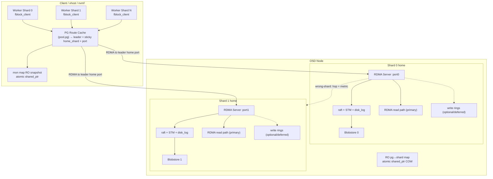
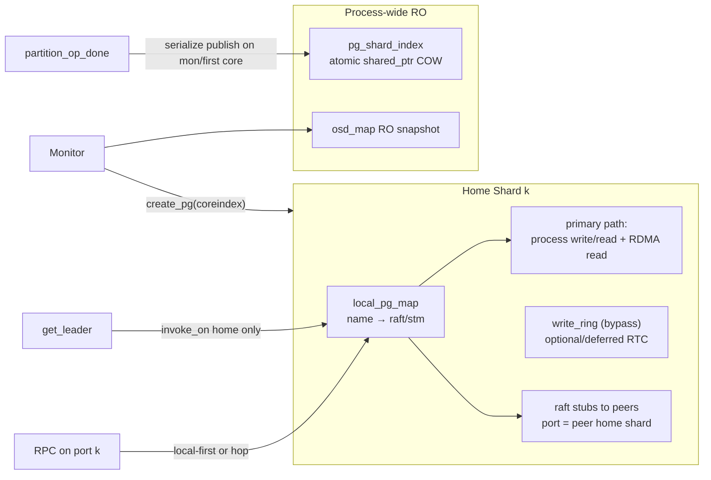
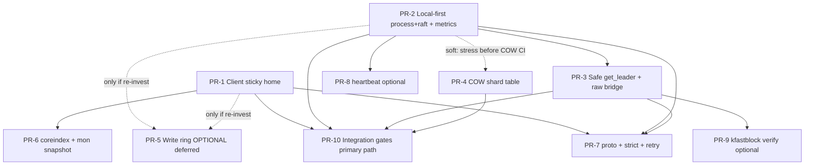

# 完整 Run-to-Completion（RTC）架构设计 — fastblock

| 字段 | 内容 |
|------|------|
| **文档标题** | Complete Run-to-Completion (RTC) Architecture for fastblock |
| **作者** | TBD |
| **日期** | 2026-08-08 |
| **状态** | Draft（Rev 3.2 — write ring 降级为可选/延后） |
| **关联代码** | `/root/fastblock-upstream`（SPDK + multi-raft + RDMA） |
| **前置工作** | PR !142「new run-to-complete design」部分落地 |
| **主路径** | 普通 RDMA RPC 写/读 + multi-raft + 既有 **RDMA read** 体系；**write ring 非主导** |

---

## Overview

fastblock 已在 PR !142 中引入了 **部分 RTC** 能力：`core_sharded` 提供 per-core SPDK 线程与 `invoke_on`；monitor 在创建 PG 时分配 `coreindex`；每个 shard 绑定独立 Blobstore 与 RDMA RPC server，并通过 `sharded_ports` 在 boot 时上报。然而稳态数据路径仍存在以下结构性缺口：

1. **客户端端口亲和错误**：`fblock_client` 在 leader 刷新时用「客户端当前 shard」覆盖「PG home shard 端口」。
2. **跨核 hop 仍是常态路径**：`osd_service::process` 以及 `raft_service` 各入口一律 `invoke_on(shard_id)`；同核会内联，但错误端口到达时 hop 不可避免，且无 hop 指标。（旁路 `process_ring_write` 同类问题，**非 phase-1 阻塞项**。）
3. **跨 shard 共享可变状态与锁**：`_shard_table` 无同步 r/w、`process_get_leader` 跨核读 raft、`heartbeat_complete`/`multi_complete` 的 pthread 锁等为正确性/RTC 主线；write ring 全局 `std::mutex` 仅影响 **旁路** ring 路径。
4. **客户端未完整多核 RTC**：`fblock_client` 绑定单一 `_current_thread`；多 worker 共享 mon map 无快照；leader 缓存路由错误。

本设计给出 **完整 RTC 目标架构**：PG 永久绑定 OSD 的一个 CPU shard；**主数据路径**（普通 RDMA 写/读 RPC + multi-raft 副本 + 既有 RDMA read 体系）在正确 home 端口上 **零跨核 hop**；消除主路径共享可变状态与锁；client 多核按 sticky `home_shard` 路由。**write ring 为可有可无的旁路优化，不主导产品、不 gate「完整 RTC」声明**；其 per-shard 无锁重构延后或冻结。

---

## Background & Motivation

### 当前部分 RTC 已实现项

| 能力 | 位置 | 说明 |
|------|------|------|
| per-core SPDK 线程 | `src/include/fastblock/base/core_sharded.h` | `invoke_on` / `this_shard_id` |
| PG ↔ core 绑定 | `monitor/osd/calculator.go`、`partition_manager::create_partition` | `coreindex` → `shard_id` |
| per-shard 存储 | `global_blobstore(shard_id)` | 一盘多 Blobstore |
| per-shard RDMA server | `src/osd/osd.cc` `create_rpc_server` / `start_monitor` | boot 上报 `sharded_ports` |
| 客户端数据请求分发 | `osd_service::process` | `get_pg_shard` + `invoke_on` |
| 环写提交分发（旁路） | `osd_service::process_ring_write` | 同样总是 `invoke_on`；**非主导写路径**，RTC phase-1 不强制改造 |
| 副本 raft RPC 分发 | `src/raft/raft_service.h` | AppendEntries/Vote/Snapshot/heartbeat 等同样总是 `invoke_on` |
| raft 客户端 per-shard stub | `src/raft/raft_client_protocol.h` | `_stubs[shard_id]` |
| leader 端口解析 | `resolve_pg_leader` | 使用 PG 的 `shard_id` 取端口（语义正确，但读 raft 未在 home） |

### 痛点（对照代码）

#### 1. Client 端口亲和在 refresh 时被破坏

`src/include/fastblock/client/fb_client.h`：

```cpp
// get_stub(utils::osd_info_t*) — 用客户端 shard，而非 PG home shard
auto shard_id = utils::get_current_shard_id() % osdinfo->sharded_ports.size();
return get_stub(..., osdinfo->sharded_ports.at(shard_id).port);

// refresh_leader_transport_from_cluster_map — 覆盖 resolve_pg_leader 返回的正确端口
const auto shard_id = utils::get_current_shard_id() % mon_osd_info->sharded_ports.size();
info->port = static_cast<int32_t>(shard_it->second.port);
```

正确路径：`process_get_leader` → `resolve_pg_leader` 已按 PG home `shard_id` 返回 `leader_port`，`on_leader_acquired` 写入 `leader_osd_info`。但 `process_request` 每次发送前调用 `refresh_leader_transport_from_cluster_map`，用 client 当前核重新选端口，**系统性破坏 RTC 路由**。

> **注**：client 使用 `utils::get_current_shard_id()`（`utils.h`，按 `SPDK_ENV_FOREACH_CORE` 扫描序号）；OSD 多用 `core_sharded::this_shard_id()`（`_shard_cores` 下标）。稠密 mask 通常一致；非连续 core mask 可能分叉。RTC 工作中 **统一以 `core_sharded::this_shard_id()` 为权威**（见 K16）；去掉 client-shard 选 port 后该分叉不再影响数据路由。

#### 2. OSD / raft 侧 hop 仍是默认路径

| 入口 | 文件 | 行为 |
|------|------|------|
| `osd_service::process<>` | `osd_service.h` | 总是 `invoke_on(home)` — **phase-1 主路径** |
| `raft_service::*` | `raft_service.h` | 各 RPC 总是 `get_pg_shard` + `invoke_on` — **phase-1 主路径** |
| `process_ring_write` | `osd_service.cc` | 总是 `invoke_on(home)` — **旁路**；不 gate 主路径 RTC |

- 同核时 `invoke_on` 内联执行（`core_sharded.h:221-223`），有一定保护。
- 但 **错误 shard 端口到达**（client bug 或探测）时 hop 变成热路径；且 **无 hop 指标**、无严格拒绝模式。
- `get_pg_shard` 读全局 `_shard_table` 无同步。

#### 3. 共享可变状态 / 锁

| 对象 | 文件 | 问题 |
|------|------|------|
| `_shard_table` | `partition_manager.h:154` | 全局 `std::map`，多核 r/w，无锁 — **真实 data race** |
| `_sm_table` / `get_pg` | `partition_manager` | 跨核通过 index 访问；`get_pg` 可被非 home 核调用 |
| `process_get_leader` / `resolve_pg_leader` | `osd_service.cc:218-267` | 在任意收包核上读 home 核的 raft 对象 — **正确性/可用性风险** |
| `_write_ring_mutex` | `osd_service` | **旁路** ring 路径 `std::mutex`；**不阻塞**主路径 RTC 声明（见 K5/K20） |
| `heartbeat_complete` | `raft_service.h:249` | multi-core 时 `pthread_mutex`（即使完成回调可能同线程） |
| `multi_complete` | `utils.h:54` | 跨核完成聚合用锁（**非稳态 IO**，P0 外） |
| `raw_tcp_server` | `raw_tcp_server.h` | `std::thread` + `_connections_mutex`；get_leader 在 raw 线程同步读 raft |
| `data_statistics` | `data_statistics.cc` | **非 data race**：`add_data` 经 `spdk_thread_send_msg` 汇聚到专用 `_thread` 后 `insert_data`。问题是 **额外 stats hop / 争用**，属可观测性开销，**不阻塞 RTC 正确性** |
| `libfblock` 聚合 | `libfblock.cc:156,284` | 注释多核需加锁；**当前 bdev 同线程完成路径下无需锁** |
| 共享 `global::mon_client` | `bdev/common.cc` | mon poller 写 `_osd_map`，多 worker 无锁读 — 多核 client 路由会放大 torn-read 风险 |

#### 4. Client 多核模型不完整

- 每个 `fblock_client` 绑定一个 `_current_thread`；跨线程 IO 用 `spdk_thread_send_msg` 汇聚（`fb_client.h:724-728`）。
- vhost/bdev 侧 `global::blk_clients` 已按 worker 分片（`bdev_fastblock.cc`），但 **每个 client 内部 leader 缓存/连接不按 PG home shard 路由**，且 get_stub 逻辑错误。
- 多 worker **共享** mon_client 视图，无 RO snapshot。
- README future works 仍列「osd和client多核性能优化」。

#### 5. 运维约束与已知债务

- OSD core 数在集群创建时固定（`ProcessBootMessage` 校验 `OSDCoreNum`）。
- **无在线 PG 跨核迁移**：monitor 若 promote 发散的 `NewCoreIndex` 而 OSD 不 migrate，会造成 **永久 home 失配**。本期 mon 对 diverge **仅 assert/log 告警，不 fail-closed**（K18）。
- **已知债务（已决议处置）**：`osd_service::process_create_pg` 硬编码 `core_index=0`（`osd_service.cc` ≈290）。**本期禁用该 RPC 并返回未实现**；mon 驱动 `create_partition(..., info.coreindex())` 不受影响（K19）。

### 动机

完整 RTC 是 SPDK/Seastar 模型下榨干多核与 RDMA 的前提：消除 cache-line bounce、锁与无意义 hop，使延迟接近「单核本地服务」下界，并让多核扩展接近线性。

---

## Goals & Non-Goals

### Goals

1. **稳态零 hop（主路径 = 普通 RDMA 写/读 RPC + raft 副本 + 既有 RDMA read）**：
   - client 选对 leader 的 **PG home shard 端口**；
   - `osd_service::process<>` 在 home 上本地完成 network → raft → log → STM → disk；
   - `raft_service` 各副本 RPC 在 home 上本地处理（与 client 数据面同一 phase-1 目标）。
2. **消除主路径跨 shard 共享可变状态与锁**：PG 相关状态只在 home shard 读写；lookup 用 COW + `atomic<shared_ptr>` 只读表。
3. **Client 多核 RTC**：每个 client worker 本地处理 IO；按 sticky `home_shard` + mon coreindex 路由；mon map 并发安全。
4. **跨核 hop 降为错误/控制面路径**，并有 **hop 计数 + 限频日志**；严格模式可选且默认关闭。
5. **raw TCP / kfastblock** 逻辑路由正确（已有 `primary_shard`）；get_leader 从 raw 线程安全接入 home。
6. **兼容滚动升级**：旧 client 行为可降级；新 client 与新 OSD 完整 RTC。
7. **可增量交付**：PR 计划每步可独立 review/merge，带可量化验收标准。

### Non-Goals

1. **在线 PG 跨核热迁移**（仅定义不变式与离线重建流程；不实现 live migrate）。
2. **动态增减 OSD core 数**（保持 `OSDCoreNum` 集群生命周期内不变）。
3. **将 raw TCP 改写为纯 SPDK poller**（本期保留 `std::thread`；执行模型允许 hop 降级）。
4. **替换 protobuf / RDMA 协议栈**。
5. **改变 multi-raft 一致性语义** 或 PG 副本数策略。
6. **完整实现 monitor 侧 PG 负载再平衡算法重写**。
7. **`data_statistics` per-shard 改造**（已单线程安全；stats hop 优化为可选 polish，不 gate RTC）。
8. **启用 / 修复 `process_create_pg` 带 coreindex 的完整语义**（本期 **禁用并返回未实现**；mon 驱动 create 不受影响，见 K19）。
9. **write ring 成为主导写路径或 phase-1 RTC 强制项**（产品方向：主导为普通 RDMA RPC + 既有 RDMA read；ring 旁路可延后/冻结，见 K5/K20）。
10. **本期强制默认关闭 write ring 或删除 ring 代码**（可选 follow-up 债；与 RTC 主线解耦）。

---

## Proposed Design

### 核心原则

1. **PG ownership**：每个 PG 在每个成员 OSD 上绑定固定 `home_shard = CoreIndex`（monitor 分配，全集群一致；依赖固定 `OSDCoreNum` 与 placement 成功）。
2. **网络入口 = 逻辑入口**：每个 shard 有独立 RDMA listen port（及 raw_port）；**连到某 port 即表示期望在该 shard 处理**。
3. **稳态路径不读跨核可变状态**：home shard 本地 map 持有 raft/STM；全局仅 COW 只读 `pg→shard`。
4. **hop 仅用于**：控制面（get_leader）、错误纠正、启动/停止、多核 barrier；**默认宽松 hop+metric，严格拒绝为 opt-in**。
5. **sticky key = `home_shard`（或 mon `coreindex`）**，不是 port：port 可在 OSD 重启后变化。

### 目标架构



### Shard-local ownership 模型



**所有权规则**

| 数据 | 所有权 | 访问规则 |
|------|--------|----------|
| `raft_server_t` / `osd_stm` | home shard | 仅 home 核读写；其他核 `invoke_on` |
| disk_log / object blobs | home shard 的 `global_blobstore(shard)` | 仅 home 核 IO |
| write ring queues（旁路） | 现状：全局 map + mutex；目标态见 PR-5（**延后**） | **不**作为主路径 RTC 所有权约束；正确性底线：错 port 仍 hop 不炸 |
| `pg→shard` 索引 | 写：指定 publisher 线程序列化 COW；读：任意核 | `std::atomic<std::shared_ptr<const T>>` |
| raft peer 连接 | per-shard stubs（已有） | 目标 port = 对端相同 `home_shard` 的 port |
| mon client / osdmap | mon poller 单写；多 worker 读 RO snapshot | `atomic<shared_ptr<const OsdMapView>>` |

### 端到端 IO 路径（目标）

```mermaid
sequenceDiagram
  participant App as App/bdev
  participant Cli as fblock_client (worker)
  participant Cache as Leader/Route cache
  participant Mon as mon RO snapshot
  participant OSD as OSD RDMA (home shard)
  participant Raft as raft/STM/disk

  App->>Cli: write/read (pool, image, off)
  Cli->>Cli: object → (pool_id, pg_id)
  alt cache miss / invalid
    Cli->>OSD: process_get_leader (probe: fixed shard-0 until PR-3)
    Note over OSD: invoke_on(home); leader_lookup_hop if cross-shard
    OSD-->>Cli: leader_id, addr, leader_port, optional home_shard
    Cli->>Cache: sticky home_shard + port + leader
  end
  Cli->>Mon: refresh addr/port via sharded_ports[home_shard] only
  Cli->>OSD: process_write/read or ring on leader_port
  Note over OSD: this_shard == home → local zero hop
  OSD->>Raft: append / apply / blob IO
  Raft-->>OSD: complete
  OSD-->>Cli: reply
  Cli-->>App: cb
```

**关键不变式**

- sticky key 是 **`home_shard`**（优先 mon `coreindex` / response `home_shard` / 一次成功的 port 反查）。
- `leader_port` **永远等于** `sharded_ports[home_shard].port`（刷新时重算，不信任陈旧 port）。
- Client **禁止**用 `get_current_shard_id() % n` 选择数据端口。
- OSD **本地执行**仅当同时满足：`this_shard_id() == home` **且** `spdk_get_thread() == shard_thread(home)`（与 `invoke_on` 内联条件一致）；否则必须 `invoke_on`/`send_msg` 进入 home SPDK 线程。raw TCP `std::thread` 即使落在 home 核上也不内联。

### Leader 查找路径（含 Closure 生命周期）

```mermaid
sequenceDiagram
  participant Cli as Client
  participant Recv as Receive shard RDMA thread
  participant Home as Home SPDK thread
  participant LeaderOSD as Leader OSD home port

  Cli->>Recv: pg_leader_request(pool, pg)
  Recv->>Recv: RO get_pg_shard → home
  alt on home SPDK thread already
    Note over Recv: Recv is Home (same participant)
    Recv->>Recv: raft_get_current_leader local
    Recv->>Recv: get_osd_addr; fill response; done.Run()
    Recv-->>Cli: response
  else wrong shard or non-SPDK thread
    Recv->>Recv: ++leader_lookup_hop
    Recv->>Home: invoke_on(home) / send_msg
    Home->>Home: read raft; fill response; done.Run()
    Note over Home: RPC completion posted from thread that runs done<br/>(same as write/read hop)
    Home-->>Cli: response
  end
  Cli->>LeaderOSD: data RPC on leader_port
```

**注意**：`get_leader` 允许 hop（低频）。稳态 **RDMA 数据 RPC / 副本 raft RPC** 在正确 home port 上不得依赖 hop；raw 调用方始终 thread-hop 进 SPDK（见 §2 `local_first`）。

### 组件级设计

#### 1. Client：sticky `home_shard` + 正确端口路由

**修改文件**：`src/include/fastblock/client/fb_client.h`（及必要时实现文件）

**`leader_osd_info` 扩展**

```cpp
struct leader_osd_info {
    int32_t leader_id{-1};
    std::string addr{};
    int32_t port{};                    // 派生：sharded_ports[home_shard].port
    uint32_t home_shard{UINT32_MAX};   // sticky key（权威）
    std::chrono::system_clock::time_point epoch{};
    bool is_valid{false};
    bool is_onflight{true};
};
```

**Sticky `home_shard` 算法（PR-1 必须实现）**

```
seed_home_shard (priority order):
  1. if mon pg_info has coreindex != UINT32_MAX → use it   // PR-6 后主路径
  2. else if pg_leader_response.home_shard present → use it // PR-7
  3. else reverse-lookup resp.leader_port in osd.sharded_ports
  4. else leave UINT32_MAX; mark invalid; re-resolve

refresh_leader_transport_from_cluster_map(info):
  mon = osd_map snapshot for info.leader_id
  if !mon up/in or home_shard invalid → invalidate; return
  // ONLY update via sticky home_shard — NEVER client shard % n
  info.addr = mon.address
  info.port = mon.sharded_ports[info.home_shard].port
  if port missing → invalidate
```

OSD 重启后 listen port 变化时：旧 port 反查失败 → invalid → 重新 get_leader；若已有 sticky `home_shard` 或 mon coreindex，**无需**依赖旧 port。

**规则**

1. **`get_stub(utils::osd_info_t*)` 仅为 get_leader 探测（probe-only）**，**禁止**用于 write/read/delete/ring。
2. **PR-1 探测端口策略（保守，直至 PR-3）**：固定使用 member 的 **shard 0 / `sharded_ports.begin()`** 端口，**不**随机、**不**宣称「任意 port 探测安全」。
3. **完整任意-port 探测语义依赖 PR-3**（get_leader home-safe）。PR-3 合入前 release notes **不得**宣传 probe-any-port。
4. 数据路径仅 `get_stub(leader_id, addr, port)`，port 来自 sticky 刷新。

**与 mon coreindex 的关系（PR-6，推荐加速）**

- `PGInfo.coreindex` 已在 `messages.proto` 下发；C++ `utils::pg_info_type` 当前 **无** `coreindex` 字段，需解析填充。
- 有 coreindex 后：leader 切换时 `port = sharded_ports[coreindex].port`，port churn 不依赖反查。

#### 2. OSD：本地优先 — `process<>` 与 **`raft_service`**（phase-1）

**phase-1 范围（K12）**：以下入口实现 local-first + hop 指标（**不含** write ring）：

| 入口 | 文件 | 指标 | 优先级 |
|------|------|------|--------|
| `osd_service::process<>` | `osd_service.h` | `cross_core_hop`（数据面） | **P0 / phase-1** |
| `raft_service` 各方法（appendentries / requestvote / timeout_now / snapshot_check / installsnapshot / heartbeat fan-in 中的 per-meta hop） | `raft_service.h` | `cross_core_hop` 或 `raft_cross_core_hop` | **P0 / phase-1** |
| `osd_service::process_ring_write` | `osd_service.cc` | 可选 | **延后**（K20）；保持现有 `invoke_on` 即可 |

**`local_first` 必须匹配 `invoke_on` 线程亲和（K17 — PR-2 阻塞项）**

现有 `core_sharded::invoke_on`（`core_sharded.h:216–226`）仅在 **两者同时成立** 时内联：

1. `spdk_env_get_current_core() == _shard_cores[shard_id]`
2. `spdk_get_thread() == _threads[shard_id]`

否则始终 `spdk_thread_send_msg`。raw TCP 从 `std::thread` 直接调 `process_read/write`（`raw_tcp_server.cc`），worker 可能跑在某 shard 的 CPU 上使 `this_shard_id()==home`，但 **不是** home SPDK reactor 线程——若仅按 shard id 内联，会在非 SPDK 线程上跑 raft/STM/blob，**相对今日 always-`invoke_on` 是正确性回退**。

```cpp
// Shared primitive for process<> / raft_service / get_leader
// (process_ring_write may reuse later; not phase-1)
bool is_on_home_spdk_thread(uint32_t home) {
    auto& cs = core_sharded::get_core_sharded();
    return cs.this_shard_id() == home
        && spdk_get_thread() == core_sharded::get_thread(home);
}

void local_first(uint32_t home, auto&& run, HopKind kind, ReplyFn wrong_shard_reply) {
    auto self = core_sharded::get_core_sharded().this_shard_id();

    if (is_on_home_spdk_thread(home)) {
        // true zero-hop: RDMA server thread on correct port
        rtc_local_inc(home);  // per-shard counter, not global atomic
        run();
        return;
    }

    // Strict: only for client data plane when caller is already an OSD RPC SPDK
    // thread but wrong shard. Never reject raw/non-SPDK solely for "wrong core"
    // when thread affinity fails — those must hop into home reactor.
    // Raft peer path: NEVER strict-reject (see K2 / §API).
    if (strict_mode_enabled()
        && kind == HopKind::ClientData
        && is_on_some_osd_rpc_spdk_thread()
        && self != home
        && self != UINT32_MAX) {
        rtc_wrong_shard_inc(home);
        wrong_shard_reply(err::ERR_WRONG_SHARD);
        return;
    }

    if (self != home && self != UINT32_MAX
        && is_on_some_osd_rpc_spdk_thread()) {
        rtc_cross_core_hop_inc(kind);  // wrong shard on RPC thread
        rate_limited_hop_log(kind, home, self);
    } else {
        // non-SPDK caller (raw std::thread) or unknown core: thread hop
        rtc_thread_hop_inc(kind);  // optional separate metric
    }
    // Always safe: same as today's invoke_on (core+thread check inside)
    _pm->get_shard().invoke_on(home, std::move(run));
}
```

| 调用方 | 正确 home port 时 | 错误 shard port 时 |
|--------|-------------------|-------------------|
| RDMA server（SPDK 线程 == shard 线程） | **零 hop** 内联 `run()` | 宽松：`invoke_on` + `cross_core_hop`；严格（仅 client data）：`ERR_WRONG_SHARD` |
| raw TCP `std::thread` | **始终** `invoke_on`/`send_msg` 进 home SPDK（thread hop，非 regression） | 同上，永不因「核碰巧是 home」而内联 |
| raft peer RDMA | 零 hop（peer 已绑 home port） | 始终 hop+metric；**不** strict reject（K2） |

**与 `invoke_on` 的关系**：`local_first` 的内联条件 **⊆** `invoke_on` 内联条件；非本地路径统一走 `invoke_on`，保留 raw 所依赖的 thread 检查。

**`process_ring_write`（旁路，非 phase-1）**

- 产品方向：write ring **不主导**；主导写路径为普通 `process` 写 RPC + 既有 **RDMA read** 体系。
- phase-1 **不要求** ring local-first / 去 mutex；维持现状 `invoke_on` 即可，保证启用 ring 时功能正确。
- 若未来重投 ring：再按 PR-5 做 receive-shard 本地 + commit 到 PG home 的 local-first（见 §5）。

**`raft_service`**

- 与 `osd_service::process` 同一 local-first 模式。
- peer 已用 `sharded_ports.at(shard_id).port`（`partition_manager.cc:414`）时，稳态同核内联；PR-2 仍 **显式** local 路径 + 指标，避免「永远 invoke_on」掩盖错 port。
- 测试：注入错误 port 的 replica RPC → hop 计数上升且业务仍成功（宽松模式）。

#### 3. `process_get_leader` / raw TCP：home-only 读 raft

**RDMA 路径（PR-3）**

1. 收包核：`get_pg_shard` → `home`（RO 表）。
2. `is_on_home_spdk_thread(home)`：本地 `raft_get_current_leader` → `get_osd_addr(leader, home)` → 填 response（含可选 `home_shard`）→ `done->Run()`。
3. 否则：`++leader_lookup_hop`；`invoke_on(home, [=]{ ... fill; done->Run(); })`（覆盖错 shard **或** 非 home SPDK 线程）。
4. Closure 生命周期与现有 **write/read 已 hop 到 home 再 `done->Run()`** 的模式一致；**禁止**在非 home 线程读 raft 后 `done->Run()`。
5. home 上 resolve 失败：填 `state=NOT_FOUND_*`，仍在 home 调 `done->Run()`。
6. get_leader **不适用** strict reject（控制面允许 hop；与 K2 raft 策略一致）。

**raw TCP 路径（PR-3，强制）**

- 现状：`raw_tcp_server.cc` ≈784 在 `std::thread` 上 **同步** 调 `resolve_pg_leader`（跨线程读 raft）。
- **必须**复用 raw 对象 IO 已有的 **blocking bridge**（`spdk_thread_send_msg` 到 home/SPDK 线程 + 等待完成），**禁止** raw 线程直接触碰 raft。
- 伪流程：

```
raw_thread:
  pack get_leader work item
  spdk_thread_send_msg(home_or_bridge_thread, run_resolve)
  wait(completion)   // same pattern as raw write/read
  write TCP response

SPDK home:
  resolve_pg_leader_local (only here)
  signal completion
```

- 指标：若 bridge 落在非 home 再二次 hop，计 `leader_lookup_hop`；理想情况 bridge 直接投递 home。

#### 4. `pg→shard` 索引 COW（PR-4）

**C++20 API（K11）**

```cpp
struct pg_shard_entry { uint32_t shard; int64_t revision; /* debug only */ };
struct pg_shard_table {
    std::unordered_map<std::string, pg_shard_entry> map;
};

// partition_manager:
std::atomic<std::shared_ptr<const pg_shard_table>> _shard_table_ro;
// 禁止 free-function std::atomic_store on shared_ptr 的旧写法
```

**单写 / 序列化发布（强制）**

- create/delete 完成回调可能回到 **不同** SPDK 线程 → 并发 COW 会 **丢失更新**。
- **所有 publish** 必须 `spdk_thread_send_msg` 到 **指定 publisher 线程**（推荐：mon client / app 所在 first core 线程，与 `partition_op_done` 汇聚一致）。
- publisher 线程串行：`auto old = _shard_table_ro.load(); auto neu = copy(*old); mutate(neu); _shard_table_ro.store(neu);`。

**生命周期规则**

| 事件 | 行为 |
|------|------|
| bootstrap | 初始 `make_shared` 空表 |
| create 成功 `partition_op_done` | publisher 线程 COW insert |
| create 失败 | **不** publish |
| delete 成功 | publisher COW erase |
| `load_partition` 成功 | 与 create 相同 publish |
| `revision` | 仅 debug/assert；**不**做 fencing（避免误伤） |

读路径：`auto t = _shard_table_ro.load(std::memory_order_acquire);` 查找；无锁。

PR-4 在 PR-2/3 抬高 `get_pg_shard` 并发后更关键；作为 multi-core stress CI 的 **软依赖**（见 PR Plan）。

#### 5. Write ring：旁路路径（PR-5 **可选 / 延后**，K20）

**产品决议（Rev 3.2）**：write ring 是 **可有可无的旁路优化**，后期不作为主导写路径；主导为 **普通 RDMA 写/读 RPC + 既有 RDMA read**。  
因此：

| 项 | 本期（phase-1 / 完整 RTC 声明） | 延后（PR-5，若重投） |
|----|--------------------------------|----------------------|
| 是否 gate「完整 RTC」 | **否** | — |
| 代码改动 | **不强制**；维持全局 map + mutex 可接受 | receive-shard 本地 map；去 mutex；每 shard GC |
| `process_ring_write` | 保持现有 `invoke_on` | 可选 local-first + hop 指标 |
| `queue_id` | 现状即可 | 可选 `(shard≪48)\|seq`（原 K13） |
| 测试 | 主路径 fio **不**要求 ring 场景 | 若启用 ring 再补 multi-shard 回归 |

**若未来仍实现 PR-5 的设计要点（备忘，非排期）**：ring 状态为 connection/receive-shard local；acquire/get 无 mutex；GC 在各 shard SPDK 线程；commit→STM 走 PG home local-first；依赖 PR-1 正确 home port。

#### 6. Heartbeat / multi_complete

- `shard_manager::dispatch_heartbeats` 已 per-shard；calculator 保证 PG 单一 `CoreIndex`。
- **PR-8**：先 **assert** 一批 heartbeat request 内所有 meta 的 `home_shard` 相同（同发送 shard 的 PG 集合），再去掉 `heartbeat_complete` mutex（同线程计数）。
- `multi_complete` 仍仅 start/stop 路径；**非 P0**。

#### 7. Client 多核 + mon RO snapshot（PR-6 / PR-6b）

```text
vhost/nvmf worker i
  └─ libblk_client i / fblock_client i   (不跨 worker 共享可变状态)
       ├─ leader cache (local, sticky home_shard)
       ├─ RDMA stubs (local, keyed by node+port)
       └─ primary IO: write/read RPC (+ RDMA read); ring optional
global::mon_client (poller 单写)
  └─ atomic<shared_ptr<const ClusterMapView>>  // PR-6b 强制
```

规则：

1. 不跨 worker 共享 `fblock_client` 可变状态。
2. **`obj_num` 无锁** 的前提：**仅限 bdev/vhost 同线程完成**（当前路径）；未来跨核拆 IO 须 atomic 或汇聚，不加全局锁。
3. **Mon map 并发（K15）— Client 与 OSD 共用模式**：
   - **Client** multi-worker：poller COW 发布 `ClusterMapView`；worker 只 `load` 快照读 `get_osd_info` / `sharded_ports`。
   - **OSD `monitor_client`**（`get_osd_addr` / `get_osd_raw_addr` 服务 `resolve_pg_leader`、成员变更）：PR-3 后多 home 并发 get_leader 会放大 mon poller 写 vs 多核读 的 torn-read。**PR-6b 必须覆盖 OSD 侧 monclient**（与 client 同一 `atomic<shared_ptr<const View>>` 模式，代码可共享）。验收：client multi-worker fio + OSD 并发 get_leader 下 osdmap churn 无 UAF / 错 port。
4. mon 驱动的连接失效：向各 worker 发消息或依赖下次 refresh/错误重试；不要求跨 worker 共享 stub 表。

#### 8. Raft 副本间 RTC

- 连接对端 port = `peer.sharded_ports[local_pg_home_shard].port`（已有）。
- **不变式依赖**：固定 `OSDCoreNum` + calculator placement 成功。`searchMinCore` 找不到匹配 core 会失败而非分配发散 CoreIndex；peer home 相等建立在 **placement 成功** 之上。
- Follower 入口走 §2 `raft_service` local-first。

#### 9. raw TCP / kfastblock（验证为主）

**现状（勿夸大缺口）**：

- kfastblock 已通过 `primary_shard` 解析目标：`kfastblock_meta_resolve_pg_target`（`kfastblock/src/meta.c`）选 `resolved_route->primary_shard`；raw listener 已 per-shard。
- 剩余工作：**OSD get_leader 从 raw 线程安全**（§3）、文档/RTC 章节、回归「永不回退到 client-cpu 取模」。

**本期**：逻辑路由正确；执行模型允许 hop（raw 线程 → SPDK）。**非目标**：SPDK-ize raw。

#### 10. 运维约束与 CoreIndex 生命周期（K18）

**不变式（强制写入文档与日志）**

1. **`OSDCoreNum` 集群级固定**。
2. **既有 PG 的 `CoreIndex` 不得变更**，除非 **delete + recreate** 该 PG。无 OSD migrate 协议时，monitor **不应** promote 与当前 `CoreIndex` 不同的 `NewCoreIndex`（否则 OSD 不会迁移内存/磁盘绑定 → 永久 home 失配）。
3. 若需「迁核」：运维离线流程 = 删 PG / 重建 pool（**非本期** live migrate）。
4. **本期 mon 策略（已决议）**：检测到 `NewCoreIndex` diverge（`NewCoreIndex != CoreIndex` 且 PG 仍存在）时 **仅 assert/log 告警**（error 级日志 + 可选 metric），**不 fail-closed**、不阻断 map 下发。不变式靠文档、日志与运维纪律维持；未来版本可再收紧。

#### 11. `process_create_pg` core_index=0（K19 — 已决议禁用）

- mon 路径正确：`create_partition(..., info.coreindex(), ...)`。
- RPC `process_create_pg` 写死 `core_index=0`，多核下会破坏 ownership。
- **本期处置（已决议）**：**禁用该路径**——不调用 `create_partition`；`SPDK_ERRLOG`；response `state` 返回 **未实现**（建议 `err::RAFT_ERR_UNKNOWN` 或专用码，与现有 client 可识别失败一致）；**不**尝试传 coreindex 修复完整语义。
- mon 驱动 PG 创建 **不受影响**。列入 **PR-4**（明确 disable，非「fix or disable」二选一）。

---

## API / Interface Changes

### Protobuf（可选增强，兼容）

```protobuf
message pg_leader_response {
    int32 state = 1;
    int32 leader_id = 2;
    bytes leader_addr = 3;
    int32 leader_port = 4;
    uint32 home_shard = 5;  // NEW optional; 旧 client 忽略
}
```

- **决策（关闭 Open Q1）**：PR-7 交付 field 5；**不阻塞 PR-1**（PR-1 用 sticky 反查 / 后续 mon coreindex）。

### 错误码：`ERR_WRONG_SHARD`（严格模式）

| 项 | 规范 |
|----|------|
| 值 | 新增 `err::ERR_WRONG_SHARD = -163`（`err_num.h`；避开已用码） |
| `string_status` | `"wrong shard for PG (RTC strict)"` |
| **作用域（K2）** | **仅 client 数据面**：`osd_service` 的 write/read/delete（及对应 raw 映射）。**不含** write ring 强制改造。**`raft_service` 副本路径永不 strict-reject**——始终 hop+metric；peer 端口由 membership 钉死，reject 只会造成不透明 raft 失败/多余选举，无 client 式 re-resolve。若需在 CI 探测错 port peer，用 hop 计数 + 日志，不把 `-163` 塞进 AppendEntries `success`。 |
| 触发 | `FASTBLOCK_RTC_STRICT=1` **且** 调用方已在某 OSD RPC **SPDK** 线程上 **且** `this_shard_id() != home`（见 `local_first`）。raw/非 SPDK 线程 **不**因核 id 单独 reject，必须 thread-hop。 |
| **client 重试（保留 sticky）** | `should_retry_request` **包含** 该码。处理顺序：① **保留** `leader_osd_info.home_shard`（禁止清 `UINT32_MAX`）；② `invalidate_connection(old port)`；③ `refresh`：`addr/port = mon_snapshot.sharded_ports[home_shard]`；④ 若仍失败或 mon 无条目 → 再 get_leader（**只更新 leader_id/addr/port**，home_shard 优先用 mon coreindex / 响应 field 5，不依赖旧 port 反查）。**禁止**静默同 stub 重试。 |
| **raw 映射** | `raw_status_from_errno`：`ERR_WRONG_SHARD` → **`raw_status_retry_later` (4)**（与可重试瞬时错误一致；不新增 wire 枚举也可）。kfastblock：收到后刷新 route（`primary_shard` + cluster map 已有机制），**不**永久 fail volume。 |
| 默认 | **关闭**（K14）；全网 client/osd 升级后再考虑开启 |

宽松模式：hop + metric，返回正常业务错误语义（NOT_LEADER 等仍按原逻辑）。

### Feature flags（K14 — **仅环境变量**，本期不做 osd.json）

| 变量 | 默认 | 含义 |
|------|------|------|
| `FASTBLOCK_RTC_STRICT` | unset/0 | 1 = 错误 shard 拒绝 |
| `FASTBLOCK_RTC_LOCAL_PROCESS` | 1（合入 PR-2 后） | 0 = 回退总是 `invoke_on`（紧急回滚） |

Deploy 文档注明 env；不做配置文件面（避免与现网 config 交织）。

### 内部 metrics（避免热路径全局 atomic 争用）

```cpp
// Per-shard (index = this_shard_id), updated only on that shard's SPDK thread
// → no cross-core cache-line ping-pong on the zero-hop path
struct rtc_shard_metrics {
    uint64_t local_process{0};       // 仅本 shard 线程写，可用普通 uint64
    uint64_t cross_core_hop{0};      // 本 shard 作为接收方发起的 hop
    uint64_t thread_hop{0};          // 非 SPDK 调用方 send_msg（raw）
    uint64_t leader_lookup_hop{0};
    uint64_t wrong_shard_reject{0};
};

// Global array sized by core_sharded::count(); 10s NOTICE 线程汇总求和
// 罕见路径可用 relaxed atomic 作为可选镜像，但 local_process 禁止 process-wide
// atomic 每 IO 递增（会抵消 RTC 收益）。
```

### 兼容矩阵（修正）

| Client \ OSD | 单核 OSD (`-C 1`) | 多核旧/新 OSD |
|--------------|-------------------|---------------|
| 旧 Client（错误 refresh） | 平凡 RTC（仅一 port） | 功能可用，**稳态 hop**；PR-2 后指标偏高（**有意基线**） |
| 新 Client（sticky home） | 零 hop | **完整 RTC 零 hop**（配合新 OSD local-first） |

不存在「当前树 multi-port 后的单端口多核模式」；单端口仅单核或极旧部署。

---

## Data Model Changes

### Monitor / etcd

- **无 schema 破坏**。
- **不变式**：`CoreIndex` 对既有 PG 生命周期内不可变；无 OSD migrate 时不应 diverge promote `NewCoreIndex`。
- **本期 mon 执行**：diverge 时 **assert/log only**（不 fail-closed）（K18）。
- 操作手册：迁核 = 离线 delete+recreate，非在线。

### OSD / Client 内存

| 结构 | 变更 |
|------|------|
| `_shard_table` | `atomic<shared_ptr<const pg_shard_table>>` + 单线程 publish |
| write rings | **旁路**：现状全局 map+mutex；per-shard 改造 **延后**（PR-5 / K20） |
| `leader_osd_info` | + sticky `home_shard` |
| `pg_info_type` | + `coreindex` |
| mon map | RO `ClusterMapView` snapshot |
| `rtc_metrics` | 新增 |

### 迁移

- 磁盘布局不变；滚动升级无 rebalance。
- 顺序：OSD → client；可选最后开 strict。

---

## Alternatives Considered

### 替代 1：客户端按 client-shard 绑定 OSD-shard

**否决**：与 monitor 全局 `CoreIndex` 负载模型矛盾。

### 替代 2：OSD 单 RDMA 端口 + 内部强制 hop

**否决**：稳态必 hop，与 PR !142 多 port 回退。

### 替代 3：错误 shard 仅拒绝（无默认 hop）

**否决作为默认**；保留为 strict flag。滚动升级需要默认 hop。

### 替代 4：`_shard_table` 读写锁

**否决**：数据路径锁开销；COW 更贴合 SPDK。

### 替代 5：coreindex-first 路由 vs port-first（新增）

| 维度 | Port-first（仅信任 get_leader 的 port） | Coreindex-first（mon `PGInfo.coreindex` + osdmap 拼 port；get_leader 只取 leader_id） |
|------|------------------------------------------|----------------------------------------------------------------------------------------|
| OSD 重启 port churn | 需 re-resolve 或反查 | sticky coreindex + 新 osdmap 即可刷新 port |
| 升级兼容 | 旧 mon 无 client 侧 coreindex 解析时仍可用 | 依赖 mon 下发 + client 解析 |
| get_leader 依赖 | 强依赖 port 正确 | leader_id 依赖 get_leader；port 可独立 |
| 实现 | PR-1 | PR-6 |

**决策（混合）**：PR-1 sticky `home_shard`（反查/响应播种）+ PR-6 mon coreindex 成为主种子；刷新 **永远** `sharded_ports[home_shard].port`。这是 port-first 与 coreindex-first 的混合，兼顾兼容与 churn。

---

## Security & Privacy Considerations

| 威胁 | 性质 | 缓解 |
|------|------|------|
| 跨核读 raft | **完整性/可用性**（错误 leader、潜在崩溃），非机密性主问题 | get_leader / 数据路径 home-only |
| 滚动升级期陈旧 leader_port | **可用性**（错 port） | 默认 hop+retry；sticky home 刷新 port |
| 端口扫描 | 与现网一致 | 网络隔离 |
| write ring MR（旁路） | 远程写 | 现状 lease；per-shard 隔离为延后债 |
| 指标 | 运维可见 | 不暴露公网 API |

无新增认证。

---

## Observability

### 指标

| 指标 | 含义 | 告警 |
|------|------|------|
| per-shard `cross_core_hop` / `local_process`（汇总） | hop 率 = hop/(hop+local)；**local 禁止全局 atomic** | 预热后多核 fio 稳态 hop 率 **&lt; 0.1%**（目标 0） |
| `thread_hop` | raw/非 SPDK 进入 reactor | 可与 cross_core 分列；不计入「错 port」告警 |
| `leader_lookup_hop` | get_leader 跨 shard | 可接受；突增查路由 |
| `wrong_shard_reject` | strict 拒绝 | 非预期 &gt;0 告警 |
| client re-resolve 次数 | 与 failover 区分 | 对照 NOT_LEADER |

### PR-2 最低导出（强制，mon scrape 可选延后）

- 原子 counter 内存累计。
- **每 10s** `SPDK_NOTICELOG`：`rtc hop=%lu local=%lu rate=... leader_hop=%lu`。
- 不依赖 `data_statistics` 通道作为 P0。

### 日志限频算法（强制）

```
// 每 shard 独立
// token bucket: capacity=8, refill=2 tokens/s
// 有 token 则 WARNLOG 详情；否则仅 ++suppressed
// 每 10s NOTICE 打印 suppressed 计数并清零
```

禁止每个 hop 无节流 `SPDK_WARNLOG`。

### 测试门槛（与 PR-10 对齐）

- 预热 30s 后，`-C 2` 与 `-C 4` multi-core fio：**hop_rate &lt; 0.1%**。
- 错误 port 注入：宽松模式 hop+成功；strict 模式 `ERR_WRONG_SHARD` + client re-resolve。

---

## Rollout Plan

### 阶段

0. 指标埋点（可与 PR-2 同 PR）。  
1. **PR-1 client sticky home**（最高 ROI；可与 PR-2 并行；PR-2 早期 hop 高为 **已知 client bug 基线**）。  
2. PR-2 local-first（**`process` + `raft_service` only**）+ 指标导出。  
3. PR-3 get_leader home-safe + raw bridge。  
4. PR-4 COW table。  
5. PR-6/6b coreindex + mon snapshot。  
6. PR-7 proto home_shard + strict + client retry 分类。  
7. PR-8/9 可选清理与验证。  
8. PR-10 集成门槛（依赖 PR-1..4 至少；**不含** ring）。  
9. **PR-5 write ring per-shard：可选 / 默认不排期**（K20）。

### 回滚

- `FASTBLOCK_RTC_LOCAL_PROCESS=0`；client PR-1 为 bugfix **不设回退 flag**。  
- 二进制回滚；无磁盘变更。

### 升级顺序

OSD → client →（可选）strict。

---

## Key Decisions

| # | 决策 | 理由 |
|---|------|------|
| K1 | **PG home shard 端口是数据路径唯一正确入口**；禁止 client shard 取模选 port | 对齐 `CoreIndex` 与 per-shard server；修复已验证 bug |
| K2 | **默认 hop+metric**；strict 拒绝 opt-in 且 **默认关闭**；**strict 仅 client 数据面**，`raft_service` 永不 strict-reject | 滚动升级；peer 无法 re-resolve，reject 有害 |
| K3 | **`_shard_table` 使用 `atomic<shared_ptr<const T>>` COW** | C++20；写少读多；无数据路径锁 |
| K4 | **get_leader 必须在 home 核读 raft**；RDMA `done->Run` 在 home；raw 用 blocking bridge | 消除跨核/跨线程竞争 |
| **K5 / K20** | **write ring 为旁路，不主导、不 gate 完整 RTC**；PR-5 per-shard 无锁改造 **可选/延后**；主路径 = 普通 RDMA 写/读 RPC + 既有 RDMA read | 产品决议：ring 可有可无；RTC 主线不绑旁路 |
| K6 | **不实现在线 PG 跨核迁移**；CoreIndex 不可变除非 delete+recreate | 复杂度；防静默失配 |
| K7 | **protobuf 可选 `home_shard=5` 在 PR-7**；不阻塞 PR-1 | 兼容；sticky 可先落地 |
| K8 | **raw TCP 保留线程模型**；逻辑路由正确；不 SPDK-ize | 不阻塞主路径 |
| K9 | **raft peer 使用相同 home_shard 的 peer port**；依赖 OSDCoreNum + placement 成功 | follower 不分配发散 core |
| K10 | **每 worker 独立 fblock_client**；obj_num 无锁仅限同线程 bdev 完成 | 避免全局锁 |
| **K11** | **COW publish 仅在指定 mon/first-core 线程串行** | 防并发 COW 丢更新 |
| **K12** | **phase-1 local-first = `process<>` + `raft_service` only**（**不含** `process_ring_write`） | 主路径完整 RTC；ring 延后 |
| **K13** | **queue_id 命名空间仅在启用 PR-5 时需要**（备忘：`(shard≪48)\|seq`） | 不阻塞 phase-1 |
| **K14** | **Feature flag 仅 env**；strict 默认 off；`LOCAL_PROCESS` 可回滚 OSD 行为 | 部署简单；安全默认 |
| **K15** | **Client 与 OSD mon_client 读路径均 RO atomic snapshot（PR-6b）** | 防 multi-worker 与多核 get_leader 下 osdmap torn-read |
| **K16** | **权威 shard id = `core_sharded::this_shard_id()`**；逐步淘汰混用 `get_current_shard_id` 选路 | 非连续 mask 一致性 |
| **K17** | **`local_first` 内联条件 = shard id 匹配 + `spdk_get_thread()==shard_thread(home)`**（对齐 `invoke_on`）；raw 始终 hop 进 reactor | 防止 raw std::thread 在「碰巧 home 核」上跑 STM |
| **K18** | **`NewCoreIndex` diverge：本期 mon 仅 assert/log 告警，不 fail-closed**；不变式仍写入文档与日志 | 产品决议：避免 mon 阻断；依赖运维纪律 + 可见告警 |
| **K19** | **`process_create_pg` 本期禁用并返回未实现**；不修 coreindex 完整语义；mon 驱动 create 不变 | 产品决议：无外部调用方前提下消除 core=0 错绑风险 |

---

## Open Questions

**本节已全部决议（Rev 3.2）。无未决项。**

| # | 原问题 | 状态 | 决议 | 落点 |
|---|--------|------|------|------|
| 1 | mon 对 `NewCoreIndex` diverge 硬拒绝 vs assert/log？ | **Resolved** | **仅 assert/log 告警，本期不 fail-closed**。不变式保留在文档与 error 日志；不阻断 map 下发。 | K18；§10；Data Model |
| 2 | `process_create_pg` 修 coreindex vs 禁用？ | **Resolved** | **禁用并返回未实现**（确认无外部调用方）。mon 驱动 create 不受影响；不在本期实现带 coreindex 的 RPC 创建语义。 | K19；§11；PR-4 |
| 3 | write ring 是否 phase-1 / 主导写路径？ | **Resolved** | **否**。旁路优化；主路径 = 普通 RDMA 写/读 + 既有 RDMA read；PR-5 **可选/延后**，不 gate 完整 RTC。 | K5/K12/K20；§5；PR-5 |

（更早的 stats / proto home_shard / strict 默认 等已在 Rev 2–3 收入 Key Decisions，不再列为 Open。）

---

## Risks

| 风险 | 严重度 | 缓解 |
|------|--------|------|
| 仍有路径用错 port | 高 | hop 指标；strict CI；grep `% sharded_ports` |
| COW 并发 publish 丢更新 | 高 | K11 单线程 publish + 压力测试 |
| write ring 旁路残留锁/错 port | 低（主路径无关） | 不启用 ring 则无影响；若启用维持 hop 正确即可；PR-5 延后 |
| get_leader Closure / raw bridge 生命周期 | 中 | 对齐 write hop 模式；单测 |
| 旧 client + strict | 高 | 默认 off |
| PR-1 后 probe 仍 race | 中 | 保守 shard-0 探测直至 PR-3 |
| mon torn-read | 高 | PR-6b snapshot 验收 |

---

## References

- `src/include/fastblock/base/core_sharded.h` — shard / `invoke_on` 内联
- `src/osd/osd_service.h` / `.cc` — `process` / `process_ring_write` / get_leader / write ring
- `src/raft/raft_service.h` — 副本 RPC 总是 `invoke_on`
- `src/osd/partition_manager.h` / `.cc` — `_shard_table` / peer port
- `src/include/fastblock/client/fb_client.h` — 端口 bug
- `src/osd/data_statistics.cc` — 单线程汇聚（非 multi-writer race）
- `src/osd/raw_tcp_server.cc` — raw get_leader 同步 resolve
- `kfastblock/src/meta.c` — 已有 `primary_shard` 路由
- `monitor/osd/calculator.go` / `osd.go` / `pool.go` — CoreIndex / NewCoreIndex / OSDCoreNum
- `proto/osd_msg.proto` / `messages.proto`
- `docs/kfastblock_raw_tcp_design_20260423.md`
- `README.md` future works
- PR !142 partial RTC

---

## PR Plan

每个 PR 含：**标题、范围、依赖、实现要点、验收标准**。  
**完整 RTC 数据路径声明**依赖：PR-1～4 +（建议）PR-6/10；**PR-5 write ring、PR-8/9 均为 schedule 可滑 / 默认可不排期**。

### PR-1: Client sticky home 端口亲和修复（Bugfix）

- **标题**：`client: sticky home_shard routing; stop client-shard port selection`
- **文件**：`fb_client.h`（及测试）
- **依赖**：无（**可立即开工**）
- **实现要点**：
  - sticky `home_shard` 算法（§1）；rewrite `refresh_*`。
  - `get_stub(osd_info*)` **probe-only**；探测固定 **shard 0**。
  - **软依赖说明**：任意-port 探测 **需要 PR-3**；PR-1 不宣传。
- **验收**：
  - osdmap 刷新后 leader port **不**随 client shard 变化。
  - 单元/集成：`home_shard` 稳定；port = `sharded_ports[home]`。

### PR-2: Local-first process + raft + hop metrics（**不含 write ring**）

- **标题**：`osd/raft: local-first primary data and replica paths + RTC hop metrics`
- **文件**：`osd_service.h` / `.cc`（**仅** `process<>` 模板路径）、`raft_service.h`、`rtc_metrics`、周期 NOTICE 日志
- **依赖**：无（可与 PR-1 并行；**并行时 hop 基线含 client bug，属预期**）
- **明确不包含**：`process_ring_write` / write ring 去 mutex / 每 shard GC（→ PR-5 可选）
- **实现要点**：
  - **两入口**共用 `local_first`：`process<>` + `raft_service::*`（K12 + **K17 双条件**）。
  - raw/非 SPDK：永远 `invoke_on`，计 `thread_hop`（可选），**禁止**仅凭 `this_shard_id()==home` 内联。
  - per-shard metrics + 10s NOTICE 汇总；限频日志 token bucket。
  - `FASTBLOCK_RTC_LOCAL_PROCESS` env。
  - raft：**不**接 strict reject（K2）。
- **验收**：
  - RDMA 正确 port：同核 **且** 同 SPDK 线程路径不 `send_msg`。
  - raw TCP 从 std::thread 调用：即使 CPU==home core，仍 `send_msg` 到 home 线程；功能正确。
  - 错 port 注入：`cross_core_hop` 增加且 **普通 write/read** IO 成功。
  - 指标日志可见；local 计数无全局 atomic 热更新。

### PR-3: get_leader home-safe + raw bridge

- **标题**：`osd: shard-safe process_get_leader; raw TCP blocking bridge`
- **文件**：`osd_service.cc`、`raw_tcp_server.cc`
- **依赖**：PR-2（指标与 local/remote 模式）
- **实现要点**：
  - RDMA：`invoke_on(home)` + home 上 `done->Run()`；`leader_lookup_hop`。
  - raw：与 raw IO 相同 blocking/SPDK bridge，**禁止** raw 线程读 raft。
- **验收**：
  - TSan/压力：并发 get_leader 无跨核读 raft。
  - raw get_leader 功能与正确 raw_port。
  - 此后才允许「任意 port 探测」文档。

### PR-4: COW pg→shard + disable process_create_pg

- **标题**：`osd: lock-free pg→shard COW; disable process_create_pg (not-implemented)`
- **文件**：`partition_manager.*`、`osd_service.cc`（`process_create_pg`）
- **依赖**：无硬依赖；**软依赖**：multi-core stress CI 应在 PR-2/3 后跑满（并发读升高）
- **实现要点**：
  - `atomic<shared_ptr<const T>>`；publisher 线程串行（K11）。
  - create 失败不 publish；load 与 create 同路径。
  - **`process_create_pg`（K19）**：禁用路径——**不**调用 `create_partition`；`SPDK_ERRLOG`；response 返回 **未实现** 错误码。**不**实现传 coreindex 的修复。mon 驱动 create 不改。
  - mon（可选同 PR 或 follow-up）：`NewCoreIndex` diverge 时 **assert/log only**（K18），不 fail-closed。
- **验收**：
  - 并发 create/delete + process 无 UAF/错 shard。
  - `process_create_pg` RPC 调用得到明确失败且 **不** 创建 core=0 PG；mon 创建 PG 仍按 `coreindex` 成功。

### PR-5: Write ring per-shard（**可选 / 默认不排期**，K20）

- **标题**：`osd: per-receive-shard write rings; remove data-path mutex`（若重投）
- **文件**：`osd_service.*`
- **优先级**：**不阻塞**「完整 RTC 主路径」声明；默认 **不排期**
- **依赖**（仅当决定实现时）：**硬** PR-2；**软** PR-1
- **实现要点**（备忘）：receive-shard 本地 map；去 mutex；每 shard GC；可选 `queue_id` 高位 shard；可选 `process_ring_write` local-first。
- **验收**（仅当实现时）：multi-shard ring 写回归；无 mutex。
- **本期建议**：维持现有 ring 代码即可；主路径压测/验收 **不**依赖 ring。可选 follow-up：默认关 `should_use_write_ring`、文档 deprecated。

### PR-6: coreindex + mon RO snapshot

- **标题**：`client: PG coreindex from clustermap; mon map RO snapshot`
- **文件**：`utils.h` `pg_info_type`、`monclient/*`、`fb_client.h`、bdev mon 使用点
- **依赖**：PR-1
- **实现要点**：
  - 解析 `PGInfo.coreindex` 播种 sticky home。
  - **PR-6b / 同 PR（K15）**：`atomic<shared_ptr<const ClusterMapView>>` 覆盖 **client 与 OSD** monclient 读路径（`get_osd_addr` 等）。
- **验收**：
  - multi-worker fio + osdmap churn 无错 port/UAF。
  - OSD 并发 get_leader + mon 刷新无 torn-read。
  - OSD 重启后仅靠 coreindex+新 map 刷新 port。

### PR-7: optional home_shard proto + strict mode + client retry

- **标题**：`proto/osd: home_shard field; RTC strict mode and client retry`
- **文件**：`osd_msg.proto`、`err_num.h`、`osd_service.*`、`fb_client.h`
- **依赖**：PR-1、PR-2、PR-3
- **实现要点**：
  - field 5；`ERR_WRONG_SHARD=-163` **仅** osd 数据面；raft 不返回该码。
  - client：`should_retry_request` 含 -163；**保留 sticky `home_shard`**，invalidate 旧 port，mon 刷新 port，必要时 get_leader 只更 leader_id。
  - raw：`raw_status_from_errno(-163) → raw_status_retry_later`；kfastblock 用 primary_shard+map 刷新。
  - `FASTBLOCK_RTC_STRICT` 默认 off。
- **验收**：
  - 旧 client 忽略 field 5。
  - strict 下错 port 返回 -163；client **home_shard 不变**且换 port 成功。
  - raft AppendEntries 在 STRICT=1 时仍 hop，不因错 port 写 -163 进 success。

### PR-8: Heartbeat same-home assert + drop mutex（可选）

- **标题**：`raft: assert same-home heartbeat batch; drop completion mutex`
- **文件**：`raft_service.h`、`pg_group.*`
- **依赖**：PR-2 建议
- **优先级**：**非阻塞**完整 RTC 数据路径声明
- **验收**：同 shard 完成路径无锁；assert 不误伤合法合并心跳。

### PR-9: kfastblock / docs 验证（可选）

- **标题**：`docs/kfastblock: RTC verification and primary_shard regression`
- **文件**：kfastblock 测试、`docs/*`、README future works
- **依赖**：PR-3
- **优先级**：**非阻塞**；**非** greenfield 路由（已有 `primary_shard`）
- **验收**：
  - 回归：无 client-cpu 取模选 port。
  - 文档：执行模型降级、与 `docs/kfastblock_raw_tcp_design_20260423.md` 交叉引用。

### PR-10: 集成测试与 hop 门槛

- **标题**：`test: RTC zero-hop gates and multi-core client`
- **文件**：`src/test/*`、CI、`docs/integrate_test.md`
- **依赖**：**PR-1、PR-2、PR-3、PR-4**（至少）；**不依赖 PR-5**
- **验收**：
  - `-C 2/4` fio（**普通 write/read 主路径**）预热后 **hop_rate &lt; 0.1%**。
  - 错 port 注入 + strict 用例。
  - get_leader / COW 并发覆盖（补 PR-3/4 缺口）。
  - **不**把 write ring 场景作为 RTC 门槛。

### PR 依赖关系



**主路径交付包（推荐）**：PR-1 → PR-2 → PR-3 → PR-4 → PR-6 → PR-10。  
**可滑**：PR-5、PR-7、PR-8、PR-9。

---

### 各 PR Implementation notes（速查）

| PR | 关键函数/符号 | Flags | 关键测试 |
|----|----------------|-------|----------|
| 1 | `refresh_leader_transport_from_cluster_map`, `get_stub(osd*)`, `on_leader_acquired`, `leader_osd_info` | 无 | port 不随 client shard 变 |
| 2 | `local_first` (shard+thread), `process<>`, `raft_service::*`, per-shard metrics | `FASTBLOCK_RTC_LOCAL_PROCESS` | 主路径零 hop；raw 必 send_msg；raft 无 strict |
| 3 | `process_get_leader`, `resolve_pg_leader_local`, raw get_leader bridge | 无 | raw+RDMA get_leader 安全 |
| 4 | `add/remove_pg_shard`, publisher thread, `process_create_pg` → not-implemented | 无 | 并发 create/delete+IO；RPC 禁用生效 |
| 5 | **默认不排期**；若做：per-shard rings / GC / queue_id | 无 | multi-shard ring write |
| 6 | `pg_info_type.coreindex`, mon COW view | 无 | multi-worker + map churn |
| 7 | proto field 5, `ERR_WRONG_SHARD`, sticky-preserving retry, raw_status map | `FASTBLOCK_RTC_STRICT` | home_shard 保留；raft 不 reject |
| 8 | `heartbeat_complete`, same-home assert | 无 | 合并心跳 |
| 9 | kfastblock meta resolve 回归 | 无 | 无 modulo 路由 |
| 10 | CI hop_rate gate（主路径 write/read） | 两者 | `-C 2/4` fio |

---

*文档结束（Rev 3.1 — Open Questions resolved）*
