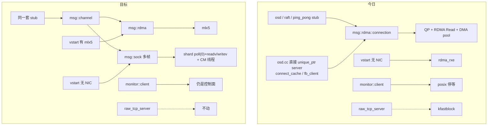
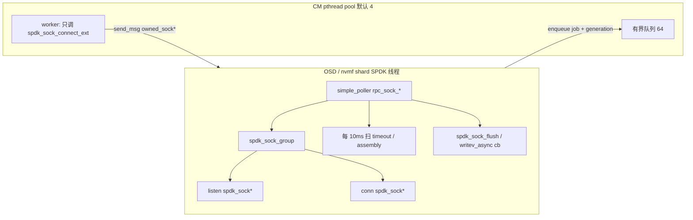
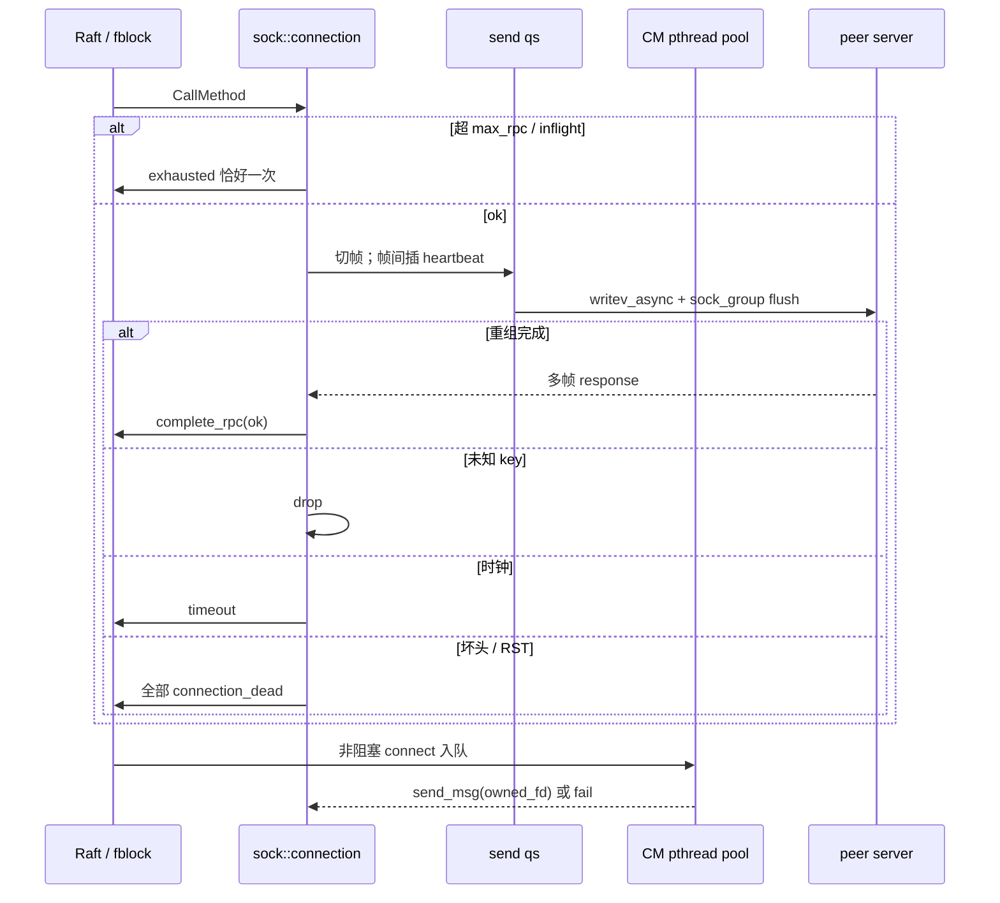

# SPDK sock 高性能后端运输层（`msg::sock`）

作者：<待填>
日期：2026-08-18
状态：**Draft（Rev 4 — 一步到位走 SPDK sock，取消 raw fd 过渡）**
代号：`msg_sock_backend`
前置：`docs/rdma_rpc_fail_soft.md` 的**调用方合同**以**当前代码**为准（`error_class` / `complete_rpc` / 时钟超时已落地）；本文**不重开** RDMA fail-soft 实现、AOS、Raft STM、nvmf `thread_exit`。
实现目录（提案）：`src/include/fastblock/msg/sock/` + `src/msg/sock/`；配置说明后续写入 `src/msg/README.md`
开发阶段：**无旧二进制 / 旧集群兼容义务**；**禁止混运输集群**（OSD 与 nvmf/vhost 必须同一 backend）。
本文是设计稿，**不写实现代码**。

---

## Locked Product Calls

下列产品决定**已拍板**，不再出现在 Open Questions：

| # | 决定 |
|---|------|
| P1 | 有 mlx5 / 真 RoCE → 数据面 + Raft 走 RDMA（生产快路径）。 |
| P2 | 无 RNIC / 开发机 → 数据面 + Raft 走 `msg::sock`。vstart **不再默认**建 `rdmanic`。 |
| P3 | soft-RoCE（`rdma_rxe`）显式 opt-in：`FASTBLOCK_USE_RXE=1` 或 `-n rdmanic`。假设 `rdmanic` 一定存在的脚本必须改，这就是切割。 |
| P4 | 开发阶段禁止混运输集群。OSD 与 nvmf/vhost 各自读**自己的** json，必须写出同一个 `msg_transport`。 |
| P5 | vstart **pro** 模式默认仍要求真 NIC（RDMA）。显式 `msg_transport=sock` 不禁止，不宣传。 |
| P6 | sock 是**第一等公民 API**（同一套 protobuf + `error_class`），**第二等公民性能路径**（dev/compat，不和 mlx5 比 IOPS）。 |
| P7 | **对 `docs/rdma_rpc_fail_soft.md:347` Non-Goal 的显式例外。** 原文「不引入第二套生产运输（TCP RPC、SPDK nvmf RDMA）作为并列路径」仍适用于「第三条生产级协议 / 第三条 on-wire 业务栈」。本文引入的是配置二选一的 **dev/compat RpcChannel**，共享 protobuf 与 fail-soft，**不是**生产快路径，**不是** kfastblock raw TCP。后续 fail-soft 文档应加一句指向本文。 |
| P8 | 不设计、不扩展 kfastblock / `raw_tcp_server` / `fbraw_hdr` / `raw_port`。 |
| P9 | PR1 **只**做运输层 + sock demo + 帧单测，**不**改 OSD / Raft / `fblock_client` / vstart。 |

用户态内核客户端 raw TCP（`kfastblock` / `src/osd/raw_tcp_server.cc`）**明确不在范围**。不要扩 `raw_tcp_server`，不要设计 Raft-over-raw-TCP，不要复用 `fbraw_hdr`。

---

## Overview

```text
现状：Data RPC（nvmf/vhost ↔ OSD）和 Raft RPC（OSD ↔ OSD）只走 msg::rdma。
      没有 OFED NIC 时 vstart.sh 造 rdma_rxe（rdmanic），把整套 QP/CQ/MR/DMA
      pool/correlation/CM 复杂度压到没有硬件卸载的软件 RoCE 上。

目标：同一套 protobuf 服务，同一套调用方合同，再加一个 reactor 轮询的
      SPDK sock 后端。运行时二选一。RDMA 仍是有 RNIC 时的生产快路径。
      sock 能承载真实 Raft recovery AE（多 4MiB entry），而不是只够单对象写。
```

`docs/complete_rtc_design.md` 的主路径仍然是「普通 RDMA RPC + multi-raft」；sock 不替换那条快路径，也不改 RTC 的 shard/port 语义。

---

## Background & Motivation

> 读完本节应能回答五件事：
> 1. 坏在哪（机制，不是轶事）
> 2. 为什么不是「再调大 rxe 池 / 再写一份 POSIX 线程服务器」
> 3. 今天的爆炸半径
> 4. 成功长什么样
> 5. 本文不解决什么

### 0. 以当前树为准的事实

| 记忆 / 假设 | 代码实际做的事 |
|-------------|----------------|
| 数据面已经有 TCP | **没有。** 数据面 / Raft 只走 `msg::rdma`。`monitor::client` 走 SPDK sock + protobuf（`src/include/fastblock/monclient/client.h`，impl 写死 `"posix"`，`zcopy=true`），那是控制面，不是 RPC 织物。 |
| `raw_tcp_server` 可以当开发后端 | **不能。** `src/osd/raw_tcp_server.cc`：`max_raw_body_len = 4096`、thread-per-conn、`poll(..., 1000ms)`、自己的 `fbraw_hdr`（on-wire 字节 `57 52 42 46`，整数 `0x46425257`）、只服务 kfastblock。 |
| 第二套运输 = 第三套 on-wire | **不必。** protobuf 服务已经是业务 API。sock 需要自己的 length-prefixed 帧，但服务名、方法名、`peel_rpc_payload` 共用。 |
| `connect_cache` / Raft / `fblock_client` 已经抽象了运输 | **没有。** `connect_cache.h` 写死 `msg::rdma::client`；`fb_client.h:531` 直接 `make_shared<msg::rdma::client>`；`raft_client_protocol` stub 持有 `connection*`。连接上多用的是 `CallMethod` + `is_terminated()` + `async_shutdown()`；**client 实例**还用 `is_start()`（`client.h:2167`，`fb_client.h:549`）。 |
| OSD 用 `src/rpc/server.h` | **不用。** `osd.cc` `#include "rpc/server.h"` 但 **从不实例化** `class rpc_server`。活的类型是 `vector<unique_ptr<msg::rdma::server>>`（`osd.cc:70, 289`）。`create_listener`/`start` 在 `while(1)` 里 catch `msg::rdma::bindException`（`socket.h:38`，`osd.cc:308-311`）。 |
| `src/msg` 可以在没网卡的机器上编过 | **不能。** `src/msg/CMakeLists.txt`、`src/msg/demo/CMakeLists.txt`、**还有** `src/tools/rpc_bench/CMakeLists.txt` 都是 `find_package(mlx5 REQUIRED)`。 |
| vstart 没 NIC 时「可选」rxe | **默认就会造。** `vstart.sh:460-478`；dev 模式注释 `:530`。 |
| monclient 已经是高性能 sock RPC | **不是。** 停等、8 字节长度前缀、无 correlation、无 `sock_group`。 |
| 本树 SPDK 有 uring sock | **没有。** `ExternalLibrary.cmake.in:88` 无 `--with-uring`；只有 `libspdk_sock_posix.a`。 |
| `spdk_sock_connect_ext` 可在 reactor 上调 | **connect 阻塞。** `posix.c:1035` 对仍是 blocking 的 fd 调 `connect()`，之后才 `fcntl(O_NONBLOCK)`（`:1063-1071`）。`AI_NUMERICHOST` 在 `:988`。`spdk_sock_opts.ack_timeout` 是已建立套接字上的 `TCP_USER_TIMEOUT`（`:554-562`），**不是** SYN 超时。 |
| 5MiB 一帧够用，因为对象是 4MiB | **对单对象 write / 单 object snapshot 够；对 Raft recovery AE 不够。** `osd_stm.cc:602-605` 把整对象放进 `raft_entry_t.data`；`raft_server.cc:35` `recovery_max_entry_num = 100`；`do_recovery`（`:2892-2909`）一批最多 100 条打进 **一个** `msg_appendentries_t`；`peel_rpc_payload` 把所有 `entries[].data` 拼成一块 OOB。两条 4MiB 就是 8MiB；一百条上限 ~400MiB。RDMA 靠 Read 切片活下来。`SNAPSHOT_MAX_CONCURRENT = 1`（`raft.h:41`）只限制 snapshot，不限制 AE。 |

### 1. 为什么现在就要 sock 后端

1. **rxe 付了 RDMA 的全价，没有卸载。**
2. **开发机 / CI 的第一需求是「能起来、能测对」。**
3. **调用方合同已经收到 `error_class`。** `raft_client_protocol.cc` 只在 `is_connection_failure()` 时 `remove_connect`；`fb_client.h:map_rpc_error` 把 exhausted/timeout 映射 `-ENOMEM`/`-EAGAIN`。
4. **大包已经有 OOB peel/attach**，sock 不需要 RDMA Read。但 peel 之后的 **整次 CallMethod** 仍可能远超 4MiB（recovery AE）。运输层必须能把一次 `CallMethod` 切成多帧，并且 Raft sock 发送路径必须按字节把 AE 切小，避免 400MiB 用户态缓冲和秒级 HOL。

### 2. 今天的爆炸半径（没有 sock 时）

```text
开发机没有 mlx5
        → CMake find_package(mlx5 REQUIRED) 配不过
        或 vstart 造 rdmanic，回归把运输层 bug 和 rxe 伪影搅在一起
```

量化（默认开发拓扑：1 mon + 3 OSD + 1 nvmf，`vstart` 默认 `cores=1`）：

| 层 | 今天（rxe） | 有 sock 之后（无 RNIC） |
|----|-------------|-------------------------|
| 运输 | 全套 verbs + CM + DMA MR | TCP + shard `sock_group_poll` + `spdk_sock*` + heap |
| 启动门槛 | `modprobe rdma_rxe` + mlx5 头文件 | 有网卡（甚至 lo）就能听 |
| 单 4MiB 对象 | ~820 data chunk + RDMA Read | 1–2 帧，无 MR |
| recovery AE | 同一套切片 | 多帧 + sock 侧 AE 字节封顶（§4.5.5） |
| 失败合同 | `error_class` 已落地；rxe WC 更脏 | 同一套 `error_class`；RST / 坏 magic 才是 `connection` |

### 3. 成功长什么样

```text
同一套 protobuf stub.CallMethod
        ├─ msg_transport=rdma  →  现有 QP / RDMA Read
        └─ msg_transport=sock  →  多帧 SPDK sock + OOB
一条 RPC 失败 ≠ 一条连接失败 ≠ 一个 reactor 停止
```

可验收（运输层，不是 xfstests）：

1. 无 mlx5、无 rxe：sock demo ping_pong；单 4MiB；**一条 `append_entries` 里 2×4MiB peeled entries**（多帧重组）。
2. 同一连接 pipeline（correlation），不是停等。
3. 未知 correlation：丢帧、计数、连接仍在。
4. server 故意不回：`rpc_timeout` 内恰好一次 `Run()`，`error_class==timeout`。
5. TCP RST：`error_class==connection`，才允许 `remove_connect`。
6. send 上限 / EAGAIN：新 RPC `resource_exhausted`，**不**拆连接。
7. 有 mlx5 时默认行为不变。

### 4. 本文明确不解决什么

| 不在范围 | 原因 |
|----------|------|
| kfastblock / `raw_tcp_server` / `fbraw_hdr` / `raw_port` | P8 |
| 把 monclient 抽成通用 RPC | 停等控制面 |
| 替换 RDMA 生产快路径 | P1 / P6 |
| 混运输滚动升级 / RDMA↔sock 网关 | P4；见 **Integration** |
| 改 Raft 提交 / 匹配 / apply 语义 | 只改 sock **发送批大小**（§4.5.5），不是另一套一致性 |
| POSIX thread-per-conn | 已否决 |
| 与旧二进制混部 | 开发阶段允许破坏 on-wire |

---

## Goals & Non-Goals

### Goals

1. **第一等公民的 `msg::sock` RpcChannel API**（P6），第二等公民性能。
2. 同一套 protobuf 服务：`rpc_service_osd`、`rpc_service_raft`、demo `ping_pong_service`。
3. 同一套调用方合同：`CallMethod`、`error_class`、complete-once、时钟超时。
4. reactor 轮询；pipeline；多帧承载超 `max_frame` 的合法 RPC；无 `ibv_reg_mr`。PR1 已连接套接字走 **`spdk_sock*` + `sock_group`**（posix impl）。不升 SPDK；阻塞 `connect` 放到 CM 线程池，不自己握 raw fd。
5. 运行时 `msg_transport`。vstart：mlx5 → RDMA；无 RNIC → sock（P2/P3）。
6. **PR1 起**没 mlx5 也能 `cmake && ninja sock_client sock_server sock_frame_test`（`FASTBLOCK_WITH_RDMA` 默认随 `mlx5_FOUND`）。
7. RTC / shard 模型不变：每 shard 自己的 listener；`core_shard_map.port`。
8. 增量合入：PR1 运输层可独立回滚。

### Non-Goals

- 不增长 kfastblock raw TCP。
- 不把 sock 宣传成生产上和 RDMA 抢流量的路径（P6）。
- 不做混运输集群。
- 不把 `monitor::client::cluster` 抽成通用 RPC。
- **不改** Raft 日志匹配 / 提交 / apply；**要改** sock 上 `_raft_get_entries_from_idx` 的**发送批字节上限**（日常 AE 与 `do_recovery` 共用，§4.5.5）。
- 不保证与旧 OSD / 旧 nvmf 混部。

---

## Key Decisions

| # | 决策 | 理由 |
|---|------|------|
| D1 | 名字 `msg::sock`。 | SPDK sock，不是 `raw_tcp_server`，不是 `fbraw`。 |
| D2 | 业务 API 只有 protobuf；两个 RpcChannel 后端。不复用 `fbraw_hdr`。 | 再做一套 opcode 就是 kfastblock 岔路。 |
| D3 | PR1 并行类型；PR2 `msg::channel` + **写全的** factory。不模板化，不复制 `connect_cache`。 | 连接侧确实几乎只有三方法；**client/server** 还有 `is_start()`、bind 重试、真实构造参数。 |
| D4 | on-wire：32 字节 LE hdr（CRC32C）+ packed meta + proto + OOB；**多帧**拼一次 `CallMethod`。 | 单帧 5MiB 装不下 2×4MiB AE。 |
| D5 | **PR1 已连接套接字只有一条 I/O 路径：`spdk_sock*` + 每 shard 一个 `spdk_sock_group`。** listen / accept / 读写全部走 SPDK sock。发送用 `spdk_sock_writev_async` + `spdk_sock_flush`；接收在 `group_poll` 回调里 `spdk_sock_readv`。禁止 raw `poll`+`readv`/`writev` 第二套状态机。禁止 thread-per-conn。 | 用户决定一步到位。自己搓 raw fd 与 posix sock 底层重叠，却拿不到 `sock_group` / `writev_async`。24.05 没有 adopt-fd，所以 **不能**「先自己 connect 再包成 sock*」；必须让 SPDK 自己 `connect`/`listen`/`accept` 交出 `spdk_sock*`。 |
| D6 | PR1 `msg_sock_impl` 写死 `"posix"`（本树已编）。`zcopy=true`（loopback 上 posix 会自己关掉）。**不**为这个后端升 SPDK，**不**编 uring。 | 24.05 已有完整 posix sock。`connect_async` 要 25.09+，且 26.05 又标 deprecated。升 SPDK 不是本后端的前置。 |
| D7 | **建连：进程内 CM 线程池（默认 4 个 pthread），只跑 `spdk_sock_connect_ext`。** 不在任何 SPDK reactor / shard 上调它。有界队列 64。调用方 1s 截止：超时先 `cb(false)`；晚到的 `spdk_sock*` 立刻 `spdk_sock_close`。handoff 后 **只有所属 shard** 把 sock 加进 `sock_group` 并做 I/O。禁止在 CM 上 read/write。禁止单线程串行 connect。 | 24.05 posix `connect()` 阻塞且无 SYN 超时。单条 CM 线程或 shard 上调会冻箱。线程池把卡死的 SYN 限制在一只 worker，不占 reactor。 |
| D8 | fail-soft 对齐**当前代码**的 `error_class`。时钟扫描并进 sock poller，**每 10ms 扫一次**，不每 0µs tick 线性扫。 | 调用方已按 class 分叉。 |
| D9 | `msg_transport: "rdma" \| "sock"`。缺省：编了 RDMA 且能打开 RNIC → rdma，否则 sock。vstart 无 RNIC 写 sock。 | P2/P3。 |
| D10 | 禁止混集群。端口写 `core_shard_map.port`，不用 `raw_port`。细则见 **Integration**。 | `port` 已是 shard 入口。 |
| D11 | **PR1 引入 `FASTBLOCK_WITH_RDMA`（默认 ON iff `mlx5_FOUND`）。** 始终编 `msg_common`+`msg_sock`+sock demo+`sock_frame_test`。OFF 时 **跳过** `osd`/`raft`/`client`/`bdev` 以及链 `msg` 的 tools/tests，这样无 OFED 箱子 `cmake && ninja sock_client sock_server sock_frame_test` 能过。ON 时行为与今日相同。只把 `mlx5 REQUIRED` 改成 `QUIET` 而不跳过消费者，configure 仍会因 `target_link_libraries(... msg)` 失败。 | `src/CMakeLists.txt` 无条件 `add_subdirectory(osd/raft/client/bdev/test/tools)`，它们无条件链 `msg`。 |
| D12 | 不复用 monclient。只抽 `msg/sock/opts.h`。 | 两种合同。 |
| D13 | 用户态 priority/normal 双队列。**多帧之间**抽空 `priority_q`。内核 HOL ≤ **一帧** 5MiB。EAGAIN / 超上限 → `resource_exhausted`。 | 见 D16。 |
| D14 | `max_frame_bytes=5MiB`（单帧）。`max_rpc_bytes=16MiB`（一次 CallMethod 重组后）。单帧超 `max_frame` 或坏 magic/CRC → **拆连接**。重组超 `max_rpc_bytes` 或合法大 AE → **不拆**，回 `resource_exhausted`。Raft sock 发送侧把 AE OOB 封顶在 8MiB（§4.5.5）。 | 拆连接只留给失步。合法 AE 不是协议破坏。 |
| D15 | PR1 = 运输层 + demo + 单测。不改 OSD/Raft/vstart。 | P9。 |
| D16 | **TCP HOL 是 Raft 活性约束。不同 `correlation` 的帧必须允许且将会交错**（心跳插在某 RPC 的 `kMore` 帧之间）。`frame_seq` 空洞按 key 判断，不是按流上的相邻帧。最坏内核 HOL = `max_frame / min_rate` ≈ 40ms@1GbE ≪ election 2000ms。禁止 100×4MiB 一次 `writev`。不开第二条 heartbeat TCP。 | 实现者若假定「一帧 RPC 的帧必须连续」会把心跳当成 seq 空洞并拆连接，D16 立刻自杀。 |
| D17 | 服务端 inbound / reply / `max_conns`。连接级 `recv_deadline` 只覆盖**当前未收齐的那一帧**。每条组装中的 RPC 另有 `assembly_deadline`。进程级 64MiB 用一颗 `std::atomic<size_t>`（§4.7.5）。 | 只限 client、或把「等续帧」当成连接超时，会拆掉健康的交错 RPC。 |
| D18 | PR1 sock 头可以 include 今日的 `rdma/types.h`、`rpc_controller.h`、`oob_payload.h`。sock **永不** `attach_pd`。PR2/PR5 把 `status` / `rpc_error_class` / peel / controller 上移到 `msg/`。 | `ibv_pd*` 只是前向声明，无 mlx5 也能编；路径名 `rdma/` 不能永远留在 no-mlx5 树上。 |

---

## Proposed Design

### 4.1 目标合同（一句话）

```text
protobuf stub     不知道底下是 QP 还是 TCP
sock 帧           magic+CRC32C+correlation+多帧，LE
大包              peel/attach + 多帧重组；AE 发送侧 8MiB 封顶
失败              停在这一次 RPC；只有 RST / 坏头 / 半开超时才拆连接
reactor           shard 上不 connect；memcpy 是接受的代价
I/O               已连接 fd 一律 raw poll(0)+readv/writev
构建              PR1 无 mlx5 时 cmake + ninja sock_* 能过
```

### 4.2 今日结构 → 目标结构



### 4.3 模块边界

| 对象 | 文件 | 职责 | 不做什么 |
|------|------|------|----------|
| `msg::channel` / `msg::client` / `msg::server` | `msg/{channel,factory}.h`（PR2） | 擦除；见 §4.4 全签名 | 不暴露 fd/QP |
| `msg::rdma::*` | 现有 | 生产快路径 | 不改 on-wire 迁就 sock |
| `msg::sock::*` | `msg/sock/*` | sock 后端 | 不 include monclient |
| `bind_error` | `msg/bind_error.h`（PR2） | OSD `while(1)` 换端口 | 不让 `create_listener` 变成 `bool` 却丢掉重试 |
| types / peel / controller | PR1 仍住 `msg/rdma/`；PR2/PR5 上移 `msg/` | 共用 | sock 不 `attach_pd` |
| `src/rpc/server.h` | 无人用的薄封装 | **不是** OSD 集成点 | 不要在 PR 里把它当主路径改 |
| `osd_raw_tcp_server` | `raw_tcp_server.cc` | kfastblock | **不增长** |

### 4.4 调用方耦合与 factory（无省略号）

#### 4.4.1 今日真实调用点

| 站点 | 做什么 |
|------|--------|
| `osd.cc:289` | `make_unique<msg::rdma::server>(core_sharded::get_thread(shard_id), opts)` |
| `osd.cc:304-311` | `create_listener` + `start`；`catch (bindException)` 换随机端口 |
| `osd.cc:435-438` `pm_init` | `client::make_options(pt)` → `connect_cache(cpumask, opts, sockid)` |
| `connect_cache.h:28-38` | 每 shard `make_shared<msg::rdma::client>(name, get_thread(i), opts, sock_id)` 然后 `start()` |
| `fb_client.h:531-532` | `make_shared<msg::rdma::client>(name, thd, opts)`（无 sock_id，默认 ANY） |
| `fb_client.h:549` | `_rpc_client->is_start()` |
| `bdev/common.cc:128,133` | `client::make_options(g_pt)` → `connect_cache(&cpumask, rpc_cli_opts)`（无 sock_id） |
| `raft_client_protocol.h:168,204` | `connection*` 构造 `rpc_service_raft_Stub` |
| `raft_client_protocol.cc:26,72` | `create_pg_msg_source` 持有 `shared_ptr<connection>` |
| `src/test/osd_client.h` | 同 cache 模式 |
| `src/test/{raft_membership,snapshot_*}.cc` | `client::make_options` |
| `tools/rpc_bench.cc:265,297,473,492` | 自建 `server(name, &cpu_mask, opts, sockid)` 与 `client(name, thread, opts, sockid)` |
| `tools/block_bench.cc:532,798` | `client::make_options` + `fblock_client` |
| `tools/image_verify.cc:298,416` | `client::make_options` |
| `src/msg/demo/{client,server}.cc` | 直接 rdma 类型 |
| `src/rpc/server.h` | **OSD 不走这里** |

#### 4.4.2 PR1

并行类型：`msg::sock::client` / `connection` / `server` 自己实现与 RDMA **同形**的方法（含 `is_start()`、`create_listener` 抛 `msg::sock::bind_error`）。demo 直接用。OSD 树零改。

#### 4.4.3 PR2 接口（可直接写成 `factory.cc`）

```cpp
namespace msg {

enum class transport_kind : uint8_t { rdma = 1, sock = 2 };

class bind_error : public std::exception {
public:
    const char* what() const noexcept override;
};
// PR2: msg::rdma::bindException 改为 using bind_error = msg::bind_error;
// 或公有继承，osd.cc catch 改为 catch (const msg::bind_error&)。

class channel : public google::protobuf::RpcChannel {
public:
    virtual bool is_terminated() noexcept = 0;
    virtual int async_shutdown() = 0;   // 0 = send_msg 已入队
};

class client {
public:
    virtual ~client() = default;
    virtual void start() = 0;
    virtual bool is_start() noexcept = 0;
    virtual void stop(std::optional<std::function<void()>> cb) = 0;
    virtual void emplace_connection(
        std::string addr, uint16_t port,
        std::function<void(bool, std::shared_ptr<channel>)> cb) = 0;
    virtual void remove_connection(
        std::shared_ptr<channel> conn,
        std::function<void(bool)> cb) = 0;
    virtual ::spdk_thread* get_thread() noexcept = 0;
};

class server {
public:
    virtual ~server() = default;
    // EADDRINUSE / 其它 bind 失败 → throw bind_error（osd.cc while(1) 依赖这个）
    virtual void create_listener(uint16_t port) = 0;
    virtual void start() = 0;
    virtual void add_service(google::protobuf::Service* svc) = 0;
    virtual uint16_t listen_port() noexcept = 0;
    virtual std::string listen_address() noexcept = 0;
    virtual void stop(std::optional<std::function<void()>> cb) = 0;
};

struct client_ctor {
    std::string name;
    ::spdk_thread* thread{nullptr};          // 所属 shard；禁止为空
    const boost::property_tree::ptree* conf{nullptr}; // 完整 json
    int numa_sock_id{SPDK_ENV_SOCKET_ID_ANY};
};

struct server_ctor {
    std::string name;
    ::spdk_thread* thread{nullptr};          // OSD：外来 shard 线程
    const struct spdk_cpuset* cpumask{nullptr}; // demo/rpc_bench：自建线程时用
    const boost::property_tree::ptree* conf{nullptr};
    int numa_sock_id{SPDK_ENV_SOCKET_ID_ANY};
};

transport_kind parse_transport(const boost::property_tree::ptree& conf) noexcept;
// 缺键：若编了 RDMA 返回 rdma，否则 sock。
// 非法值：返回 rdma（若编了）并 ERRLOG；未编 RDMA 则 sock。

std::shared_ptr<client> make_client(transport_kind k, client_ctor c);
std::shared_ptr<server> make_server(transport_kind k, server_ctor c);
// kind 与编译开关不符 → throw std::runtime_error，让 OSD 启动路径走到
// 现有 create_rpc_server 的 catch → 不向 mon boot。

} // namespace msg
```

`msg::rdma::client::connection` / `msg::sock::client::connection` public 继承 `msg::channel`（可同时 `enable_shared_from_this<concrete>`）。

`connect_cache` PR2 构造改为：

```cpp
connect_cache(::spdk_cpuset* cpumask,
              const boost::property_tree::ptree& conf,
              int numa_sock_id = SPDK_ENV_SOCKET_ID_ANY);
// 内部：kind = parse_transport(conf);
// 每 shard make_client(kind, { "connect_cache"+i, get_thread(i), &conf, numa_sock_id })->start();
```

因此 **`osd.cc:pm_init` 和 `bdev/common.cc` 必须在 PR2 改签名**（不再先 `client::make_options` 再传入）。缺 `msg_transport` 时 kind=rdma，**行为零变化**。`create_rpc_server` 在 PR2 改为 `make_server(parse_transport(pt), {..., thread, &pt, ...})`，`catch (msg::bind_error)`。缺键仍是 RDMA。

PR2 **验收只跑 RDMA**（现有 vstart / demo）。`make_*(sock)` 必须能链接，但 PR2 不启 sock 进程。

`src/rpc/server.h`：可改成对 `msg::server` 的薄封装，或删除；**不要**把它写成 OSD 集成点。

### 4.5 On-wire 帧

#### 4.5.1 头（32 字节，packed，全 LE）

```cpp
struct sock_frame_hdr {
    uint32_t magic;         // 整数 0x4B534246；on-wire 字节 46 42 53 4B（'F' 'B' 'S' 'K'）
    uint8_t  version;       // 1
    uint8_t  flags;         // bit0 kResponse；bit1 kMore
    uint16_t frame_seq;     // 从 0；同一 correlation 内单调 +1
    uint64_t correlation;   // transport_data::make_correlation_index(gen, idx)
    uint32_t meta_bytes;    // seq==0：wire_*_meta 大小；seq>0：必须 0
    uint32_t proto_bytes;   // seq==0：peeled envelope；seq>0：必须 0
    uint32_t payload_bytes; // 本帧 OOB 切片
    uint32_t hdr_crc32;     // 前 28 字节的 CRC32C（spdk_crc32c），不是 zlib crc32
} __attribute__((packed));
static_assert(sizeof(sock_frame_hdr) == 32);
```

| 字段 | 规则 |
|------|------|
| `magic` | 对不上 → 失步 → **拆连接**。这是混集群 / 连错 `raw_port` 的**唯一**运行时探测（无 handshake / transport-id 字节）。 |
| `version` | 只接受 `1`。否则拆连接。v1 冻结 `meta_bytes` 合法值；以后加字段必须 bump `version`。 |
| `flags` | 未知 bit 必须 0，否则拆连接。`kMore=1` 表示同 correlation 还有后续帧。 |
| `frame_seq` | 首帧 0。**只在同一 `correlation` 内**单调 +1。流上相邻两帧可以、也将会属于不同 key（D16）。同 key 出现空洞或重复 seq → **丢弃该 RPC 的组装**（server 回 `bad_request_body` / client `timeout`），**不拆连接**。TCP 可靠，真丢字节会以 RST/短读表现，不靠 seq 侦测失步。 |
| `correlation` | **复用** `transport_data::make_correlation_index` + `completed_key_ring` + `next_request_key` 的 skip-done 循环（`client.h:437-448`）。PR1 从 rdma 头 include；PR2 把 helper 挪到 `msg/correlation.h`。 |
| `hdr_crc32` | CRC 错 → 拆连接。不算 payload。 |
| `meta_bytes` | 请求首帧必须 `== sizeof(wire_request_meta)`（74）；响应首帧 `== sizeof(wire_reply_meta)`（12）。续帧必须 0。 |

kfastblock magic on-wire 是 `57 52 42 46`。连错会在本 magic 处拆，不会误解析。

#### 4.5.2 wire meta（不要 memcpy 主机 `request_meta`）

主机 `request_meta` 有 padding（76B）；packed 线结构 74B。

```cpp
struct wire_request_meta {
    char     service_name[32];
    uint8_t  service_name_size;
    char     method_name[32];
    uint8_t  method_name_size;
    uint32_t data_size;      // LE；peeled envelope 的 ByteSizeLong()
    uint32_t payload_size;   // LE；**整次 RPC** 的 OOB 总长（不是本帧）
} __attribute__((packed));

struct wire_reply_meta {
    uint8_t  reply_status;
    uint8_t  _pad[3];
    uint32_t data_size;
    uint32_t payload_size;   // 整次响应 OOB 总长
} __attribute__((packed));
```

`payload_size`（meta）与各帧 `payload_bytes` 之和必须相等，否则拆连接。meta 让接收方在首帧就能拒绝 `payload_size > max_rpc_bytes` 而不拆连接。

#### 4.5.3 序列化顺序（规范）

**发送（请求）：**

1. `peel_rpc_payload(*request, &oob)`（可变 message；与今日 `client.h:846` 相同）。
2. `proto_bytes = request->ByteSizeLong()`（**peel 之后**）。必须写入 `wire_request_meta.data_size`。
3. `SerializeToArray` 到 proto 缓冲。
4. 若 `proto_bytes + oob.size() > max_rpc_bytes`：本端 `complete_rpc(resource_exhausted)`（可重试），**不发送**。单对象 `write_request` 自己就 `> max_rpc_bytes`（例如 20MiB）→ `too_large`（不可重试）。
5. 切帧：首帧 = hdr(seq=0) + meta + proto + oob 前缀；后续帧 = hdr(kMore/最后一帧清 kMore) + oob 切片。每帧 `payload_bytes ≤ max_frame - 32 - meta - proto`（续帧无 meta/proto，上限 `max_frame-32`）。

**接收（请求）：**

1. 收齐首帧，校验 hdr。读 `wire_request_meta.payload_size`；若 `data_size + payload_size > max_rpc_bytes` → 回 `status::resource_exhausted`，丢弃后续同 key 帧，**不拆**。
2. 收齐全部帧（`kMore==0`）。
3. `ParseFromArray(proto)`，再 `attach_rpc_payload(msg, oob)`。失败 → `bad_request_body`。
4. sock **没有** RDMA inline 路径；不要抄 `dispatch_method` 的 `is_inlined` 分支。

响应对称：`peel` 响应 → `ByteSizeLong` → `SerializeToArray` → 切帧。

**交错是规范，不是边角：** 同一条 TCP 上流会出现

```text
AE  corr=1 seq=0 kMore=1
HB  corr=2 seq=0 kMore=0
AE  corr=1 seq=1 kMore=0
```

接收方按 `correlation` demux 进组装表。心跳不是 corr=1 的 seq 空洞。实现者不得假设「一次 RPC 的帧在流上连续」。

#### 4.5.4 上限与「什么算失步」

| 项 | 值 | 违规时 |
|----|-----|--------|
| `max_frame_bytes` | 5,242,880（5MiB） | **拆连接**（单帧无法合法超过这个，除非长度字段被破坏） |
| `max_rpc_bytes` | 16,777,216（16MiB） | **不拆**。发送方不发 / 接收方回 `resource_exhausted` |
| 单对象硬上限 | 4MiB（`kMaxObjectSize`） | 单独一条 `write_request` / snapshot object 超此 → `too_large` |
| proto 单独上限 | 1MiB | 计入 `max_rpc_bytes` |
| `recovery_max_entry_num * 4MiB` | ~400MiB | **不允许**作为一次 sock `CallMethod`。由 §4.5.5 在 Raft 发送侧切开 |

#### 4.5.5 Raft 发送侧（一致性不变，批大小变）

这是显式的 sock 适配，**不是**静默改 Raft 状态机：

- 日志匹配、提交、apply、选举条件不变。
- 仅当 `msg_transport=sock` 时，**唯一**打包入口 `_raft_get_entries_from_idx`（`raft_server.cc:1689-1698`）增加 OOB 字节预算 `msg_sock_ae_max_oob_bytes` 默认 **8MiB**。
- 日常热路径不是 `do_recovery`：cache flush 后 `raft_send_appendentries(node, _first_idx, _current_idx)`（`:1354-1364`，仅 `!raft_node_is_recovering()`）同样走进 `_raft_get_entries_from_idx`。只改 `do_recovery` 的两个 `add_entries` 循环（`:2880`、`:2898`）会让非 recovering follower 在一次 flush 里吃下 3×4MiB。
- 算法：按 `entry.data().size()` 累加；再加下一条会超过预算则 **停止**，返回实际打进 AE 的 `cut`。调用方发送 `[_first_idx, cut]`，把 `next_idx` 设成 `cut+1`，余下条目下一次 AE。`do_recovery` 与 `raft_send_appendentries` **都**走这个函数（或一层薄 wrapper），禁止再手写一遍 `add_entries` 循环而不看预算。
- `recovery_max_entry_num=100` 对小 4KiB entry 仍然有效（100×4KiB=400KiB）。
- install-snapshot 已是 `SNAPSHOT_MAX_CONCURRENT=1`、每 object 4MiB，一次 CallMethod 落在 16MiB 内，不必再切。
- 落点：PR3。PR1 运输层自己就能发 2×4MiB 一条 `append_entries`（demo / 单测），不依赖 Raft。

若未切的 peer 仍发来 `payload_size>16MiB`：回 `resource_exhausted`，不拆。`too_large` **不要**用在「合法但本批太大」上。

#### 4.5.6 未知 / 重放 / 组装表

组装表按 `correlation` 索引，每项：

```cpp
struct assembly {
    uint64_t correlation{};
    uint16_t next_seq{0};
    std::string proto;
    std::string oob;
    uint32_t expect_oob{0};
    std::chrono::system_clock::time_point assembly_deadline{};
};
```

- 首帧（seq=0）：新建项，`assembly_deadline = now + rpc_timeout`。每收到该 key 的后续帧刷新 deadline。
- 时钟扫描（10ms）发现 `now > assembly_deadline`：丢掉该项。若本端是请求发送方（等响应续帧）→ `complete_rpc(timeout)`。若本端是 server 且尚未 `CallMethod` → 不 dispatch，不回包或回 `request_timeout`（能塞下就回）。**不拆连接。** 其它 in-flight / 其它组装项继续。
- 不同 key 交错：各进各的项。

**Client 收响应：**

- key 不在 in-flight：`sock_unknown_key++`，丢帧，不拆。
- key 在 `completed_key_ring`：静默丢（迟到）。

**Server 收请求：**

- 对齐 `server.h:1058-1079`：`done_keys.contains(full)` → 静默丢（重放），不拆。
- 首帧、key 已在组装表或 `rpc_tasks` → 回 `bad_request_body`，不拆。
- 续帧、key 不在组装表 → 丢弃，`sock_unknown_key++`，不拆。
- 真正的新 key：进组装表；齐了再 `dispatch_method`。`done_keys.remember` 在 complete 时。

### 4.6 连接、CM 线程池、reactor

#### 4.6.1 拓扑



- **listen / accept / 全部 I/O 只在所属 shard。** 每 shard 一个 `spdk_sock_group`，在 `client::start` / `server::start` 时 `spdk_sock_group_create`。
- **建连不在 reactor 上。** 进程内一个 CM 池（`msg_sock_connect_workers`，默认 4），第一个 `msg::sock::client::start()` 时创建，`client::stop` 全部停完后销毁。
- CM 是 **pthread，不是 `spdk_thread`**。24.05 的 `spdk_sock_connect_ext` 会阻塞；把它放进 SPDK 线程（含 `cores=1` 上那颗唯一 shard 核）会冻 reactor。
- 池的宽度限制「同时卡在 SYN 上的 connect 数」。一只 worker 堵住不影响另外三只，也不影响任何 shard poller。

#### 4.6.2 connect 算法（`spdk_sock_connect_ext` 只允许在 CM worker 上）

24.05 posix：`connect()` 在设 `O_NONBLOCK` 之前（`posix.c:1035-1071`）。`ack_timeout` 不是 SYN 超时。公共 API 也没有 adopt-fd。因此 **唯一能拿到 `spdk_sock*` 的建连方式**就是让 SPDK 自己 `connect_ext`。

流程：

1. shard `emplace_connection`：数字地址用 `try_numeric_sockaddr`，失败立刻 `cb(false)`。hostname / `getaddrinfo` 禁止。
2. 构造 `connect_job{addr, port, generation, target_thread, cb}`。队列满（默认 64）→ `cb(false, nullptr)`，不入队。
3. 空闲 worker 取出 job，调：

```cpp
spdk_sock_opts opts{};
opts.opts_size = sizeof(opts);
spdk_sock_get_default_opts(&opts);
opts.zcopy = true;
spdk_sock* s = spdk_sock_connect_ext(ip, port, "posix", &opts);
```

4. **调用方 1s 截止在 shard 上用时钟扫 job。** 到期：置 `cancelled`，`cb(false, nullptr)`。worker 随后返回的 `s` 一律 `spdk_sock_close(&s)`，不 handoff。
5. worker 成功且未被 cancel：`spdk_thread_send_msg(target_shard, handoff, owned_sock)`。**worker 上禁止 read/write/flush/group_add。**
6. `send_msg` 失败：worker 上 `spdk_sock_close`；再试一次失败通知。两次都失败：`ERRLOG`，connect 失败。
7. shard handoff：若 `_stopping` 或 generation 不匹配 → `spdk_sock_close`，`cb(false)`。否则 `spdk_sock_group_add_sock(group, s, on_sock_event, conn)`，`cb(true, conn)`。
8. 一只 worker 一次只跑一个 `connect_ext`。四个 worker 最多四个并发阻塞 SYN。不在单线程上串行全世界的 reconnect。

不升 SPDK 追 `spdk_sock_connect_async`（25.09 才有，26.05 已 deprecated）。

#### 4.6.3 已连接 I/O：只有 `spdk_sock*` + `sock_group`

| 步骤 | 调用 |
|------|------|
| listen | shard 上 `spdk_sock_listen_ext(ip, port, "posix", &opts)`。失败（含 `EADDRINUSE`）→ `bind_error`（OSD `while(1)` 换端口） |
| accept | shard poller 里 `spdk_sock_accept(listener)`。非空则 `group_add_sock`。满 `max_conns` → `spdk_sock_close` 新 sock |
| client | CM 交出的 `spdk_sock*`，shard 上 `group_add` |
| 选项 | `TCP_NODELAY`、`SO_RCVBUF`/`SO_SNDBUF`（2MiB）经 `spdk_sock_set_recvbuf` / `set_sendbuf`。impl 固定 posix |
| 关闭 | 只在 shard：`group_remove_sock` 再 `spdk_sock_close`。CM 只在 handoff 失败 / 迟到时关 |

shard `rpc_sock_*` poller 每个 tick：

```text
spdk_sock_group_poll(group)          // 内部 epoll_wait(..., 0) + flush
on_sock_event(sock):
  循环 spdk_sock_readv，最多 256KiB，推进 NeedHdr/… 
  read==0 或 err != EAGAIN → teardown_connection
然后 10ms 扫描：RPC 时钟、assembly_deadline、recv_deadline
```

posix `group_impl_poll` 每次还会对组内 sock `_sock_flush`。发送路径提交 `writev_async` 后，这个 tick 的 `group_poll` 负责把数据推到内核。

**禁止**再维护一套 raw `poll(fd)+writev`。没有运行时 if。

#### 4.6.4 `stop()` 竞态

- shard `client::stop()`：置 `_stopping`，拒绝新 `emplace_connection`，对已入 CM 队列的 job 置 `cancelled`。
- worker 取出已 cancel 的 job：若尚未 `connect_ext` 则跳过；若已经返回 sock 则 `close`。
- 迟到成功 handoff：shard 发现 `_stopping` / generation 不匹配 → `spdk_sock_close`，`cb(false, nullptr)`。
- 已在 `sock_group` 里的连接走 `async_shutdown`（`group_remove` + `close`，in-flight `complete_rpc(connection_dead)`）。
- 全部连接拆完再 `spdk_sock_group_close`。

#### 4.6.5 允许 / 禁止

| 允许 | 禁止 |
|------|------|
| shard 上 `spdk_sock_listen_ext` / `accept` / `group_poll` / `readv` / `writev_async` / `flush` | **任何** SPDK 线程上 `spdk_sock_connect_ext` |
| CM pthread 上 **只** `connect_ext` + `close` + `send_msg` | CM 上 read/write/flush/`group_add` |
| 调用方 1s 时钟取消 + 迟到 sock 丢弃 | shard / 单 `spdk_thread` 上阻塞 connect |
| impl `"posix"`，`zcopy=true` | raw fd 第二套 I/O；运行时切 uring |
| `try_numeric_sockaddr` | hostname / 阻塞 `getaddrinfo` |
| | thread-per-conn（每条数据连接一个 pthread） |

#### 4.6.6 listen 端口与 RTC

保持 `osd.cc:create_rpc_server` 仪式：每 shard 随机端口，`bind_error` 重试，`listen_port()` → `core_shard_map.port`。`raw_port` 仍只给 kfastblock。

### 4.7 发送路径、pipeline、背压、`writev_async`

#### 4.7.1 CallMethod（client）

1. 非 `running` → `connection` + `Run()`。
2. 名过长 → `application` + `Run()`。
3. peel；按 §4.5.3 算大小。
4. `proto+oob > max_rpc_bytes`：单对象不可切 → `too_large`；可切的 AE 不应走到这里（§4.5.5）。其它 → `resource_exhausted`。都不入队。
5. 本连接 `inflight_bytes + rpc_size > max_inflight_bytes` 或 `inflight_rpcs >= rpc_batch_size`，或进程 cap `try_reserve` 失败 → `resource_exhausted`（§4.7.5）。
6. `next_request_key()`，切帧，入 priority（方法名 `heartbeat`）或 normal。
7. 跨线程 → `spdk_thread_send_msg`。

#### 4.7.2 双队列 + 帧间插心跳（D16）

每个 tick，在当前 `writev_async` 提交完（或 sock 内部队列 EAGAIN）之后：

1. 先从 `priority_q` 取一帧 `submit_frame`。
2. 再从 `normal_q` **一次只取一帧** `submit_frame`。
3. 该帧的 `cb_fn` 跑完（整帧交给 sock 层）后回到 1，让心跳插在两条 data 帧之间。
4. 内核 HOL ≤ 5MiB ≈ 40ms@1GbE ≪ 2000ms election。

流上对端将看到交错的不同 `correlation`；这是规范行为。

#### 4.7.3 `writev_async` 状态机（PR1 唯一发送路径）

每条连接一个 `std::deque<sock_send_req*>`。`sock_send_req` 是带 4 个 iovec 的 `spdk_sock_request` 包装，**四块 buffer 活到 `cb_fn`**：

```cpp
struct sock_send_req {
    struct spdk_sock_request req;   // 必须是第一个成员，后面紧跟 iov
    struct iovec iov[4];
    std::shared_ptr<frame_buf> hold;
    connection* conn{nullptr};
    uint64_t correlation{0};
    uint16_t frame_seq{0};
};

static void on_sock_send_done(void* arg, int err) {
    auto* r = static_cast<sock_send_req*>(arg);
    auto* conn = r->conn;
    if (err < 0) {
        conn->teardown_connection();
        return;
    }
    conn->on_frame_sent(r->correlation, r->frame_seq);
    r->hold.reset();
    delete r;
}

void connection::submit_frame(std::shared_ptr<frame_buf> hold, uint64_t corr, uint16_t seq) {
    auto* r = new sock_send_req{};
    r->req.cb_fn = on_sock_send_done;
    r->req.cb_arg = r;
    r->req.iovcnt = hold->nvec;          // 1..4：hdr / meta / proto / oob_slice
    r->hold = std::move(hold);
    r->conn = this;
    r->correlation = corr;
    r->frame_seq = seq;
    memcpy(SPDK_SOCK_REQUEST_IOV(&r->req, 0), r->hold->iov, sizeof(iovec) * r->req.iovcnt);
    spdk_sock_writev_async(_sock, &r->req);
}

void connection::teardown_connection() {
    if (_torn) return;
    _torn = true;
    if (_in_group) {
        spdk_sock_group_remove_sock(_group, _sock);
        _in_group = false;
    }
    spdk_sock_close(&_sock);
    // 尚未 cb 的 writev_async：close 会以负 errno 调 cb_fn；on_sock_send_done
    // 见 _torn 则只释放 req，不再 teardown / 不再 Run。
    complete_all_inflight(rpc_fail::connection_dead);
}
```

`cb_fn` 在 `group_poll` / `flush` 的调用栈上跑，仍在所属 shard。短写、EAGAIN、zcopy 完成都由 sock 层消化；运输层只认「整帧 cb」或「负 errno」。

`spdk_sock_close` 必须保证所有未完成 `spdk_sock_request` 都收到 `cb_fn`。若本树 posix close 漏 cb，PR1 单测必须打红，并在 `teardown` 里显式 `spdk_sock_abort_requests`（若符号可见）或自己把未完成 req 标失败——**禁止泄漏、禁止双 `Run`**。

#### 4.7.4 为什么还有 `resource_exhausted`

没有 DMA 池，仍有：TCP 窗口、`SO_SNDBUF`（2MiB）、每连接 16MiB、`rpc_batch_size=1024`、进程 64MiB。挡住新 CallMethod / 新 inbound → `resource_exhausted`。运输层不 delay、不内部重试。

#### 4.7.5 进程级 64MiB cap 算法

跨 shard 共享的可变状态 **只有**这一颗原子。不按实例再拆（否则 3 shard × 64MiB 打穿 `--no-huge`）。

```cpp
// src/msg/sock/quota.cc，进程单例
struct process_quota {
    std::atomic<size_t> used{0};
    size_t limit{64 * 1024 * 1024};  // msg_sock_max_process_inflight_bytes
    bool try_reserve(size_t n) noexcept {
        size_t cur = used.load(std::memory_order_relaxed);
        while (true) {
            if (cur + n > limit) return false;
            if (used.compare_exchange_weak(cur, cur + n,
                                           std::memory_order_acq_rel))
                return true;
        }
    }
    void release(size_t n) noexcept {
        used.fetch_sub(n, std::memory_order_acq_rel);
    }
};
```

| 何时 reserve | 字节 | 失败 |
|--------------|------|------|
| client `CallMethod` 通过本连接检查后、入发送队列前 | `proto + oob` | `complete_rpc(resource_exhausted)`，不入队，不拆 |
| server 收到某 key **首帧**且 `payload_size` 合法 | `data_size + payload_size` | 回 `status::resource_exhausted`，不进组装表，不拆 |

| 何时 release | |
|--------------|--|
| client `complete_rpc`（ok / timeout / connection_dead / unserialize） | 恰好一次；已 `completed` 的路径不得再 release |
| server：回复最后一帧 `on_frame_sent`，或 `sock_reply_drop`，或组装超时丢掉未 dispatch 项，或 teardown | 恰好一次 |

`cores=3` 时第 5 个 16MiB RPC 的 `try_reserve` 失败 → `resource_exhausted`。这就是「不能 12×16 全开」的机制。

### 4.8 接收路径与服务端上限

读状态机：`NeedHdr → NeedMeta → NeedProto → NeedOob → Assemble`。recv buf 起 64KiB，按**本帧** `resize`，帧后若 >256KiB 缩回。先校验 hdr CRC 再 `resize`。

**每 tick 每连接 `readv` 上限 256KiB**（或一帧剩余，取小），然后回到 poller，避免一条 16MiB RPC 在同一 quantum 里 memcpy+Parse 冻死邻居。

`ParseFromArray` + `attach_rpc_payload`（OOB memcpy）发生在 shard 上。这是接受的 sock 代价，与 RDMA Read 完成之后的 unserialize 同类；文档不再写「reactor 只 poll、零拷贝」。

#### `recv_deadline` vs `assembly_deadline`

两条计时器，不要混：

| | `recv_deadline`（每连接一个） | `assembly_deadline`（组装表每 key 一个，§4.5.6） |
|--|-------------------------------|--------------------------------------------------|
| 何时开始 | 当前帧已收 ≥1 字节（NeedHdr 部分头，或 NeedMeta/Proto/Oob） | 该 correlation 的 seq=0 收齐；每来一帧刷新 |
| 空闲 `NeedHdr` 且 0 字节 | **无**超时（连接上可以只有心跳或沉默） | 不适用 |
| 刚收齐 AE seq=0、`kMore=1`，连接回到空闲 NeedHdr 等下一帧 | **不**开连接级超时。5MiB 已在组装表里，中间可以插入心跳 | 该项在跑。到期 → 丢掉该项，`timeout` / `request_timeout`，**不拆连接** |
| 到期 | **拆这一条连接**（半开 / slowloris，流可能卡在半帧） | 只丢这一个 correlation |

因此「等 corr=1 的 seq=1」不能用连接级 deadline 表达——那会把同时在飞的心跳和其它 RPC 一起杀掉。

#### 服务端 inbound / reply / accept（D17）

| 帽 | 默认 | 超限 |
|----|------|------|
| 每连接 inbound 组装+未回复 `max_inflight_bytes` | 16MiB | 首帧已见 `payload_size` 则回 `resource_exhausted`，不拆 |
| 每连接 inbound `max_inflight_rpcs` | 1024 | 同上 |
| 每连接 reply 队列字节 / 条数 | 16MiB / 1024 | `handle_rpc_done` 已跑过 `Service::CallMethod` 的 `done`。队满：能塞下 12+32 字节的 `resource_exhausted` 回复就塞；否则丢回复、`sock_reply_drop++`，client 靠时钟 `timeout`。禁止再 `Run` server done |
| 每 shard `max_conns` | 128 | `accept` 后立刻 `close`，`sock_accept_drop++`，已有连接不动 |

分发对齐 **`server.h:dispatch_method`（696-813）** 与 `on_response` / `handle_rpc_done`，**不是** `handle_add_service`（那只是插入 `_services`）。步骤：名字查找 → `GetRequestPrototype` / `ParseFromArray` / `attach_rpc_payload` → `service_not_found` / `method_not_found` / `bad_request_body` → `CallMethod`。无 inline 分支。`rpc_controller` 不 `attach_pd`。

### 4.9 complete-once 与时钟

```cpp
struct sock_rpc {
    uint64_t correlation{};
    google::protobuf::RpcController* ctrlr{nullptr};
    google::protobuf::Message* response{nullptr};
    google::protobuf::Closure* closure{nullptr};
    std::chrono::system_clock::time_point start_at{}; // 与 RDMA client.h:198 相同
    bool completed{false};
};
```

`start_at` 用 `system_clock` 是为了与 RDMA **同一合同**。NTP 回拨/前跳可以批量超时 in-flight RPC；sock **故意**不改成 `steady_clock`，以免两条后端行为分叉。

`complete_rpc` 合同抄 `client.h:518-596`：`completed` 防双 Run；按 why 填 `error_class`；`Run` 一次。

时钟扫描：**每 10ms**（`msg_sock_timeout_scan_us=10000`）扫一次各连接的 in-flight map **和** 组装表 `assembly_deadline`，不要在每个 0µs tick 上线性扫。实现：poller 里用 `now` 与 `_last_timeout_scan` 比较。

### 4.10 `error_class` 映射

| 事件 | class | 拆连接？ |
|------|-------|----------|
| inflight / 进程 cap / 重组超 `max_rpc_bytes` | `resource_exhausted` | 否 |
| 时钟超时 / 组装超时 / server `request_timeout` | `timeout` / `request_timeout` | 否 |
| 未知 / 重放 correlation | （无 RPC） | 否 |
| method/service / parse 失败 | `application` | 否 |
| 单对象永远装不进 `max_rpc_bytes` | `too_large` | 否 |
| RST / EOF / EPIPE / 坏 magic/CRC/version/单帧超 max_frame / 半开 `recv_deadline` | `connection` | 是 |
| PR1 硬关 | `connection` | 是 |

### 4.11 运行时选项与配置

PR1 不读 `msg_sock_impl` / zcopy（没有 `spdk_sock`）。

```cpp
struct sock_runtime_opts {
    uint32_t recv_buf_size{2 * 1024 * 1024};   // SO_RCVBUF
    uint32_t send_buf_size{2 * 1024 * 1024};   // SO_SNDBUF
    bool enable_quickack{true};                // TCP_QUICKACK if present
    uint32_t max_frame_bytes{5 * 1024 * 1024};
    uint32_t max_rpc_bytes{16 * 1024 * 1024};
    uint32_t max_inflight_bytes{16 * 1024 * 1024};
    uint32_t max_process_inflight_bytes{64 * 1024 * 1024};
    uint32_t max_conns_per_shard{128};
    uint32_t ae_max_oob_bytes{8 * 1024 * 1024};
    uint32_t connect_queue_depth{64};
    int64_t  connect_timeout_us{1'000'000};
    int64_t  timeout_scan_us{10'000};
    int64_t  rpc_batch_size{1024};
};
```

不要 ssl。zcopy / uring 不在 PR1。

### 4.12 与 monclient

不 include `monclient/client.h`，不抽 `fill_spdk_sock_opts`（PR1 不用 `spdk_sock_opts`）。数字地址策略可复用 `try_numeric_sockaddr` 的思路。

### 4.13 性能、memcpy、进程内存

**memcpy：** 一次 16MiB RPC 在 shard 上最多 `attach` 一次 16MiB + `Parse` envelope。用 per-tick 256KiB `readv` 摊开。不承诺零拷贝到用户 buffer。

**延迟目标（dev/compat，不是 mlx5 SLA）：**

| 场景 | 目标 |
|------|------|
| localhost 4KiB ping_pong qd=32 | p99 < 1ms |
| localhost 4MiB 单 RPC | p99 < 10ms |
| 10GbE 4KiB | p99 < 2ms |
| 10GbE 4MiB | **不承诺** 800MiB/s。2MiB `SO_SNDBUF` 下单流单 RPC 受窗口限制；要带宽靠 pipeline qd≥2，测量后再写数字 |

**vstart 拓扑内存（1 mon + 3 OSD + 1 nvmf，`cores=1`）：**

| 进程 | 连接数（量级） | 每连接峰值 | 进程 cap |
|------|----------------|------------|----------|
| 每个 OSD | client 2 + server 2 + 偶发 nvmf 1 | 16MiB inflight + 64KiB recv | 64MiB |
| nvmf | client ≤ 3 | 16MiB | 64MiB |

最坏 4×16=64MiB 刚好顶到 cap，之后 `resource_exhausted`。`cores=3` 时连接数约 6+6=12，**必须**靠 64MiB 进程 cap，不能 12×16 全开（192MiB 相对 `--no-huge` 1GiB 不可接受）。CM 线程栈可忽略。

HOL 数字见 D16。

### 4.14 控制流



---

## API / Interface Changes

### PR1

新建 `msg/sock/{frame,opts,client,server,connection,cm}.h` + `.cc`；`src/msg/demo/sock_{client,server}.cc`；`src/test/sock_frame_test.cc`。

CMake（**必须**让无 OFED 箱子 configure + 编出 sock 验收目标）：

```cmake
# 顶层 CMakeLists.txt — PR1 就引入，不要等到 PR5
find_package(mlx5 QUIET)
if(NOT DEFINED FASTBLOCK_WITH_RDMA)
  set(FASTBLOCK_WITH_RDMA ${mlx5_FOUND})
endif()

# src/CMakeLists.txt
add_subdirectory(base)
add_subdirectory(msg)          # 始终：msg_common + msg_sock
add_subdirectory(rpc)          # protobuf，无 mlx5
add_subdirectory(monclient)
add_subdirectory(localstore)
add_subdirectory(utils)
add_subdirectory(test)         # sock_frame_test 始终；链 msg 的 RDMA 测试见下
if(FASTBLOCK_WITH_RDMA)
  add_subdirectory(raft)
  add_subdirectory(osd)
  add_subdirectory(client)
  add_subdirectory(bdev)
  add_subdirectory(tools)      # rpc_bench / block_bench / image_verify
endif()
```

`src/msg/CMakeLists.txt`：`find_package(mlx5 QUIET)`。始终编 `msg_sock` + sock demo。`if(FASTBLOCK_WITH_RDMA)` 才编今日的 `msg`（rdma）目标和旧 ping_pong demo。

`src/test/CMakeLists.txt`：`sock_frame_test` 无条件。`rdma_memory_pool_test`、`raft_membership`、`snapshot_*` 以及其它 `target_link_libraries(... msg)` 包在 `if(FASTBLOCK_WITH_RDMA)`。不链 `msg` 的单测（`pg_home_shard_test` 等）保持原样。

无 OFED 验收命令：`cmake -DFASTBLOCK_WITH_RDMA=OFF && ninja sock_client sock_server sock_frame_test`。

PR5 再让 OFF 也能编 `fastblock-osd`（只链 sock）。PR1 的 OFF **故意不编 OSD**——OSD 仍 `#include rdma/server.h`。

### PR2

§4.4.3 全签名。`osd.cc` / `bdev/common.cc` / `connect_cache` / `fb_client` / `raft_client_protocol` 改类型。`src/rpc/server.h` 不是主路径。

### 配置键

| 键 | 默认 |
|----|------|
| `msg_transport` | 见 D9 |
| `msg_sock_impl` | `"posix"`（写死，本树未编 uring） |
| `msg_sock_zcopy` | `true`（loopback 上 posix 自行关闭） |
| `msg_sock_connect_workers` | `4` |
| `msg_sock_recv_buf_size` / `send_buf_size` | 2097152 |
| `msg_sock_max_frame_bytes` | 5242880 |
| `msg_sock_max_rpc_bytes` | 16777216 |
| `msg_sock_max_inflight_bytes` | 16777216 |
| `msg_sock_max_process_inflight_bytes` | 67108864 |
| `msg_sock_max_conns` | 128 |
| `msg_sock_ae_max_oob_bytes` | 8388608 |
| `msg_sock_connect_queue_depth` | 64 |
| `msg_sock_connect_timeout_us` | 1000000 |
| `msg_sock_timeout_scan_us` | 10000 |
| `msg_client_rpc_timeout_us` / `msg_server_rpc_timeout_us` | 1000000（复用） |
| `msg_client_rpc_batch_size` | 1024（复用） |

`msg_transport=sock` 时忽略 `rdma_device_name` / pool / `msg_rdma_*`，打一行 NOTICE。

---

## Data Model Changes

无磁盘 / etcd / mon proto 变更。`core_shard_map` 不加 `sock_port`。

---

## Integration

今日配置文件**不是**一份：

| 进程 | 配置 | 谁写 |
|------|------|------|
| `fastblock-osd` | `-C` → vstart 的 `.vstart/etc/fastblock/fastblock.json` 或 `/etc/fastblock/fastblock.json`；systemd `fastblock-osd@.service` 同路径 | `vstart.sh` / 运维 |
| `fastblock-mon` | `-conf=` 同一份 `fastblock.json`（mon 不读 `msg_transport`） | 同上 |
| `fastblock-nvmf-tgt` | systemd：`/etc/fastblock/nvmf_tgt.json` | **不会**被 vstart 自动改。运维 / 部署剧本必须自己写 `msg_transport` |
| `fastblock-vhost` | `-C /etc/fastblock/vhost.json`（树里有一份样例 `vhost.json`） | 同上 |

vstart **不**拉起 nvmf/vhost。因此 P4 不能靠「一个文件」实现。

**强制规则：**

1. **启动自检（PR3）：** 进程解析 `msg_transport`。若值为 `rdma` 但 `FASTBLOCK_WITH_RDMA=OFF` → 打 ERR，**拒绝 boot**（OSD 不 `start_monitor`；nvmf 不建 `fblock_client`）。若值为 `sock` 但 sock 未链入 → 同样硬失败。
2. **文件同步（PR4）：** `vstart.sh` 只保证 OSD 的 `fastblock.json`。README 写明：起 nvmf/vhost 必须把**同一** `msg_transport` 抄进 `nvmf_tgt.json` / `vhost.json`。PR4 可提供 `scripts/sync-msg-transport.sh` 或在文档化的手工步骤里 `jq`。
3. **对端探测：** 无 in-band 运输 ID。混集群的唯一运行时现象是 magic 不匹配 → `sock_bad_hdr` + 拆连接（RDMA 侧则是 CM/QP 失败）。不在 boot 时去探测对端运输。
4. **滚动：** 整箱 OSD + 所有 nvmf/vhost 一起改键并重启。禁止先起 sock OSD 再让旧 RDMA nvmf 连。

---

## Alternatives Considered

### A1. 继续默认 rxe

否决（P2/P3）。

### A2. 扩 `raw_tcp_server`

否决。`max_raw_body_len=4096`、thread-per-conn、另一套业务协议。

### A3. 抽 monclient

否决。只抽 opts。

### A4. 模板化整树 / 长期两套 cache

否决。PR1 并行 + PR2 小接口。

### A5. PR1 走 raw fd，以后再接 `sock_group`

否决（Rev 4）。与 posix sock 底层重叠，却要自己写 `pending_send`。用户要求一步到位。

### A6. 在 shard / 单颗 `spdk_thread` 上调 `spdk_sock_connect_ext`

否决。24.05 阻塞且无 SYN 超时。Rev 4 把它限制在 **CM pthread 池**，不占 reactor。不升 SPDK 追 `connect_async`。

### A7. 双 TCP 做 heartbeat

否决。帧间插 priority 后内核 HOL 是 5MiB/链路速率（≤40ms@1GbE），低于 2s election。双连接破坏「一个 port = 一个 shard」。

### A8. 把 `max_frame` 提到 400MiB / 不做多帧

否决。用户态 400MiB 缓冲 + 秒级 HOL 会打选举；15GiB `--no-huge` 堆吃不消。

### A9. 只靠运输层 `too_large`、Raft 不切 AE

否决。`too_large` 不可重试，recovery 永久停。必须发送侧按字节切批（§4.5.5）。

---

## Security & Privacy Considerations

内网，无 TLS。

| 威胁 | 严重度 | 缓解 |
|------|--------|------|
| 超大长度 | 高 | 先 CRC 再 `resize`；单帧 > `max_frame` 拆连接；重组 > `max_rpc` 回 exhausted |
| 流失步 | 高 | magic+version+CRC32C；不尝试再同步 |
| 重放 correlation | 中 | `completed_key_ring`；不拆 |
| slowloris | 中 | `recv_deadline` = `rpc_timeout`，拆**该**连接 |
| 进程 OOM | 高 | 每连接 16MiB + 进程 64MiB + `max_conns` |
| 连错 `raw_port` | 中 | on-wire `46 42 53 4B` ≠ `57 52 42 46` |
| 日志泄 payload | 低 | 只打 key / sizes / method |

---

## Observability

| 计数器 | 触发 | PR |
|--------|------|----|
| `sock_unknown_key` | 合法帧无 in-flight / 续帧无组装项 | PR1 |
| `sock_timeout` | 10ms 扫描 | PR1 |
| `sock_exhausted` | 新 RPC / 新 inbound 被帽挡住 | PR1 |
| `sock_bad_hdr` | magic/crc/version/单帧超限 | PR1 |
| `sock_complete_ok` / `fail` | `complete_rpc` | PR1 |
| `sock_conn_teardown` | 真拆 | PR1 |
| `sock_eagain` | writev EAGAIN | PR1 |
| `sock_inflight_rpcs` / `bytes` | gauge | PR1 |
| `sock_closure_double` | 双 complete | PR1 |
| `sock_connect_fail` | CM 失败 / 队列满 / send_msg 失败 | PR1 |
| `sock_reply_drop` | server 回复队列满 | PR1 |
| `sock_accept_drop` | `max_conns` | PR1 |
| `sock_assembly_timeout` | 组装表到期 | PR1 |

坏头 `ERRLOG` 后 teardown。未知 key `INFOLOG`。exhausted `WARNLOG`。每 10s NOTICE。`sock_bad_hdr` 非零 ⇒ 混运输或连错端口。

---

## Rollout Plan

1. **PR1** 运输层 + demo + 帧单测。`FASTBLOCK_WITH_RDMA` 默认随 mlx5。无 OFED 只编 sock 目标。OSD/vstart 不动。
2. **PR2** factory + 类型擦除。`osd.cc`/`connect_cache`/`fb_client` 改走 factory，**缺键仍 RDMA**。验收只跑 RDMA。
3. **PR3** 认 `msg_transport=sock`：OSD server/client、nvmf/vhost、`_raft_get_entries_from_idx` 8MiB 封顶、boot 自检。先单 OSD 读写，再日常 3×4MiB flush，再 recovery AE。
4. **PR4** vstart 无 RNIC → sock；写清 nvmf/vhost json 必须手抄同一键。
5. **PR5** `FASTBLOCK_WITH_RDMA=OFF` 也能编 `fastblock-osd`（只链 sock）；types/peel/controller 离开 `msg/rdma/`。
6. **PR6** 可选：重建 SPDK `--with-uring` 并验证后再允许 `msg_sock_impl=uring`。不阻塞 PR1–PR5。

回滚：每 PR 独立 revert。

**PR1 验收：**

- `sock_frame_test`：编码/解码、CRC32C、LE、on-wire `46 42 53 4B`、payload 总和 vs meta、超 `max_frame`、超 `max_rpc`。无 verbs、无网卡。
- sock demo：（a）小 ping_pong；（b）4MiB；（c）qd=32；（d）timeout 恰好一次；（e）未知 key；（f）inflight 满 → exhausted；（g）**一条 `append_entries` 2×4MiB peeled entries，重组成功**；（h）**同一条 AE 的 seq=0 与 seq=1 之间插入一条 heartbeat，两边都完成，连接不拆**。
- 无 OFED：`cmake -DFASTBLOCK_WITH_RDMA=OFF && ninja sock_client sock_server sock_frame_test` 必须过。
- 不跑 xfstests，不启 3 OSD。

**PR2 验收：** 现有 RDMA vstart/demo 不退化；`msg_transport` 缺省 → RDMA。不要求 sock 进程测试。

**PR3 验收：**

1. 单 OSD + demo/`fblock` client，`process_write` / `process_read`。
2. 3 OSD 选主、日常 AE、1×4MiB snapshot。
3. **非 recovering follower，一次 flush 里 3×4MiB write**（走 `_raft_get_entries_from_idx`，不是 `do_recovery`）：必须切成至少两批 AE，follower 追上。
4. **recovery：follower 落后多条 4MiB 对象**（至少 2 条），能追上；heartbeat 不因 HOL 触发 `"the network connection to %d is disconnected"`。
5. 注入 timeout 不 `remove_connect`。

**PR4 验收：** 无 NIC、无 `rdma_rxe` 时 `vstart.sh -m dev` 起来；`fastblock.json` 为 `"msg_transport": "sock"`。

---

## Open Questions

只留真正未拍板、且不与 Locked Product Calls 重复的项：

1. **是否给本树 SPDK 加 `--with-uring`。** 不阻塞 PR1–PR5。PR1 写死 posix。没有 adopt-fd 需求了。
2. **graceful close 要不要 `status::terminating` 帧。** PR1 硬关 → `connection`。与 HOL / 选举无关。
3. **`rpc_controller` 上移时要不要去掉 `ibv_pd*`。** PR5 头文件清洁。sock 已规定永不 `attach_pd`。

---

## References

- `src/include/fastblock/msg/rdma/client.h` — `CallMethod`、`complete_rpc`、`next_request_key`、`is_terminated`、`async_shutdown`、`is_start`
- `src/include/fastblock/msg/rdma/server.h` — `dispatch_method`（696+）、`on_response`、`handle_rpc_done`、`done_keys`（1058+）
- `src/include/fastblock/msg/rdma/{types,oob_payload,completed_key_ring,transport_data}.h`
- `src/include/fastblock/msg/rpc_controller.h` — `error_class`；`ibv_pd*`
- `src/include/fastblock/rpc/connect_cache.h`
- `src/osd/osd.cc` — `unique_ptr<msg::rdma::server>`、`bindException` 重试、`pm_init`；**不用** `src/rpc/server.h`
- `src/osd/osd_stm.cc:602-605` — 整对象进 `raft_entry_t.data`
- `src/raft/raft_server.cc:35, 1354-1364, 1689-1698, 2892-2909` — 日常 AE `_raft_get_entries_from_idx`；`recovery_max_entry_num=100`
- `src/raft/pg_group.h:84-86` — heartbeat 1000ms / lease 2000ms / election 2000ms
- `src/raft/raft.h:41` — `SNAPSHOT_MAX_CONCURRENT=1`
- `src/raft/raft_client_protocol.h` `.cc`
- `src/include/fastblock/client/fb_client.h`
- `src/bdev/common.cc` — nvmf/vhost 侧 `connect_cache` + `make_options`
- `src/msg/CMakeLists.txt`、`src/msg/demo/CMakeLists.txt`、`src/tools/rpc_bench/CMakeLists.txt` — `mlx5 REQUIRED`
- `src/osd/raw_tcp_server.cc`
- `docs/rdma_rpc_fail_soft.md:347` — 本文 P7 对其 Non-Goal 的例外
- `docs/complete_rtc_design.md`
- `vstart.sh` rxe；`systemd/fastblock-{osd,nvmf-tgt,vhost}*.service` 配置路径
- `posix.c:475` `posix_sock_alloc` 为 `static`；`:1035` 阻塞 connect
- `src/localstore/aos/types.h` `kMaxObjectSize`

---

## PR Plan

每条独立可 review / 合 / 回滚。

### PR1 — `msg::sock` 运输层 + demo + 帧单测（无 mlx5 可 configure）

- **标题：** `msg/sock: SPDK sock_group RpcChannel backend and ping_pong demo`
- **影响文件：** 顶层 `CMakeLists.txt`（`FASTBLOCK_WITH_RDMA`）、`src/CMakeLists.txt`（按开关跳过 osd/raft/client/bdev/tools）、`src/msg/*`、`src/msg/demo/*`、`src/test/CMakeLists.txt` + `sock_frame_test.cc`、`src/msg/log_components.cc`
- **依赖：** 无
- **内容：** D4 多帧 + CRC32C；D5 `spdk_sock*` + `sock_group` + `writev_async`；D7 CM 线程池 `connect_ext`；D16 交错 + 组装超时；D17/`recv_deadline` vs `assembly_deadline`；D8 10ms 扫描；§4.7.5 进程原子 cap；CMake 见 API PR1
- **不改** OSD / Raft / `fblock_client` / vstart / `raw_tcp_server` 的**源码**（CMake 可跳过这些目录）
- **验收：** Rollout「PR1 验收」（含 2×4MiB AE **以及帧间 heartbeat**；无 OFED ninja sock_*）

### PR2 — `msg::channel` + 全签名 factory；缺省仍 RDMA

- **标题：** `msg: type-erase channel and factory; default remains RDMA`
- **影响文件：** `msg/{channel,factory,bind_error}.h`、`src/msg/factory.cc`、`connect_cache.h`、`osd.cc`（`create_rpc_server` / `pm_init`）、`fb_client.h`、`raft_client_protocol.*`、`bdev/common.cc`、`src/test/osd_client.h`、各 test 的 `make_options`、rdma `client.h`/`server.h` 继承 channel。`src/rpc/server.h` 仅顺手或删除，不当集成点
- **依赖：** PR1
- **内容：** §4.4.3；`parse_transport` 缺键 = rdma（若已编）；`make_*(sock)` 可链接
- **验收：** **只跑 RDMA** 现有路径。不启 sock 集群

### PR3 — 认 `msg_transport=sock` + Raft AE 字节封顶

- **标题：** `osd,nvmf,raft: honor msg_transport=sock and cap AE OOB`
- **影响文件：** `osd.cc` 启动自检、`raft_server.cc` 的 **`_raft_get_entries_from_idx`**（以及 `raft_send_appendentries` / `do_recovery` 的调用约定）、`bdev/common.cc`、`src/msg/README.md`、tools
- **依赖：** PR2
- **内容：** 读键；§4.5.5 预算做在 `_raft_get_entries_from_idx`，返回 `cut`，调用方更新 `next_idx`；boot 硬失败；端口仍进 `core_shard_map.port`
- **验收：** Rollout「PR3 验收」——含 **非 recovering 3×4MiB 一次 flush**

### PR4 — vstart：无 RNIC → sock；rxe opt-in

- **标题：** `vstart: default to msg_transport=sock when no RNIC; make rxe opt-in`
- **影响文件：** `vstart.sh`、README、`src/msg/README.md`（写明 `nvmf_tgt.json` / `vhost.json` 必须手抄同一键）
- **依赖：** PR3
- **内容：** P2/P3；更新 `vstart.sh:16` 注释
- **验收：** Rollout「PR4 验收」

### PR5 — 无 mlx5 整树可编 OSD；头文件离开 `msg/rdma/`

- **标题：** `build: FASTBLOCK_WITH_RDMA=OFF builds osd against msg_sock`
- **影响文件：** `src/CMakeLists.txt`（OFF 时仍 add osd/raft/client/bdev，但链 `msg_sock`）；`msg/types.h` `msg/oob_payload.h` `msg/rpc_controller.h` `msg/correlation.h`
- **依赖：** PR2
- **内容：** OFF 时 `make_client(rdma)` 不存在；OSD 不再 include `msg/rdma/client.h`；PR1 已引入的 option 在这里覆盖「编 OSD」
- **验收：** 无 `mlx5dv.h` 容器 `cmake -DFASTBLOCK_WITH_RDMA=OFF` 编出 `fastblock-osd` + sock demo

### PR6 —（可选）`--with-uring` 后再允许 uring impl

- **标题：** `msg/sock: optional uring impl after SPDK rebuild`
- **依赖：** PR1；且 ExternalLibrary 先 `--with-uring` 并回归 nvmf
- **不阻塞** 其它 PR。PR1 写死 posix，不得预留 raw-fd 双栈。

---

以上 PR 之外，**禁止**顺手改 `raw_tcp_server` 或给 kfastblock 接 protobuf。
