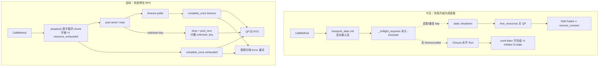
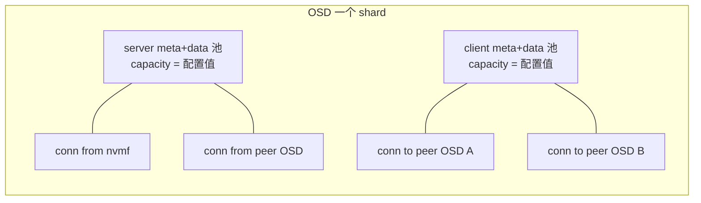
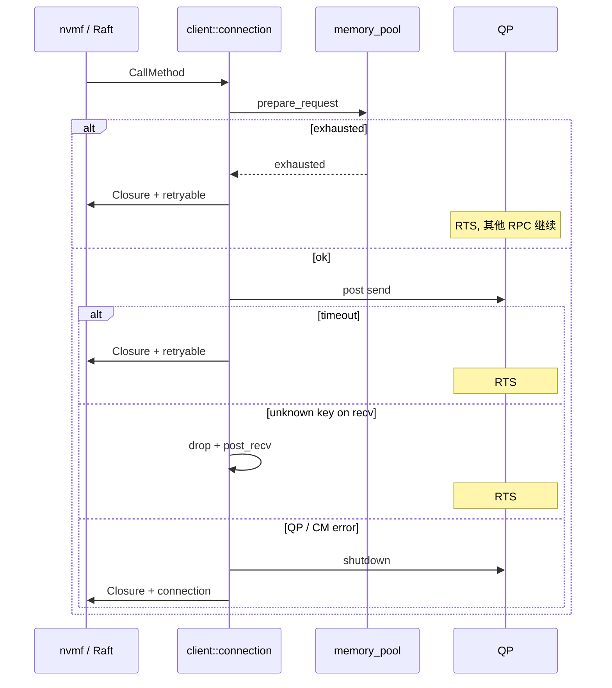
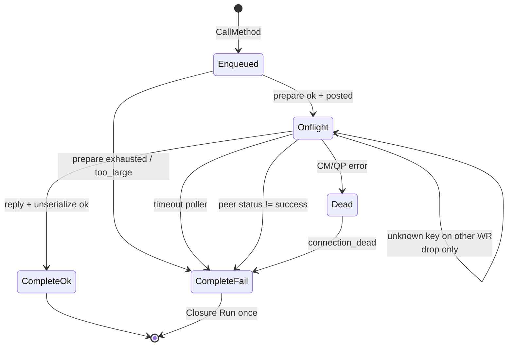

# RDMA RPC 传输层重写：失败必须停在单次 RPC，不能拆 QP / 冻 reactor

作者：<待填>  
日期：2026-08-15  
状态：**Draft**  
代号：`rdma_rpc_fail_soft`（AOS P6 `log=STM` 之后的下一个模块）  
前置：AOS + Raft「log = STM」在已知 bug 级别视为完成。**本文不重开 AOS / Raft / nvmf thread_exit。**  
实现目录：`src/include/fastblock/msg/rdma/`（几乎全是 header-only），配置说明见 `src/msg/README.md`  
开发阶段：**无旧二进制 / 旧集群兼容义务**。on-wire / pool / RPC 合同可以破坏，但必须在正文显式标出。

---

## Overview

```text
现状：RDMA RPC 把「资源不够 / 一个坏 key / 一次超时」升级成「这条连接死了」。
      调用方（Raft AE / snapshot / heartbeat、nvmf bdev、OSD client）再把
      Failed() 一律当成断连。reactor 上没有真正的 fail-soft 完成路径。
      于是一次 pool miss 可以冻住 mkfs / jbd2 / nvme，把整台 15GiB VM 打成 D-state。

目标：一条 RPC 失败；连接还在；reactor 永不阻塞等待；Closure 恰好跑一次；
      调用方拿到可重试错误，而不是一块死掉的 QP。
```

这不是功能清单，是运输层合同重写。**PR1 是一条可独立合入的闭环合同**，不是「三个 if」：空池不得入队、未知 key 不拆 QP、**`complete_rpc` + `completed` 标志 + 时钟扫描**、server 回 `resource_exhausted`、**Raft/`fblock_client` 对 exhausted/timeout 字符串不拆连接**。后续 PR 改 pool 所有权、`error_class`、reactor 集成、key 格式，让同一类 bug 不能再靠调大 `*_memory_pool_capacity` 来藏。

---

## Background & Motivation

> 读完本节应能回答五件事：  
> 1. 坏在哪（机制，不是轶事）  
> 2. 为什么不是配置问题  
> 3. 今天的爆炸半径  
> 4. 成功长什么样  
> 5. 本文不解决什么

### 0. 先纠正几处「最近几周调试记忆」与代码的偏差

下列事实以当前树为准。记忆里若略有偏差，以本节为准。

| 记忆 / 观察 | 代码实际做的事 |
|-------------|----------------|
| 「进程级单一 meta/data 池」 | **配置**是进程一份数字；**分配**是每个 `msg::rdma::client` / `msg::rdma::server` 实例各建一套 `_meta_pool` + `_data_pool`。`connect_cache` 每 shard 一个 client（`src/include/fastblock/rpc/connect_cache.h`），OSD 每 shard 一个 server（`src/osd/osd.cc` `create_rpc_server`），nvmf 每个 `fblock_client` 再各建一套（`fb_client.h:796`）。同一实例上的**所有连接、所有 RPC 共享这一对池**，没有 per-RPC / per-connection 预留。运维体感仍是「一个数字管全场」。 |
| `transport_data::init` 空池「打日志然后返回」 | 属实。`SPDK_NOTICELOG("Not enough memory for transport, need meta element is %ld, but has %ld; need data element is %ld, but has %ld\n", ...)` 后 **`return`，对象活着、计数已算、`_metas/_datas` 为空**（`transport_data.h:711-716`）。`has_enough_memory()` 为假时**不会**分到一半；分配发生在谓词之后的 `alloc_*`，且 `get()==nullptr` 未检查（见 §1.1）。不是 exception，也不是把这次 RPC 标失败。 |
| 未知 request key 拆 QP | **仅 client 收包路径**。`ERROR: Cant find the request stack of key '%d'` 之后 `_ctrl_ops.push_back(state::shutdown)`（`client.h:837-840`）。server 对找不到的 `task_id` 只 `SPDK_NOTICELOG("rpc task with id %d has been set to timeout state, going to skip this transfered data")` 并 `post_recv`（`server.h:866-874`），**不**拆 QP。 |
| `msg_*_rpc_timeout_us` 默认 1s | README / 多数 json 写 1s。**代码默认不是 1s**：`client::options::rpc_timeout` 默认 **30s**（`client.h:66`），`server::options::rpc_timeout` 默认 **5s**（`server.h:152`）。vstart 更把两端都改成 **600s**（`vstart.sh:293-294,337-338`）。 |
| 超时会 fail-soft 完成 Closure | **不会。** 发送路径 `process_request_once` **从不**检查 `is_timeout`，也从不返回 `-EINVAL`（`client.h:330-388`）；`process_rpc_request` 里 `rc == -EINVAL` 分支是死代码。收包路径超时 `SetFailed("timeout")` 后 **不调用 `closure->Run()`**（`client.h:843-852`）。`switch (reply_m)` 的 `default`（含 server 已回的 `status::request_timeout`、`method_not_found` 等）同样只 `SetFailed`、不 `Run()`（`client.h:949-958`）。排队等池的请求永远 `-EAGAIN`，没有 timeout poller。 |
| 「生产默认 / vstart 默认是 16384」 | **四套数字，不要混。** README 示例 16384；`client::options` 代码默认 **1024**（`client.h:61-64`）；`server::options` 代码默认 **16384**（`server.h:147-150`）；vstart `generateConfigAndStartMonitor` 先写 **4096**（`vstart.sh:327-330`），`<64GiB` 再砍成 **256 / 2048**（`478-483`）；`block_bench.dev.json` 四池全 **256**。 |
| 「reactor 在 connect/resolve 上 POSIX 阻塞」 | CM 事件循环本身是非阻塞的：`event_channel::poll` / `socket::poll_event` 都是 `::poll(..., 0)`。但 **`socket` 构造函数里的 `rdma_getaddrinfo()` 是同步阻塞**，从 `client::handle_emplace_eonnection` 在 reactor 上调用（`socket.h:76`）。`msg_rdma_poll_cm_event_timeout_us` **只进了 `endpoint` 打印，没有任何 poll 调用读它**。真正把进程冻死的是「等不到完成的逻辑阻塞」，不是 `poll(timeout=1s)`。 |
| mon RPC 走同一条 RDMA | **不。** `monitor::client` 走 SPDK sock / protobuf，不是 `msg::rdma`。RDMA 的客户是 **OSD↔OSD（Raft / osd_service）** 和 **nvmf/vhost 的 `fblock_client`**。mon 只是间接受害：OSD 心跳/PG 死了，集群看起来全挂。 |

下面按机制讲，不按日志故事讲。

### 1. 什么坏了：五条互锁的失败合同

#### 1.1 资源耗尽不是「这次 RPC 失败」，而是空对象入队 + 永久 `-EAGAIN`

`transport_data` 在构造时就算好这次 RPC 需要多少 meta / data chunk，然后向实例级 `memory_pool` 要：

```677:716:src/include/fastblock/msg/rdma/transport_data.h
    void init() noexcept {
        // ... 按 serialized_size 算 _meta_count / _data_count / _is_inlined ...
        if (not has_enough_memory()) {
            SPDK_NOTICELOG(
              "Not enough memory for transport, need meta element is %ld, but has %ld; need data element is %ld, but has %ld\n",
              _meta_count, _meta_pool->size(), _data_count, _data_pool->size());
            return;
        }
        alloc_request_data();
    }
```

空池之后这个对象仍然被 `enqueue_request` 挂进 `_onflight_requests`。发送侧：

```330:338:src/include/fastblock/msg/rdma/client.h
        int process_request_once(std::unique_ptr<rpc_request>& req) {
            if (_state != state::running) { return -ENOLINK; }

            if (not req->request_data->is_ready()) {
                SPDK_DEBUGLOG(
                  msg,
                  "not enough chunks for request %d, which needs %ld bytes\n",
                  req->request_key, req->request_data->serilaized_size());
                return -EAGAIN;
            }
```

`is_ready()` 会再试一次分配；仍不够就返回 `false`（`transport_data.h:198-205`）。`process_rpc_request` 对 `-EAGAIN` **直接 `return false`，请求留在队列头**（`client.h:598-599`）。这里有两件必须分开的事：

1. **空对象入队（今日的活 bug）。** `has_enough_memory()` 为假时 `init()` **不会**分到一半：`_metas/_datas` 保持空，计数已写好，对象仍被 `enqueue_request` 挂进 `_onflight_requests`。活着的合同失败是「对象存在、仍当一次 RPC 排队、`is_ready()` 永远 `-EAGAIN`」。
2. **`alloc_*` 不检查 `get()==nullptr`（相邻 TOCTOU）。** 谓词为真之后、`get()` 之前，同一 reactor 同一 tick 上另一条连接可以抽走 chunk。此时会把 `nullptr` 写进 `_metas/_datas`，随后 `is_ready()` 因 `size()==_meta_count` 返回 true——这是另一条 bug，不是「init 分一半」。PR1 的 `prepare_*` 必须循环 `get()`，中途 `nullptr` 则已取出的全部 `put()` 回去。

还要注意：`process_request_once` 的 `-EAGAIN` **还有第二条来源**——`ibv_post_send` 返回 `ENOMEM`（QP send-credit / SQ 满，`client.h:371-375`），与池 miss **不是**一回事。PR1 禁止把后者也打成 `resource_exhausted`。

server 回复路径同样：队头 `response_data->is_ready()` 为 false 时 `handle_rpc_reply` 返回 `SPDK_POLLER_IDLE`（`server.h:668-670`），整条 reply 队列头阻塞。

`memory_pool` 本身是进程内手写 freelist（`std::list<net_context*>`），`get()` 空则 `nullptr`，**没有水位、没有预留、没有按优先级隔离**。heartbeat 与 4MiB install-snapshot 抢同一把 `data_pool`。

池的物理分配发生在 client / server 构造期，一次性 `spdk_zmalloc(..., SPDK_MALLOC_DMA)` + 逐块 `ibv_reg_mr`（`memory_pool.h:56-102`）。`ibv_reg_mr` 失败直接 `std::raise(SIGABRT)`。这不是运行期可恢复错误，是启动期「要么全注册、要么进程死」。

#### 1.2 一个未知 key 拆整条 QP

client 收到 `IBV_WC_RECV` 后用 `transport_data::read_correlation_index` 去 `_unresponsed_requests` 找栈：

```835:840:src/include/fastblock/msg/rdma/client.h
                auto req_key = transport_data::read_correlation_index(recv_ctx);
                auto req_it = _unresponsed_requests.find(req_key);
                if (req_it == _unresponsed_requests.end()) {
                    SPDK_ERRLOG("ERROR: Cant find the request stack of key '%d'\n", req_key);
                    _ctrl_ops.push_back(std::make_unique<control_operation>(state::shutdown));
                    return true;
                }
```

`process_control_op` 把 `_state` 打成 `shutdown`；`shutdown_timeout` **默认 0µs**（`client.h:71`），`process_shutdown` 立刻 `free_resources()`：关 poller、对所有 in-flight `SetFailed` + `closure->Run()`、`_sock->close()`（`client.h:1012-1096`）。

未知 key 的来源在现有路径里并不罕见。**不是「第一段就 move」。** 代码在 `is_metadata_complete() && is_ready()` 之后才 `move` 到 `_send_read_requests`（`client.h:904-921`）。今日「完成」定义为 **最后一个 serial 到达**（`serial_no + 1 == metadata_count`，`transport_data.h:274-279`），不是「`[0, metadata_count)` 每一个都见过」：

1. **乱序：last-serial 先到。** 置 `_is_metadata_complete`、（若池够）`alloc_reply_data`、`move` 出 map；更早的 serial 再来 → miss → shutdown。RDMA Read 此时带着不完整的 `remote_info`。
2. **move 之后的多余 / 重复 fragment。**
3. **超时路径先擦后到的迟到包：** `handle_cqe` 超时分支 `erase` 但不 `Run()`、也不 `post_recv`（`client.h:843-852`）。后续 fragment 变成未知 key。
4. **`correlation_index` 是单调 `uint32_t`，从 1 起跳**（`client.h:542,1183`）。回绕后与未完成/已擦除的 key 碰撞。
5. **迟到 / 重传 / 对端在 client 已 `free_server_list` 之后仍 SEND。**

顺序到达的多段在今日已经会留在 map 里直到 last serial；PR1 若只写「拼齐前不抹掉」而不重定义「拼齐」，乱序路径原样在。

错误半径是连接，不是请求。一条已经不存在的 key，杀死这条 QP 上所有 in-flight Raft AE、install-snapshot、heartbeat、以及 nvmf 写。

server 侧同类 miss 目前只 skip（见 §0），说明「未知 key ⇒ 拆 QP」甚至不是对称协议需求，只是 client 的过度反应。

#### 1.3 超时不是 fail-soft；很多路径根本没有超时

配置项存在：`msg_client_rpc_timeout_us` / `msg_server_rpc_timeout_us`。合同不存在。

| 路径 | 超时检查？ | Closure / 回复？ |
|------|------------|------------------|
| client 排队等池（`is_ready` 失败，`-EAGAIN`） | 否。`process_request_once` 不看 `is_timeout` | 否。请求永远停在 `_onflight_requests` 头 |
| client `process_rpc_request` 的 `-EINVAL` 分支 | 死代码 | — |
| client 已发出、等 reply（`_unresponsed_requests`）CQE 上 `is_timeout` | 只在**该 key 的 CQE 到达时**检查 | `SetFailed("timeout")` **不** `Run()`，且 `break` 掉 `post_recv` |
| client `switch (reply_m)` 的 `default` | 否（这是对端已经回了非 success） | `SetFailed("rpc call failed with reply status …")` **不** `Run()`，**不** `--_onflight_rpc_task_size`（`client.h:949-958`）。含 server 已回的 `request_timeout`、`method_not_found`、`service_not_found`、`bad_request_body`、`server_error` |
| client `no_content` / `terminating` / inline `success` | — | **有** `Run()` |
| client RDMA Read 完成（`process_read_complete`） | 是 | `SetFailed` + `Run()`（这条是好的） |
| server `_task_list` / `_read_task_list` 队头 | 是，`handle_timeout_task` | 调 `make_response_data` 再入 `_reply_task_list`。**若 meta 池也空，新 `transport_data` 又是空对象，`handle_rpc_reply` 对队头 `IDLE` 到永远**（超时处理自己造出 HOL） |
| server `_reply_task_list` 等池 | **否**。`is_ready()` 失败只 `IDLE` | 否 |
| server `_on_fligh_tasks`（方法已 dispatch、等 service 回调） | 否 | 否 |

没有独立的 timeout poller。没有「clock 走到了就完成」的路径。`rpc_timeout` 在 vstart 被调到 600s，等于把这个本就不完整的保险再拧松。

更糟的是 client 收包超时还**漏掉 `post_recv`**（`break` 出 `switch (cqe->opcode)`，而 re-post 写在 `IBV_WC_RECV` 分支末尾）。超时几次就把这条连接的 recv WR 耗光，之后再也收不到包，只能等 keep-alive / 下一次未知 key 把 QP 拆掉。

#### 1.4 Reactor 合同被违反的方式，不是「卡在 poll()」，是「永远完不成」

SPDK 合同：reactor 线程上每一次等待都必须是回调。本模块表面上有 poller（`rpc_cli_core` / `rpc_cli_conn` / `rpc_srv_*`），但：

1. **逻辑阻塞**：pool miss / 空对象入队把 RPC 停在队列头，`CallMethod` 的 `Closure` 永不跑。调用方（`raft_client_protocol`、`fblock_client`、nvmf bdev I/O）认为请求还在飞。heartbeat 发不出去，AE 发不出去，bdev 完不成 → initiator `jbd2`/`mkfs`/`nvme` 进 D-state。
2. **真阻塞 syscall**：`rdma_getaddrinfo` 在 `socket` 构造函数、也就是 reactor 上的 `handle_emplace_eonnection` 里同步调用。Soft-RoCE / DNS / 异常 GID 时这会卡住整个 shard。
3. **异常当控制流**：`ibv_reg_mr` 失败 `SIGABRT`；`on_response` 里 `spdk_thread_send_msg` 失败 `throw std::runtime_error`（`server.h:543-547`）；CM 处理失败 `async_shutdown(bad_event)`。Reactor 上抛异常不是 SPDK 的完成模型。
4. **堂兄历史坑（只作爆炸半径证据，不在本文改，也不是活 bug）**：`bdev_fastblock.cc:537-549` 在同一 shard 上开第二个 bdev 时会 `stop` 旧 `libblk_client`。**当前代码已经拒绝**对 `nullptr` / 当前 thread / `app_thread` 调 `spdk_thread_exit`；注释记录的是「曾经会杀掉 nvmf poll group / app_thread」的旧脚枪。它不是 RDMA 栈的一部分，也不再是「开第二个 bdev 就 exit」。留下它只说明同一进程里曾经流行「出错就拆线程 / 拆连接」——运输层拆 QP 是同一病的另一处病灶。

`docs/rpc_memory_parameter.md` 用实验把这个合同写死了：池小于某个阈值时「mkfs / fio 卡住，vhost 进程也会卡住，rpc 数据发送不出去」。作者当时的处方是把 capacity 从 1024 调到 2048 / 4096 / 8192。那是在用容量掩盖「失败不会完成」的 bug。

#### 1.5 调用方把一切 `Failed()` 当成断连

运输层一旦 `SetFailed`，客户没有「可重试、连接仍可用」的错误类：

```75:96:src/raft/raft_client_protocol.cc
void heartbeat_source::process_response(){
    // ...
        if (ctrlr.Failed()){
            SPDK_INFOLOG(pg_group, "the network connection to %d is disconnected\n", _target_node_id);
            // ... raft_set_suppress_heartbeats(false) ...
            _rcp->remove_connect(_shard_id, _target_node_id, [](void *, int ){});
```

`process_appendentries_response` / `process_installsnapshot_response` / vote / timeout_now / snapshot_check：**全部** `clr->Failed()` → `process_disconnect_rpc` → `remove_connect`（`raft_client_protocol.cc:125-172`）。

`fblock_client` 把 `ctrlr->Failed()` 映射成 **`-ENOLINK`**（`fb_client.h:1011,1044,1062`）。`-ENOLINK` 在 `should_retry_request` 里是可重试（`fb_client.h:224-239`），但语义是「链路没了」——会拆 write ring、重连、重试。一次 pool miss 如果被做成 `Failed("timeout")` 或 `Failed("connection terminated")`，nvmf 会当断连处理；一次未知 key 拆 QP 则是真断连。

`rpc_controller::StartCancel` / `NotifyOnCancel` 是空 TODO（`rpc_controller.h:41,50-52`）。没有取消，没有「连接仍在」的 error code。`status` 枚举里没有 `resource_exhausted`；`string_status` 甚至漏了已有的 `status::terminating`（落到 `"unknown status"`，`types.h:125-145`）。

### 2. 为什么这是核心问题，不是「把池调到 16384」

#### 2.1 vstart 缩池是默认开发路径，不是测试边角

四套容量不要混用：

| 来源 | meta / data capacity |
|------|----------------------|
| README 示例（`src/msg/README.md`） | 16384 / 16384 |
| `server::options` 代码默认 | 16384 / 16384 |
| `client::options` 代码默认 | **1024 / 1024** |
| vstart `generateConfigAndStartMonitor`（先写出的值） | **4096 / 4096** |
| vstart `isSmallMemory`（`<64GiB`，15GiB VM 走这里） | meta **256** / data **2048** |
| `block_bench.dev.json` | **256 / 256** |

`vstart.sh` 在 `total_memory < 64GiB` 时（`isSmallMemory`）把已经写出的 4096 再砍成：

```478:483:vstart.sh
    if [ "$isSm" = "true" ];then
        echo "small memory, need modify memory pool capacity"
        jq '.msg_server_metadata_memory_pool_capacity |= 256' ...
        jq '.msg_server_data_memory_pool_capacity |= 2048' ...
        jq '.msg_client_metadata_memory_pool_capacity |= 256' ...
        jq '.msg_client_data_memory_pool_capacity |= 2048' ...
```

15GiB Parallels VM、本仓库几乎所有 AOS+Raft+nvmf 回归，都走 256/2048。OSD 同时 `osd_no_huge=true`、`osd_mem_size_mb=1024`（`vstart.sh:295-296`；`osd.cc:1152-1159`）。运输层 **不能假设无限 DMA**。

「把池调回 README 的 16384」是假想算术，不是「恢复 vstart 非小内存路径」（那条是 4096）：

- README element 下每实例 data 池：`16384 × 8192 = 128MiB`；vstart element：`16384 × 5120 ≈ 80MiB`
- OSD N 个 shard × (server + client) 两套 ≈ **2N × 80–128MiB**
- 3 shard OSD 仅 RPC 池就可吃掉 0.5–0.8GiB DMA，而整个 `--no-huge` heap 只有 1GiB，还要养活 iobuf（small 1024 / large 64）和 AOS

所以「开发机把池调小」不是偷懒，是 **和 OSD `--no-huge` 1GiB heap 共存的办法**。缩池必须能降级，不能把盒子打崩。

#### 2.2 把容量调到 README 16384 只是把引爆点往后推

一次 4MiB install-snapshot（Raft recovery 常规对象大小，`kMaxObjectSize=4MiB`）：

```
transport_size ≈ 4MiB + proto + 2 × rdma_read_tag
data_count    ≈ ceil(transport_size / element_size)
vstart element 5120B → ≈ 820 个 data chunk
vstart data 池 2048  → 一次 snapshot 吃掉 ~40% 的 client data 池
```

再叠加：

- 同连接上多 PG 的 AE（每条 4KiB + meta，通常 1 chunk，但 `rpc_batch_size` 默认 1024）
- heartbeat（走 `_priority_onflight_requests`，**仍用同一 `_data_pool`**）
- nvmf 路径实测单次写最大约 **1,310,720 B**（`docs/rpc_memory_parameter.md`）→ `1310720 / 5120 ≈ 256` chunk；8 个并发大写即可抽干 2048 池
- 日志里真实出现过的量级是「need data element is 26, but has 9」——**远小于 snapshot 的小 I/O** 在池被大包抽空后就会失败

把 capacity 调到 README 16384（或 vstart 非小内存的 4096）让「26 vs 9」变得更少见，但：

- 多 shard × 多连接 × 多 4MiB snapshot 并发仍然能抽干
- 空对象入队 + 未知 key 拆 QP + 超时不 `Run()` **一个都没修**
- Soft-RoCE（vstart 在没有 OFED 时 `rdma link add rdmanic type rxe`，`vstart.sh:462-470`）的 MR 数量 / 延迟比 mlx5 更差，同样的容量更先爆

`docs/rpc_memory_parameter.md` 自己已经证明：capacity 是「刚好够这次 fio / mkfs 的经验值」，bs 或 numjobs 一加就再卡。这是容量竞赛，不是合同。

#### 2.3 池实现本身也撑不住「调大」这条路

`memory_pool::get_bulk` **不从 freelist 弹出**，循环上界是 `_net_context_list.size()` 而不是 `n`；`put_bulk` 是空函数（`memory_pool.h:133-150`）。调用点是 **client 与 server 各自的 `per_post_recv`**（`client.h:417-443` + `start()` 里 `per_post_recv_num` 建 recv 池；`server.h:327-354`），且都是 `n == capacity`、list 尚未被动用，靠「误打误撞」才没写爆。`free()` 只对仍留在 list 里的 MR `ibv_dereg_mr`——因为 get_bulk 没弹出，刚好全在。这不是设计，是运气。**PR1 的 `prepare_*` 禁止走 `get_bulk`**，只允许循环 `get()` + 失败回滚；修 `get_bulk`/`put_bulk` 留在 PR3。

没有水位、没有 per-connection reservation、没有「大包不得抽干心跳额度」。调大 capacity 不改变这些。

### 3. 今天的爆炸半径

```text
一条 RPC 要 26 个 data chunk，池里剩 9 个
        │
        ▼
transport_data::init  NOTICELOG 后空对象入队
        │
        ▼
process_request_once 永远 -EAGAIN
  或 handle_rpc_reply 永远 IDLE
        │
        ├─ 若此时另有迟到/重复/已搬迁的 correlation_index
        │       → "Cant find the request stack of key"
        │       → state::shutdown（timeout 默认 0）
        │       → free_resources() 关闭 QP
        │       → 这条连接上所有 in-flight RPC SetFailed
        │
        └─ 即使不拆 QP：Closure 不跑
                │
                ▼
raft heartbeat / AE Failed()
        → "the network connection to %d is disconnected"
        → remove_connect()
        → PG 复制停、lease/election 乱跳
                │
nvmf / vhost fblock_client
        → Failed() 映射 -ENOLINK，bdev I/O 不完成
        → initiator mkfs / jbd2 / nvme 进 D-state
                │
                ▼
同进程 reactor 不再推进（逻辑阻塞 + 可能的 getaddrinfo 真阻塞）
        → 15GiB VM 冻住
```

量化这条链（本仓库默认开发拓扑：1 mon + 3 OSD + 1 nvmf，单箱 Soft-RoCE）：

| 层 | 单位 | 一次失败杀掉什么 |
|----|------|------------------|
| RPC | 1 个 `correlation_index` | 本应只是这一次调用 |
| QP / connection | 1 条 `client::connection` | 该 OSD 对端 shard 上**所有** in-flight RPC |
| PG | 该连接服务的全部 PG | AE / snapshot / vote 全部 `remove_connect` |
| OSD shard | 1 个 reactor | heartbeat 发不出 → 更多 PG 误判断连 |
| initiator | 1 个 nvme 盘 | mkfs/jbd2 D-state |
| 宿主机 | 1 台 VM | 失去调度 / 只能重置 |

`probe` 只数 WR / CQE（`probe.h`），**没有** pool empty / unknown key / timeout / QP teardown 计数。今天排障只能扫 NOTICELOG/ERRLOG，而且空池那条还是 NOTICE。

### 4. 成功长什么样

一句话合同：

```text
一次 RPC 失败  ≠  一条连接失败  ≠  一个 reactor 停止
```

可验收（这也是 PR1 的验收，**不是 xfstests**）。PR1 **含**运输层闭环 + 最小调用方字符串匹配，因此下面的「QP 仍在 / 后续小 RPC 仍能走」在带 Raft/`fblock_client` 的进程里也成立：

1. 池空：这次 RPC 的 `Closure` 以 `status::resource_exhausted` / `SetFailed("resource_exhausted")` 完成；**server 对端回同一个 enum**；QP 仍 `IBV_QPS_RTS`；Raft **不** `remove_connect`；后续小 RPC（heartbeat、4KiB AE）仍能走。
2. 未知 key：打点 + 丢弃该 WR / 补 `post_recv`；**不** `state::shutdown`；其他 in-flight 不受影响。
3. 超时与一切非 success `reply_meta`：无论请求卡在排队、已发送、等 Read，或 server 回了 `request_timeout` / `method_not_found` / …，都在 `rpc_timeout` 内（或 CQE 到达时）**恰好一次** `closure->Run()` + `post_recv`；连接保留。
4. Reactor（PR1 范围）：无「等池」忙等；失败是 `complete_rpc` 回调。`rdma_getaddrinfo` / `SIGABRT` / borrowed `spdk_thread_exit` 属 PR4，不在 PR1 验收。
5. 调用方（PR1 最小集）：`ErrorText()` ∈ `{resource_exhausted, timeout, request_timeout}` → Raft 不 `remove_connect`，`fblock_client` 不映射 `-ENOLINK`。完整 `error_class()` 留 PR5。

### 5. 本文明确不解决什么

| 不在范围 | 原因 |
|----------|------|
| AOS GC、checkpoint、layout | P6 已收口；运输层重写不得回头改盘 |
| Raft snapshot 列表 / install 语义 / log=STM | 同上。snapshot **只是** 4MiB RPC 的客户 |
| nvmf 第二个 bdev 的 `spdk_thread_exit` | 历史脚枪，现码已 guard；不在本文改 `bdev_fastblock.cc` |
| xfstests / fsstress 作为验收 | PR1 验收是运输层单测 / 聚焦故障注入 |
| hugepage 供给、`--no-huge` 堆大小 | 运输层必须在 OSD `--no-huge` + `osd_mem_size_mb=1024`（`vstart.sh:295-296`）下工作；不假设 nvmf 另有无限 huge |
| 换一套 RDMA 库 / 改走 SPDK NVMe-oF RDMA | 见 Alternatives；成本远高于 in-tree 合同重写 |
| monclient 协议（SPDK sock） | 不是本模块 |

---

## Goals & Non-Goals

### Goals

1. **Fail-soft 是第一合同。** 分配失败、未知 key、超时、反序列化失败，全部停在「这一次 RPC」。QP 默认保持。
2. **`Closure` 恰好一次。** 成功、失败、超时、连接真死，四条路径共用同一个完成函数；禁止 `SetFailed` 而不 `Run`；禁止双 `Run`。
3. **空池不得半初始化。** `transport_data` 要么完整持有所需 MR，要么构造/准备失败且不占任何 chunk。
4. **超时是时钟驱动的（PR1）。** 不依赖「刚好有一个 CQE 到达」。`complete_rpc` + `completed` 是 PR1 的一部分，不是后续整理。**vstart 600s 的默认清理属于 PR2**，不在 PR1 改配置。
5. **Pool 有所有权模型（PR3）。** 明确是 per-client/server 实例共享 + 水位/预留（推荐默认），而不是「一个数字、先到先得、心跳和大包平权」。
6. **错误码可重试。** PR1 给出稳定字符串 / `status::resource_exhausted`，并用字符串匹配挡住调用方拆连接；`error_class()` API 属 PR5。
7. **SPDK reactor 合同（PR4 收口）。** 热路径无阻塞；`rdma_getaddrinfo` 移出 reactor 或换成异步；禁止 reactor 上 `throw` 作为 RPC 失败路径。PR1 只消灭「等池」逻辑阻塞。
8. **Soft-RoCE 与 mlx5 同一套合同。** 继续走现有 `provider`（`verbs` / `mlx5dv`），不假设 mlx5 特有完成语义。
9. **可观测。** PR1 落地三个计数器：`rpc_pool_exhausted` / `rpc_unknown_key` / `rpc_timeout`。QP teardown、水位、`rpc_closure_double` 等属 PR6。
10. **增量合入。** PR1 是闭环、可单独 review / 单独回滚；后续 PR 再动所有权、`error_class`、reactor、key 格式。

### Non-Goals

- 不重写 AOS / Raft 状态机，不把 snapshot 改小来迁就运输层。
- 不在本文改 nvmf `thread_exit`、不把 xfstests 当运输层验收。
- 不引入第二套生产运输（TCP RPC、SPDK nvmf RDMA）作为并列路径。
- 不保证与旧 OSD / 旧 nvmf 二进制混部（开发阶段允许破坏）；但 **每一个 on-wire 变化必须单独点名**。
- 不做跨进程共享 MR、不做 GPU-direct、不做 RC 以外的 QP 类型。
- 不把 monclient 迁到 RDMA。

---

## Key Decisions

| # | 决策 | 理由 |
|---|------|------|
| D1 | **PR1 是闭环合同，立刻合。** 含：原子 `prepare`、未知 key 丢弃、`complete_rpc`+`completed`、时钟扫描、`status::resource_exhausted` enum、server 回该 enum、最小调用方字符串匹配、posted-MR 隔离。不含：水位 / `get_bulk` 修复 / `error_class()` / vstart 600s / `rdma_getaddrinfo` / key 格式。 | 现在就能让集群不再被一条坏 RPC 拆穿；所有权重构需要更多设计窗口。complete-once 不能留到「或许 PR2」。 |
| D2 | **分配失败 = 这次 RPC 立刻 `complete_rpc`，不进发送队列，没有「稍后重试一次」窗口。** `prepare_*` 循环 `get()`，全有或全无。`pool_exhausted` / `too_large` ≠ post-send `ENOMEM`（后者仍 `-EAGAIN`，受时钟扫描约束）。 | 空对象入队是 `-EAGAIN` 死循环的根；把 SQ 满误判成池空会丢健康 RPC。 |
| D3 | **未知 key / 迟到 fragment = 丢弃 + 补 recv WR，不 `async_shutdown`。** | server 已经是这个模型；client 应对齐。拆 QP 的半径不可接受。 |
| D4 | **`Closure` 恰好一次，由连接上的 `complete_rpc()` 统一出口；时钟扫描进现有 `connection_poller` / `rpc_srv_*`。** 所有完成位点（见 §4.7）必须走它。 | 今天超时、`reply_meta` default、unknown key、shutdown、成功路径行为不一致；再加一条扫描而不带 `completed` 会双 `Run()`。 |
| D5 | **推荐默认：每 client/server 实例一个共享池 + 水位 + 每连接预留，而不是每连接全量池。**（产品分叉见 Open Questions；落地在 PR3） | `--no-huge` 1GiB 堆；每连接复制 80–128MiB 不可接受。水位保证 heartbeat / 小 AE 在大包打满时仍能走。 |
| D6 | **PR1 必须新增 `status::resource_exhausted`。** 「不改 on-wire 布局」= 不改 `inline_data` / `metadata` / `request_meta` 头结构；enum 多一个 `uint8_t` 值是允许的、非可选的 on-wire 变化。server 池 miss **回这个 status**，不静默丢。 | 若 server 不回包，client 只能靠时钟扫描完成，合同不闭环。开发阶段不混部。 |
| D7 | **PR1 做最小调用方改动：** `ErrorText()` ∈ `{resource_exhausted, timeout, request_timeout}` 时 Raft 不 `remove_connect`，`fblock_client` 不映射 `-ENOLINK`（映射 `-EAGAIN`/`-ENOMEM`，二者都不在 `should_retry_request` 里）。**PR5** 再换成 `error_class()`。 | 否则运输层 fail-soft 之后调用方仍拆连接，「QP 仍在 / 小 RPC 仍走」在集群里是假的。完整分类 API 不阻塞 PR1。 |
| D8 | **留在 in-tree `msg::rdma`，不换库。** 继续 `verbs`/`mlx5dv` provider。 | 协议、poller、protobuf RPC 已嵌在 OSD/nvmf 里；换库是另一个项目。 |
| D9 | **request key 短期仍用 `uint32_t correlation_index`；PR1 不改头布局。** 后续再考虑 generation / 64-bit。 | fail-soft 不依赖换 key 格式；换格式要 3 OSD + nvmf 同时升。 |
| D10 | **验收是运输层故障注入 + 点名的单测文件，不是 fstests。** | 用户已指定；fstests 会把 nvmf/AOS/Raft 噪声混进来。 |
| D11 | **「拼齐」= `[0, metadata_count)` 每一个 `serial_no` 都见过（bitmap / remaining count）且 `is_ready()` 且 RDMA Read WR 已 post，之后才允许 move 出 `_unresponsed_requests`。** 今日 `serial_no + 1 == metadata_count` 作废。 | last-serial-first 会带着残缺 `remote_info` 去 Read，并让更早的 fragment 变成未知 key。 |
| D12 | **时钟超时不得立刻 `put()` 已 post 出去的 data MR。** 进隔离名单，直到 (a) 匹配的 reply/finish CQE、(b) grace ≥ `rpc_timeout`（同一量级，足以覆盖对端 Read）、或 (c) QP teardown。tag 作纵深防御，不是替代。 | 时钟扫描比今日「等 reply CQE 才擦」更早回收，对端可能仍在 `RDMA_READ`；memset 挡不住 in-flight Read，也别在 reactor 热路径上扫 4MiB。 |
| D13 | **`make_response_data` 是一次 `prepare`，可以失败。** 失败则丢 task、补 `post_recv`、前进队列、`rpc_pool_exhausted++`；禁止把空 `transport_data` 推进 `_reply_task_list`。`_reply_task_list` 与 `_on_fligh_tasks` 纳入 PR1 时钟扫描。 | 今日 `handle_timeout_task` 自己能再造一个空对象 HOL。 |
| D14 | **exhausted 退避：运输层不 delay；调用方不 tight-retry。** Raft 靠自身 heartbeat/AE tick；`fblock_client` 映射 `-EAGAIN`/`-ENOMEM`（`should_retry_request` 不会自动再发）。 | 立即重试会打爆已经空的池；PR1 已挡住 `remove_connect` 重连风暴，不必再在运输层加 delay poller。 |

---

## Proposed Design

### 4.1 目标合同（一句话）

```text
transport_data  要么完整，要么不存在
request key     找不到 ⇒ 丢弃这一段，QP 不动
timeout         时钟到期 ⇒ complete 恰好一次，QP 不动
pool            实例共享 + 水位；大包不得抽干心跳额度
reactor         只 poll、只 callback；失败不是 throw
caller          exhausted/timeout 可重试；只有 CM/QP 真死才断连
```

### 4.2 今日结构 → 目标结构



### 4.3 模块边界（保持，收紧合同）

现有对象已经分层，重写是改合同而不是换名字：

| 对象 | 文件 | 今日职责 | 重写后不变 / 要改 |
|------|------|----------|-------------------|
| `device` / `protection_domain` / `completion_queue` | `device.h` `pd.h` `cq.h` | 打开网卡、PD、CQ | 基本不动 |
| `provider` (`verbs` / `mlx5dv`) | `provider.h` `provider/*` | Soft-RoCE vs mlx5 建 QP | 保留；禁止在上层写死 mlx5 |
| `socket` / `event_channel` | `socket.h` `event_channel.h` | CM + QP | `rdma_getaddrinfo` 移出 reactor |
| `memory_pool` | `memory_pool.h` | DMA + `ibv_reg_mr` + freelist | 修 `get_bulk`/`put_bulk`；加水位 API |
| `transport_data` | `transport_data.h` | inline / RDMA Read 切片 | **禁止半初始化**；prepare 可失败 |
| `client::connection` | `client.h` | protobuf `RpcChannel` + poller | `complete_rpc`；未知 key 不拆 QP；timeout poller |
| `server` | `server.h` | 多连接、方法分发 | reply 排队等池也要超时；对 exhausted 回包 |
| `rpc_controller` | `rpc_controller.h` | `Failed` + 字符串 | 加稳定 error 类；实现 cancel 可后置 |

OSD / nvmf 继续通过 `connect_cache`、`fblock_client` 持有 `msg::rdma::client`，不改调用入口形状。

### 4.4 分配失败策略（PR1 核心）

引入显式准备，拆掉「构造期悄悄失败、发送期永远重试」：

```cpp
enum class prepare_result {
    ok,
    exhausted,   // 池不够；对象未持有任何 chunk
    too_large,   // 超过池容量上限（n > capacity），重试也没用
};

class transport_data {
public:
    // 构造只算 _meta_count/_data_count/_is_inlined，不碰池
    static prepare_result prepare_request(/* ... */);
    prepare_result prepare_reply();   // from_net_context 末尾不再「有就分、没有就算了」
    bool is_prepared() const noexcept;
};
```

规则（全部 PR1，没有「稍后重试一次」窗口）：

1. **`prepare_*` 在单 reactor 上循环 `get()` 齐所有 chunk。禁止使用 `get_bulk`。** 中途 `get()==nullptr` 则已取出的全部 `put()` 回去，返回 `exhausted`。构造期只算 `_meta_count/_data_count/_is_inlined`，不碰池。禁止今日「谓词失败仍入队」；也禁止谓词通过后不检查 `get()` 把 `nullptr` 写进向量。
2. **析构只 `put` 自己真正拿到、且不在隔离名单里的指针。** 已 post 给对端 Read 的 data chunk 走 §4.7 隔离，不在 `complete_rpc` 当时回收。
3. **client `enqueue_request`：** `prepare_request == exhausted` ⇒ 立刻 `complete_rpc(resource_exhausted)`，**不进** `_onflight_requests`。`too_large` ⇒ `complete_rpc` 不可重试错误（否则 livelock）。
4. **client `process_request_once`：** 入队对象必须已经 `is_prepared()`。`-EAGAIN` **只**留给 `ibv_post_send` 的 `ENOMEM`（SQ / send-credit），请求留在队列、受时钟扫描约束。禁止再把池 miss 折成 `-EAGAIN`。
5. **server 池 miss 回 `status::resource_exhausted`。** `make_response_data` 本身是一次 `prepare`：1-chunk inline 回复都拿不到 ⇒ **丢 task、补 `post_recv`、前进队列、`rpc_pool_exhausted++`**，禁止把空对象推进 `_reply_task_list`。队头不得因 `!is_ready()` 永久 `IDLE`。

`has_enough_memory()` 今日只比较 `size()`，不预留。PR1 可把它当快路径，但 **权威检查是 `get()` 循环**。水位留给 PR3。

### 4.5 Pool 所有权（PR3，Motivation 必须先讲清楚方向）

#### 今日实际拓扑



`connect_cache` 为每个 shard `make_shared<msg::rdma::client>(..., opts)`，每个构造函数再 `make_shared<memory_pool>(capacity)`。所以：

- **不是** 全进程一个单例池
- **是** 每个运输实例一份全量池，实例内连接共享、无预留

nvmf 每个 `fblock_client` 再来一份。同一台 15GiB 机器上：3 OSD × N shard × 2 + 1 nvmf × M channel。

#### 推荐默认（D5）：共享池 + 水位 + 每连接小预留

```text
per-instance data_pool
  ├─ reserved_per_connection × N_conn     // 保证 heartbeat / 4KiB AE
  ├─ reserved_priority                    // heartbeat 专用（client 已有 priority 队列）
  └─ bulk                                 // snapshot / nvmf 大包，可被水位挡住
watermark_low  : size() < low  ⇒ 只允许 priority + 已预留连接的小 RPC
watermark_high : 恢复 bulk
```

拒绝「每连接一份 2048×5120」：3 OSD 互连 × 多 shard 会把 `--no-huge` 1GiB 吃光。拒绝「维持现状只改三个 if」：没有预留，大包仍能把心跳抽干，PR1 之后集群不再冻死、也不再因 exhausted 拆连接，但恢复/snapshot 期间仍会系统性 `resource_exhausted`。

PR3 落地时 `memory_pool` 需要：

- 修 `get_bulk`：弹出 n 个，`n > size()` 返回 nullptr，循环上界是 `n`
- 实现 `put_bulk`
- `try_get(n, class)`：`class ∈ {priority, reserved, bulk}`
- 计数：`exhausted_total`、`inuse`、`watermark_hits`

容量配置含义改为「这个运输实例的上限」，不再暗示「调到 16384 就不会出错」。vstart 保持 256/2048，作为 **fail-soft 是否成立的默认试验场**。

### 4.6 Request-id / key 生命周期

今日 on-wire key 是 `transport_data::correlation_index`（`uint32_t`），放在 `inline_data` / `metadata` 头里（`transport_data.h:50-66`）。client 用 `_unresponsed_request_key_gen++` 分配，server 用它做 `conn->rpc_tasks` 的 key。

PR1 不改这个头。改查找失败的语义：

```
IBV_WC_RECV
  key = read_correlation_index(ctx)
  if key not in _unresponsed_requests:
        counters.unknown_key++
        log at INFO/NOTICE with wr_id, key, qp
        post_recv(ctx)          // 今日未知 key 路径不补 recv
        return                  // 不 push shutdown
  if request already completed:  // 迟到
        same as unknown key
```

PR1 不变量（D11）：

```
request 留在 _unresponsed_requests，直到
  1. 每一个 serial_no ∈ [0, metadata_count) 都已见过（bitmap 或 remaining count）
  2. is_ready() / prepare_reply() 成功
  3. RDMA Read WR 已经 post
然后才允许 move 到 _send_read_requests。
此后迟到 / 重复 fragment = 未知 key 丢弃 + post_recv。
```

今日「完成」是 `serial_no + 1 == metadata_count`（last-serial 到了就算完），**顺序多段已经会留在 map 里**。PR1 要修的是乱序 last-serial-first：带着残缺 `remote_info` 去 Read，并把更早的 serial 变成未知 key。不要把现状描述成「第一段就 move」。

后续 PR（见 Open Questions）可以：

- key 改为 `{generation:u32, index:u32}` 或 64-bit
- 完成时把 key 放进 **generation bloom / 环形已完成集**，迟到包静默丢弃且不报警

### 4.7 超时与恰好一次完成

在 `client::connection` 增加统一出口：

```cpp
enum class rpc_fail : uint8_t {
    ok,
    resource_exhausted,
    timeout,
    unserialize,
    peer_terminating,
    connection_dead,   // 仅 CM/QP 真死
};

void complete_rpc(rpc_request* req, rpc_fail why);
```

`rpc_request` 增加 `bool completed{false}`（今日 `client.h:156-169` 没有）。`complete_rpc` **在 PR1 落地**，不是 PR2 整理：

1. 若 `req->completed` 已置位：`rpc_closure_double` 可后置到 PR6；PR1 至少直接返回（防双 `Run`）
2. 置位；按 `why` `SetFailed` 稳定字符串（`resource_exhausted` / `timeout` / `request_timeout` / …）或保持成功
3. `closure->Run()` 恰好一次
4. 从四个 client 容器摘掉：`_onflight_requests` / `_unresponsed_requests` / `_send_read_requests` / `_wait_read_requests`
5. 需要时把 key 推入 `_free_server_list`（今日的 finish WR）
6. **MR 回收分两类（D12）：**
   - 从未 post 给对端的 chunk（`prepare` 失败、还在 `_onflight_requests`）：立刻 `put()`
   - 已 post 的 request data MR（对端可能仍 `RDMA_READ`）：进入 **quarantine**，`~transport_data` / `complete_rpc` **不得** `put()`。出隔离条件三选一：(a) 匹配的 reply / finish CQE；(b) grace ≥ `rpc_timeout`；(c) QP teardown。隔离期间只打无效 tag，**不做**热路径 `memset`。

**必须走 `complete_rpc` 的位点（PR1 列全）：**

| 位点 | 今日 | PR1 |
|------|------|-----|
| `prepare_*` 失败 | 空对象入队 | `complete_rpc(exhausted/too_large)` |
| CQE `is_timeout` | `SetFailed`，不 `Run`，不 `post_recv` | `complete_rpc(timeout)` + `post_recv` |
| `reply_meta` `default`（含 server `request_timeout` / `method_not_found` / …） | `SetFailed`，不 `Run` | `complete_rpc` + `post_recv` |
| `no_content` / inline `success` / unserialize fail / `process_read_complete` | 有的 `Run`、有的不 | 全部 `complete_rpc` |
| 时钟扫描四个 client 容器 | 不存在 | `complete_rpc(timeout)`，已 post 的 MR 进隔离 |
| `free_resources` / `connection_dead` | 直接 `Run` | `complete_rpc(connection_dead)`；QP 拆时隔离 MR 可立刻 `put` |
| 未知 key | `shutdown` | **不** `complete_rpc` 某个已不在的 req；只 `post_recv` + 计数 |

时钟扫描并进现有 `connection_poller`（client）和 `rpc_srv_*`（server），**不**另开 poller。每 tick 或每 N 次 tick 扫：

- client：上述四容器，`now > start_at + rpc_timeout` ⇒ `complete_rpc(timeout)`
- server：`_task_list` / `_read_task_list` / `_reply_task_list` / `_on_fligh_tasks`。能回包则 `prepare` 一个 inline `request_timeout` / `resource_exhausted`；`prepare` 失败则丢 task 前进队列。

`SetFailed("timeout")` / `SetFailed("resource_exhausted")` / `SetFailed("request_timeout")` 是 PR1 调用方匹配的稳定字符串（D7）。`rpc_error_class()` 属 PR5，PR1 不引入。

`StartCancel` 仍可 TODO，但 timeout 路径必须等价于「运输层取消」。

### 4.8 SPDK reactor 规则

硬约束：

| 允许 | 禁止 |
|------|------|
| poller 里 `ibv_poll_cq` / `poll(fd, 0)` / `rdma_get_cm_event`（channel 已 O_NONBLOCK） | reactor 上 `rdma_getaddrinfo`、阻塞 `poll(timeout>0)`、 condvar、sleep |
| `spdk_thread_send_msg` 把完成打回所属 thread | `throw` 出 poller；`std::raise(SIGABRT)` 作为 RPC 失败 |
| 分配失败走 callback | 空池忙等 / 队头 `IDLE` 直到有内存 |
| 连接级 `async_shutdown` 仅用于 CM/QP 真死 | 未知 key、超时、exhausted 走 `async_shutdown` |

`socket` 构造拆成：

1. reactor 外或独立 work item：`rdma_getaddrinfo`（或直接填 `sockaddr`，OSD 本就有 IPv4 字符串）
2. reactor 上：`rdma_create_id` + `rdma_resolve_addr`（已有 CM 状态机 `wait_address_resolved` → `wait_route_resolved` → `wait_connect_established`）

`ibv_reg_mr` 仍在池构造期做（启动路径，可接受）。运行期禁止再同步注册。`ibv_reg_mr` 失败改为构造失败回调，而不是 `SIGABRT`——至少 OSD 还能把错误打到 mon，而不是被内核信号打死。

`server::handle_stop_timeout` 里的 `::spdk_thread_exit(_thread)`（`server.h:921`）只允许退出 **server 自己 `spdk_thread_create` 出来的线程**（`rpc_server` 那条路径）。OSD 传入 `core_sharded::get_thread(shard_id)` 的路径 **禁止** exit 应用线程。这与 nvmf `thread_exit` 是同一类坑，在运输层先把自己管住。

### 4.9 调用方需要什么（Raft / nvmf / 间接的 mon）

运输层给出稳定字符串 / `status`；PR1 调用方做最小匹配，PR5 再换 `error_class()`：



| 客户 | 今日 | PR1（最小） | PR5 |
|------|------|-------------|-----|
| `raft_client_protocol` | 任何 `Failed()` → `remove_connect` | `ErrorText()` ∈ `{resource_exhausted, timeout, request_timeout}` **不** `remove_connect`、不刷 disconnected 日志；其余 `Failed()` 仍走今日路径 | `error_class()==retryable` 同样不拆；仅 `connection` 才 `remove_connect` |
| `fblock_client` | `Failed()` → `-ENOLINK`（`should_retry_request` 会重试并拆 write ring） | 上述三个字符串 → `-EAGAIN` 或 `-ENOMEM`（**都不在** `should_retry_request` 里，不自动再发、不拆 ring）；其余仍 `-ENOLINK` | `map_rpc_error()` 看 `error_class()` |
| nvmf bdev | 等回调；回调不来就 D-state | 回调必来（timeout 上限）；exhausted 以 I/O 错误回去，initiator 重试 | 同左 |
| monclient | 不走 RDMA | 不变 | 不变 |

PR1 **没有**「运输层修了、调用方仍拆连接」的中间窗口。那会让 Overview / 成功标准 / 验收里的「QP 仍 RTS、小 RPC 仍走」在带 Raft 的进程里变假。完整分类 API 可以等。

### 4.10 Soft-RoCE (rxe) vs mlx5

vstart 无 OFED 时建 `rdmanic type rxe`。`socket` 已用 `mlx5dv_is_supported` 选择 `mlx5dv` 或 `verbs`（`socket.h:60-66`）。设计约束：

- 不依赖 mlx5 的 completion 压缩 / UMR / 特殊 opcode
- rxe 的 `ibv_reg_mr` 更慢、MR 数量更紧：池容量必须能在 256/2048 下 **正确失败**，而不是假设生产网卡
- rxe 上 WC 错误更脏（`IBV_WC_REM_ACCESS_ERR` 等）：QP 进 ERR 才是 `connection_dead`；单次 WC 状态异常若尚未把 QP 打翻，PR1 先保守拆连（与今日 `cqe->status != SUCCESS` → `async_shutdown` 相同），后续再评估是否能复位

同一套 fail-soft 合同必须在 rxe 上用故障注入跑绿。

### 4.11 关键控制流（PR1 后）



---

## API / Interface Changes

### 运输层（PR1，on-wire 仅多一个 `status` 值）

`types.h` 的 `status`：

```cpp
enum class status : uint8_t {
    success = 1,
    no_content,
    method_not_found,
    service_not_found,
    request_timeout,
    bad_request_body,
    bad_response_body,
    terminating,
    server_error,
    resource_exhausted,   // NEW；开发阶段无混部
};
```

`string_status` 补上 `terminating` 和 `resource_exhausted`（今日 `terminating` 会掉进 `"unknown status"`，这是现成的小坑）。

`CallMethod` 签名不变。`rpc_controller` 在 PR1 **不**加 `error_class()`；调用方匹配 `ErrorText()` 稳定字符串（D7）。`error_class()` 属 PR5。

`transport_data` 构造不再在空池时「成功返回空对象」。推荐：

```cpp
// 旧：transport_data(idx, size, meta_pool, data_pool)  可能半初始化
// 新：
static std::unique_ptr<transport_data> try_create(...); // nullptr + 原因
// 或构造后必须检查 prepare_result
```

这是源码级破坏，调用点只有 `client.h` / `server.h`，demo 和 `msg` 内部。

### 调用方

**PR1 最小（必须与运输层同 PR）：**

```cpp
// raft_client_protocol.cc
static bool is_transport_retryable(const google::protobuf::RpcController& c) {
    if (!c.Failed()) return false;
    const auto& t = c.ErrorText();
    return t == "resource_exhausted" || t == "timeout" || t == "request_timeout"
        || t.find("request_timeout") != std::string::npos; // server 回包走 "rpc call failed with reply status request_timeout_found"
}
if (clr->Failed() && !is_transport_retryable(*clr))
    process_disconnect_rpc(...);

// fb_client.h
auto state = stack_ptr->ctrlr->Failed()
    ? (is_transport_retryable(*stack_ptr->ctrlr) ? -EAGAIN : -ENOLINK)
    : resp->state();
```

匹配时要注意今日 `string_status(status::request_timeout)` 是 `"request_timeout_found"`（`types.h:75`），PR1 修 `string_status` 的同时把调用方匹配写成「包含 `resource_exhausted` / `timeout` / `request_timeout`」即可，避免再被旧拼写绊倒。

**PR5：** 换成 `error_class()`，删掉字符串匹配。

### 配置

| 键 | 今日 | 目标 |
|----|------|------|
| `msg_*_memory_pool_capacity` | 「调到足够大就不卡」 | 实例上限；小了必须 fail-soft |
| `msg_*_rpc_timeout_us` | client / server / README / vstart **一律 1s**（`default_rpc_timeout_us`）。600s 只通过 json 或 `FASTBLOCK_RPC_TIMEOUT_US=600000000` 显式打开 | PR2 已收口。不改 complete 路径 |
| 新增 `msg_*_pool_low_watermark` | 无 | PR3 |
| 新增 `msg_*_reserved_per_connection` | 无 | PR3 |
| `msg_rdma_poll_cm_event_timeout_us` | 死配置 | 删或真正用在非 reactor 辅助路径；reactor 上保持 timeout=0 |

PR1 **不强制**改 vstart 的 256/2048——那正是验收 fail-soft 的环境。

---

## Data Model Changes

### 池内存（不改磁盘，改 DMA）

`memory_pool` 仍是：

```
spdk_zmalloc(element_size * capacity, 4KiB, DMA)
每 element 一次 ibv_reg_mr(LOCAL_WRITE | REMOTE_WRITE | REMOTE_READ)
freelist: std::list<net_context*>
```

PR1 不改这个布局。PR3 在 `net_context` 之外加 class / reservation 计数，不改 MR 形状。

估算（vstart 小内存，element 512 / 5120）：

| 池 | capacity | 字节 |
|----|----------|------|
| server/client meta | 256 | 128 KiB |
| server/client data | 2048 | 10.0 MiB |
| 每连接 recv | 64 × 512 | 32 KiB |

3 shard OSD ≈ 6 × 10MiB data + 6 × 128KiB meta ≈ **61MiB** DMA，可放进 1GiB `--no-huge`。生产 16384 × 8192 必须按 shard 数显式算，禁止「默认抄 README」。

### On-wire

PR1 **确定的** on-wire 变化：`reply_meta.reply_status` 多一个 `resource_exhausted` 枚举值（`uint8_t`）。头结构不动。旧对端会当成 unknown / `server_error`——开发阶段不混部。3 OSD + nvmf 一起重启。

`inline_data` / `metadata` / `remote_info` / `request_meta` 布局 PR1 不动。

`correlation_index` 格式变更（若做）放到独立 PR，并在 Open Questions 拍板。

### 迁移

无持久状态。滚动顺序：先 OSD 再 nvmf（同一箱一起起）。不需要 pool 版本号。

---

## Alternatives Considered

### A1. 只把 vstart 池调回 4096 / 16384

- **优点：** 一行 jq，立刻减少「26 vs 9」。
- **缺点：**  
  - `--no-huge` 1GiB 上多 shard 会挤爆 DMA / iobuf  
  - 半初始化、未知 key 拆 QP、超时不 `Run()` 原样保留  
  - `docs/rpc_memory_parameter.md` 已经演示过：fio bs/numjobs 一加就再卡  
- **结论：** 可以作运维缓解，**不能当主修复**。Motivation §2 整节就是在否决它。

### A2. 只改三个 if，不动所有权

即「只改三个 if、不引入 `complete_rpc`/`completed`/时钟扫描/最小调用方」。

- **优点：** 更小 diff。
- **缺点：** 再加一条完成路径必双 `Run()`；`reply_meta` default 仍漏 `Run()`；调用方仍 `remove_connect`；乱序 metadata 仍用 last-serial 当拼齐。评审已经否决这个切口。
- **结论：** PR1 必须是 D1 的闭环。残留风险改由 PR3（水位 / `get_bulk`）收：大包仍能抽干心跳额度，但 exhausted 不再冻箱、不再拆连接。

### A3. 整栈换掉（libfabric / 生 verbs / SPDK NVMe-oF RDMA）

- **优点：** 借别人的 CQ、MR pool、异步 CM。
- **缺点：**  
  - OSD 的 protobuf RPC、Raft、heartbeat 优先级、RDMA Read 切片协议都绑在 `transport_data` 上  
  - SPDK nvmf RDMA 解决的是 **NVMe-oF 前端**，不是 OSD↔OSD RPC  
  - 人月是一个新项目，救不了这周的冻箱  
- **结论：** 不做。`provider` 抽象留着就够 rxe/mlx5。

### A4. 每连接独立池 vs 共享池 + 水位

| | 每连接全量池 | 共享 + 水位 + 小预留（推荐） |
|--|--------------|------------------------------|
| 隔离 | 一条连接抽干不影响邻居 | 靠 reserved_per_connection / priority |
| DMA | `N_conn × capacity`，`--no-huge` 不可行 | `1 × capacity` |
| 实现 | 简单 | 需要 class / watermark |
| 大包 | 单连接内仍会饿死心跳 | 水位禁止 bulk 穿越 low |

**结论：** 选共享 + 水位。若后续测量证明预留不够，再把 `reserved_per_connection` 调大，而不是复制整池。

---

## Security & Privacy Considerations

- RDMA Read 暴露 `rkey` + `raddr`（`remote_info`）。时钟超时比今日「等 reply CQE 才擦」更早完成 RPC，对端可能仍在 Read。**PR1 用隔离（D12），不用热路径 memset。** 已 post 的 data MR 在 (a) 匹配 CQE、(b) grace ≥ `rpc_timeout`、或 (c) QP teardown 之前不得 `put()`。tag 作纵深防御。未知 key 不再拆 QP 之后，这条隔离是 fail-soft 的硬前置，不是可选项。
- 不引入新的认证。QP 仍假定集群内网。
- `ibv_reg_mr` 带 `REMOTE_WRITE | REMOTE_READ`。PR 不缩小权限（RC 协议需要）；文档注明这是信任计算平面。
- 日志里不要打印整包 payload。key / wr_id / pool size 可以打。

威胁模型（运输层）：

| 威胁 | 严重度 | 缓解 |
|------|--------|------|
| 恶意/错误对端乱打 `correlation_index` | 高（今日直接拆 QP，可做 DoS） | 未知 key 丢弃；必要时 per-conn unknown_key 速率限制后再拆 |
| 迟到 RDMA Read 读到复用 MR | 高 | **隔离已 post 的 MR**（D12）；tag 作纵深防御；禁止 complete 当时 `put()` |
| 池耗尽导致拒绝服务 | 中（预期） | fail-soft + 水位保心跳；告警而不是冻死 |

---

## Observability

今日 `probe` 只有 `posted_send_wr` / `posted_receive_wr` / queue depth / CQE。不够。

每个 `client` / `server` 实例、再按连接聚合：

| 计数器 | 触发点 | PR |
|--------|--------|----|
| `rpc_pool_exhausted` | `prepare_*` 返回 exhausted | **PR1** |
| `rpc_unknown_key` | map miss | **PR1** |
| `rpc_timeout` | 时钟扫描 / CQE 超时 | **PR1** |
| `rpc_pool_too_large` | 需求 > capacity | PR6 |
| `rpc_complete_ok` / `rpc_complete_fail` | `complete_rpc` | PR6 |
| `rpc_qp_teardown` | 真正的 `async_shutdown` / `close_connection` | PR6 |
| `rpc_inflight` | gauge | PR6 |
| `rpc_pool_inuse` / `rpc_pool_free` | gauge | PR6 |
| `rpc_watermark_low` | 水位 | PR3 |
| `rpc_closure_double` | `complete_rpc` 发现已完成 | PR6（PR1 静默 return） |

日志：

- 空池：从 `NOTICELOG` 升到 `WARNLOG`，带 `need_meta/has_meta/need_data/has_data/req_key/method`
- 未知 key：`INFOLOG`（可能频繁），带 key / wr_id；**不再伴随 shutdown 的 ERRLOG**
- QP teardown：`ERRLOG`，必须能和 unknown_key 区分
- 慢 RPC 已有 `slow rpc detected` / `slow rpc method detected`，保留

告警（生产）：

- `rpc_pool_exhausted` 5min 速率 > 阈值
- `rpc_qp_teardown` 任何非零（开发机 rxe 可放宽）
- `rpc_timeout` 异常升高且 `rpc_pool_free` 接近 0 → 容量问题，不是网卡问题

PR1 只要求上面三个计数器可在故障注入后读到（成员变量 + 现有 `msg` 日志即可）。其余 PR6。

---

## Rollout Plan

开发阶段无混部义务，仍然分阶段，避免「一个 PR 改完运输层全世界一起炸」。编号与下面 PR Plan 对齐：

1. **PR1** 闭环 fail-soft（见 PR Plan）。vstart **保持** 256/2048。含最小调用方匹配，故不需要 kill-switch flag。on-wire 多一个 enum：3 OSD + nvmf 一起重启。
2. **PR2** 超时默认清理（代码 / README / vstart 收口到 1s；600s 仅长回归显式键）。`string_status` 边角已在 PR1。**不再**承担 complete-once / 时钟扫描。
3. **PR3** 水位 + 修 `get_bulk`。
4. **PR4** reactor 卫生（可与 PR2/PR3 并行）。`ibv_reg_mr` 改构造失败时，`create_rpc_server` 已有 `catch (std::exception)`（`osd.cc:292-294`），会把 shard 标失败并回调 mon；不要和 `getaddrinfo`  silently 混在同一个「顺便」里——PR 描述里分开写启动路径如何报到 mon。
5. **PR5** `error_class()` 替换 PR1 字符串匹配。
6. **PR6** 其余计数器。
7. **PR7** key 格式（可选 on-wire）。

回滚：每个 PR 独立可 revert。PR1 revert 等于回到冻箱世界，只在新回归证明 PR1 本身有双 `Run` / 泄漏时才允许。

**PR1 验收（必须，且仅此）：**

- `src/test/rdma_memory_pool_test.cc`：verbs-free freelist + `transport_data::prepare`（`get`/`put` 与 `ibv_reg_mr` 解开）。空池 / `too_large` / TOCTOU 回滚。
- `src/msg/demo/inject_rpc.cc`（或 demo 里同等 debug RPC）：(a) 把 data 池缩到不够一次请求 → Closure `resource_exhausted`，下一条小 RPC 成功，QP RTS；(b) 注入未知 `correlation_index` → `rpc_unknown_key+1`，已有 in-flight 完成，QP RTS；(c) server 故意不回包、`rpc_timeout=50ms` → 50–100ms 内恰好一次 `Run()`，已 post MR 进隔离不立刻 `put`；(d) server 回 `request_timeout` → client `Run()` 恰好一次且 `post_recv`。
- 带 Raft 的聚焦用例：注入 exhausted 后 **不** 出现 `"the network connection to %d is disconnected"`，heartbeat 仍能发出。
- **不跑 xfstests。** 不把 nvmf mkfs 当 PR1 门禁。

---

## Open Questions

1. **共享水位 vs 每连接池的最终配比。** 推荐 D5。若生产单连接 fan-out 极大，是否把 `reserved_per_connection` 做成必配项而不是默认公式？
2. **nvmf 与 Raft 是否共享同一进程池。** 今日 OSD 上 server（服务 nvmf + peer Raft）共用一对池；OSD client（连 peer）另一对。是否要给 server 池按 service 再切（osd_service vs raft_service）？推荐先水位，不先切池。
3. **`correlation_index` 是否改 64-bit / 加 generation。** PR1 不改。若 unknown_key 在 fail-soft 后仍高频，再开这个 on-wire PR。
4. **vstart 的 600s RPC timeout（PR2 已拍板）。** 开发默认收回 1s。长回归 / 等 snapshot：`FASTBLOCK_RPC_TIMEOUT_US=600000000` 或 json 显式 `600000000`。
5. **单次 WC 失败是否总是拆 QP。** rxe 上噪声更多。PR1 保持今日行为（非 SUCCESS 就 shutdown）；是否尝试 `ibv_modify_qp` 恢复留给测量。
6. **`resource_exhausted` 退避已拍板为 D14。** 运输层不 delay；调用方不 tight-retry。此处不再开放。

---

## References

- `src/msg/README.md` — 配置项与 `ibv_post_recv` / timeout 含义
- `src/include/fastblock/msg/rdma/transport_data.h` — 半初始化、`Not enough memory for transport...`
- `src/include/fastblock/msg/rdma/client.h` — 未知 key shutdown、超时不 `Run`、`-EAGAIN` 死循环
- `src/include/fastblock/msg/rdma/server.h` — 队头 `is_ready` HOL、未知 task skip、`spdk_thread_exit`
- `src/include/fastblock/msg/rdma/memory_pool.h` — 启动期 `ibv_reg_mr`、残缺 `get_bulk`/`put_bulk`
- `src/include/fastblock/rpc/connect_cache.h` — 每 shard 一个 client、每 client 一对池
- `src/raft/raft_client_protocol.cc` — `Failed()` ⇒ `remove_connect`
- `src/include/fastblock/client/fb_client.h` — `Failed()` ⇒ `-ENOLINK`
- `src/bdev/bdev_fastblock.cc:537-549` — 历史 `spdk_thread_exit` 脚枪，现码已 guard（证据，不改）
- `docs/rpc_memory_parameter.md` — 调大容量才能 mkfs/fio，卡住即合同失败
- `docs/nvmf_tgt.md` — nvmf 与同一套 client 池参数（启动行是 `-C … -S 1`，**不**写死 `-s 1024`）
- `docs/aos_unified_log_design.md` / `docs/append_only_store_design.md` — 文档体例；AOS 不在本次范围
- `vstart.sh` `isSmallMemory` / `osd_no_huge` / rxe `rdmanic`

---

## PR Plan

每条 PR 独立可 review、可合、可回滚。PR1 是「集群不再被一条坏 RPC 拆穿」的最低**闭环**增量。

### PR1 — fail-soft 闭环：prepare / unknown-key / complete-once / 时钟 / exhausted 回包 / 最小调用方

- **标题：** `rdma: fail-soft pool miss, unknown key, and timeout without tearing down the QP`
- **影响文件：**  
  `src/include/fastblock/msg/rdma/transport_data.h`  
  `src/include/fastblock/msg/rdma/client.h`  
  `src/include/fastblock/msg/rdma/server.h`  
  `src/include/fastblock/msg/rdma/types.h`（`resource_exhausted` + 修 `string_status`，**非可选**）  
  `src/raft/raft_client_protocol.cc`（`ErrorText` 匹配，不 `remove_connect`）  
  `src/include/fastblock/client/fb_client.h`（同上，不映射 `-ENOLINK`）  
  `src/test/rdma_memory_pool_test.cc`（**新建**，verbs-free）  
  `src/msg/demo/inject_rpc.cc`（**新建**，未知 key / 扣住回复 / 缩池）
- **依赖：** 无
- **内容：**  
  - `prepare_*` 循环 `get()` 全有或全无；**禁止** `get_bulk`；失败立刻 `complete_rpc`，不入发送队列  
  - 区分 `pool_exhausted` / `too_large` 与 post-send `ENOMEM`（后者仍 `-EAGAIN`，受时钟扫描）  
  - 一个 `complete_rpc()` + `rpc_request::completed`；CQE 超时、`reply_meta` 一切非 success、时钟扫描、`prepare` 失败、unserialize、`free_resources` 全走它；每次收包路径补 `post_recv`  
  - 时钟扫描并进 `connection_poller` / `rpc_srv_*`：client 四容器 + server `_task_list` `_read_task_list` `_reply_task_list` `_on_fligh_tasks`  
  - 未知 key：计数、`post_recv`、**不** shutdown  
  - 「拼齐」= `[0, metadata_count)` 全见过 + `is_ready()` + Read 已 post，然后才 move  
  - server 池 miss / 超时回 `status::resource_exhausted` 或 `request_timeout`；`make_response_data` 失败则丢 task 前进队列，禁止空对象入 `_reply_task_list`  
  - 已 post data MR 进隔离（D12），不在 `complete_rpc` 当时 `put()`  
  - 最小调用方字符串匹配（D7）+ 退避（D14）  
  - 三个计数器：`rpc_pool_exhausted` / `rpc_unknown_key` / `rpc_timeout`  
- **验收：** 见 Rollout「PR1 验收」。vstart 保持 256/2048。不跑 fstests。

### PR2 — 超时默认值收口（不再承担 complete-once）

- **标题：** `rdma: document and align rpc_timeout defaults`
- **影响文件：** `client.h` `server.h` `types.h` `src/msg/README.md` `vstart.sh`（开发默认 1s；`FASTBLOCK_RPC_TIMEOUT_US` 为长回归键）
- **依赖：** PR1
- **内容：** client / server 代码默认、README 示例、vstart 写出的 json **一律 1s**（`default_rpc_timeout_us = 1000000`）。600s 只用于长回归 / 等 snapshot，必须显式：`msg_*_rpc_timeout_us=600000000` 或 `FASTBLOCK_RPC_TIMEOUT_US=600000000`。不改 complete 路径。
- **验收：** 未配 json 时配置打印 `msg_*_rpc_timeout_us: 1000000us`，与 README 一致；不改 PR1 合同。

### PR3 — 池所有权：修 bulk API + 水位 + 预留

- **标题：** `rdma: watermarked shared pools and fix memory_pool bulk alloc`
- **影响文件：** `memory_pool.h` `transport_data.h` `client.h` `server.h` `src/msg/README.md` 配置说明
- **依赖：** PR1（fail-soft 已在，改所有权不会再空对象入队）
- **内容：** 修 `get_bulk`/`put_bulk`（client **与** server `per_post_recv`）；`try_get(n, class)`；low watermark 拒绝 bulk；heartbeat 走 priority 额度；文档写清 capacity 是上限不是「不卡保证」。
- **验收：** 注入一个占 40% 池的大包，heartbeat / 4KiB RPC 仍成功；`get_bulk` 单测覆盖 `n < size`、`n > size`。
- **落地：** `get_bulk` 按 `n` 弹出；`put_bulk` 还回去。`try_get(n, priority|reserved|bulk)` + 水位滞回；heartbeat 走 `priority`，inline 走 `reserved`，非 inline 走 `bulk`。capacity 文档改为实例上限。

### PR4 — Reactor 卫生：`rdma_getaddrinfo` 与禁止应用线程 exit

- **标题：** `rdma: no blocking getaddrinfo on reactor; never exit borrowed spdk threads`
- **影响文件：** `socket.h` `client.h` `server.h`
- **依赖：** 无（可与 PR2/PR3 并行）
- **内容：**  
  - 用已有 IPv4 填 `sockaddr` 或把 `rdma_getaddrinfo` 移出 reactor  
  - `handle_stop_timeout` 不得 `spdk_thread_exit` 外来 thread  
  - **另段说明：** `ibv_reg_mr` 失败改为构造抛错而非 `SIGABRT`。这是启动路径：`osd.cc:292-294` `create_rpc_server` 已 `catch (std::exception)` 并把 shard 标失败；要写清错误如何到 mon，不要和 `getaddrinfo` 混成一个「顺便」。  
- **验收：** 构造连接路径在故障注入下不卡住 `rpc_cli_core` poller；OSD shard thread 在 server stop 后仍在；`ibv_reg_mr` 失败时进程不 abort、OSD boot 回调失败。

### PR5 — 调用方：`error_class()` 替换字符串匹配

- **标题：** `raft/libblk: replace ErrorText matching with rpc_error_class`
- **影响文件：** `rpc_controller.h` `src/raft/raft_client_protocol.cc` `src/include/fastblock/client/fb_client.h`（及少量测试）
- **依赖：** PR1（字符串匹配已挡住拆连接）
- **内容：** 引入 `error_class()`；Raft 仅在 `connection` 类错误时 `remove_connect`；删掉 PR1 的字符串匹配。**不改** AOS、不改 snapshot 列表。
- **验收：** 与 PR1 集群行为相同；不再依赖 `ErrorText` 英文。

### PR6 — 可观测性（PR1 三个计数器以外的部分）

- **标题：** `rdma: remaining transport counters and periodic dump`
- **影响文件：** `probe.h` `client.h` `server.h` `src/msg/log_components.cc`
- **依赖：** PR1
- **内容：** §Observability 表中 PR6 行；周期性 NOTICE dump；未知 key 降级为 INFO；`rpc_closure_double`。
- **验收：** 故障注入后计数非零且与现象一致。

### PR7 — Request key 生命周期（可选 on-wire）

- **标题：** `rdma: correlation index generation to silence late fragments`
- **影响文件：** `transport_data.h` `types.h` `client.h` `server.h`
- **依赖：** PR1；**on-wire 若变，需 3 OSD + nvmf 同发**
- **内容：** 仅当 PR1 之后 unknown_key 仍吵时开启。64-bit 或 `{gen,idx}`；已完成环形集。
- **验收：** 重复回复 / 迟到 fragment 零 QP teardown、unknown_key 不再误报成 ERR。

PR1 合入后，运输层不再具备「一条坏 RPC 冻死 VM」的能力，调用方也不会把 exhausted/timeout 拆成断连。后面的 PR 是为了让 exhausted 变成常态降级（水位），而不是下一次容量悬崖。

---

## 附录：payload 离 protobuf（零拷贝第一台阶）

**这份设计正文是 fail-soft，不是零拷贝。** 零拷贝是后续讨论补上的数据面：4KiB/4MiB **不进** `SerializeToArray` / `ParseFromArray`。路由仍走 `request_meta`（service/method）+ 信封 protobuf。

- 信封：`write_request` / `raft_entry_t` / `read_reply` / `object_data_info` 只留 `data_len`，`bytes data` 清空后再序列化。
- 线上：`request_meta.data_size` = 信封；`payload_size` = 裸 payload。body = `[envelope][payload]`。
- 进程内 attach 仍会把 payload `assign` 回 `bytes data`，方便现有 `entry->data()` 调用方。省掉的是 proto 编解码扫 4KiB，不是端到端 0 次拷贝。
- 实现：`oob_payload.h`，`client.h` / `server.h` / write-ring。单测 `oob_payload_test`。

